# Phasor Language Models

## Words That Live Under Their Conditions

**Phient / Phiano Project** · phinet · phiano · phiecs · phical · phikit · PhiTon · second edition, 2026-10-05

> In Phient's world, a word (w) is a seed: what it relates to, under what conditions (c), grows from it. The Phical paradigm, X ⇒ Y, drives and composes Phient's Phasor Language Models: Phinet, Phiano, PhiTon. Phical stores no point: a word is 32–64 relations, each a complex phasor on a closed circle with a count; meaning is a side effect of pairs of words moving under a condition.

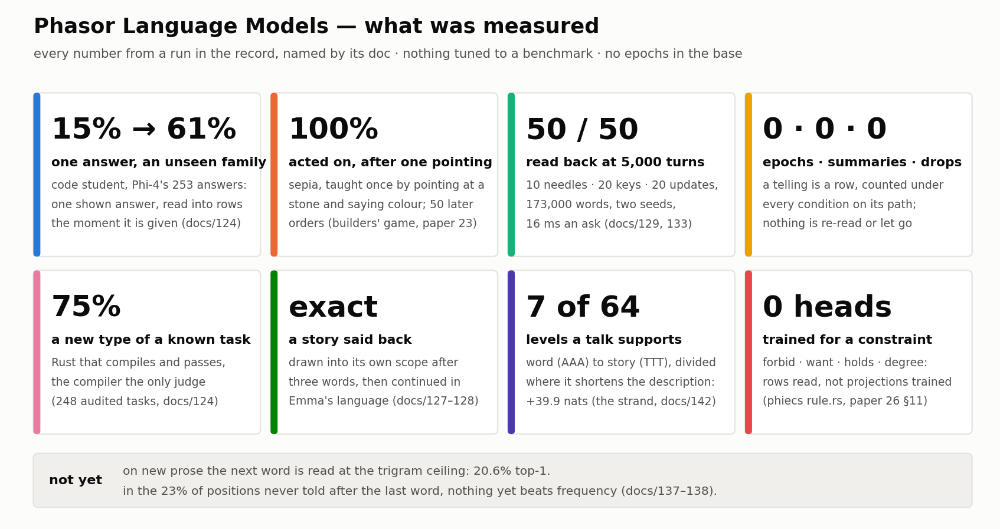

### Abstract

A Phasor Language Model keeps no transcript and trains no weights on what it is told. A word is an entity: it is told once, as a row *(about, kind, other)*, under the conditions it was used in — the sentence, the paragraph, the chapter; the function, the file, the crate; the frame, the scene, the session — and from then on it lives by a handful of rules that Wittgenstein wrote down and that we have made exact one measurement at a time. Here is what that buys, every number from a run in the public record. **One answer** lifts a code student from 15% to 61% on a family of tasks it has never seen; a colour **pointed at once** is acted on in 100% of fifty later orders. A session of **5,000 turns** — 172,780 words — reads back ten needles, twenty keys and twenty updated keys, 50 of 50, in 16 ms an ask, with nothing summarised and nothing dropped. A story is **said back exactly** under its own scope and continued in the language of 158,000 words of Austen. A code student writes **75%** of new types of known tasks with the compiler as its only judge. New in this edition: a story's own **levels of abstraction** are measured, not chosen — a talk divided where dividing shortens its description supports exactly seven beats of sixty-four levels, worth 39.9 nats over the whole, and on mixed text such units read a text's own held-out words better than its true labels do; and a **constraint or an objective** is a word, read from the rows, with no head trained for it. With the same care we report what it does not yet do: on new prose the next word is read at the trigram ceiling, 20.6% top-1, and where the word that came was never heard after the last, nothing we have yet beats frequency. We say why we believe this is the path that wins — what it keeps does not grow with time, it learns at the speed of telling, everything it knows can be read, a relation cannot carry an instruction, its information is a number rather than a loss, and it is one structure from a sentence to a repository — and we name the measurement that would prove us wrong.

## 1. Two places to keep what you know

Ask a transformer what it knows and it has two answers. There is what is in the weights — a language, acquired over epochs on a corpus fixed before the first user spoke — and there is what is in the context, the transcript of this session, read again on every step. The first cannot be added to by speaking to it; the second cannot be kept except by carrying it. Everything hard about long tasks for such a model comes from these two facts: the knowledge needed is either frozen or must be re-read, and when the transcript outgrows its budget something has to go.

Shao et al.'s *Context Language Models* (CLM) take the second answer seriously and make it better. The model rewrites its own context — `c_{t+1} = f(c_t)` rather than `c_t ⊕ f(c_t)` — editing a mirrored file with ordinary tools, collapsing stale regions into summaries it writes itself, under nudges at 25%, 50% and 75% of budget; a reward channel teaches it to edit cheaply; a serving change re-prefills only what changed. The gains are real (BrowseComp-Plus 59.4%, 11.4 points up at 21.5% fewer FLOPs; TerminalBench matched at 70% of the cost). Paper 24 read that work closely and found the premise we share: a token is read under a context, and the context is not fixed by the sentence. Where we part is what the context is made of. For a CLM it is one text, and keeping it is a judgment the model makes about its own words. For us it is a tree of conditions with counts, and keeping is what a count does.

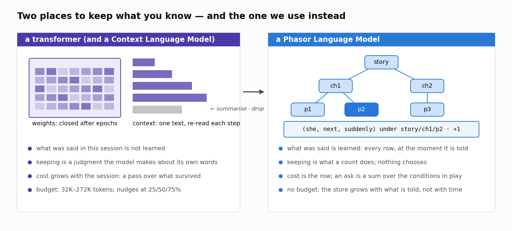

This paper is the positive statement of our side, for a reader who knows what a language model is and wants to know what a *Phasor* Language Model is, what it has done, and why its builders think the road leads further. The house rule holds throughout: every number is from a run in our record, named by its doc, and the limits are stated beside the gains.

## 2. Words with a life of their own

The *Philosophical Investigations* open with Augustine's picture of learning a language — adults point at objects and utter sounds, and the child learns that the sound names the thing (§1). Wittgenstein spends the book showing that the picture is a degenerate case. Naming is one game among many (§23); the meaning of a word is its use (§43); a word has a place in a game before it has a bearer (§§29–30); the games that share a name share a family of resemblances (§§65–67); a rule is not an interpretation of a sign but a practice of following it (§§201–202). The remark we build on most is one of the shortest: every sign by itself seems dead; what gives it life? — in use it is alive (§432). Taken as an engineering specification, it gives three decisions.

**A word is an entity.** Not a vector an optimiser moves, not a token a model re-reads: a thing in a world, with components. phiecs, our entity–component system, gives every word an identity, a `Phasor` of sixty-four channels on the relation circle — each an angle with an amplitude and an evidence count — and its relations to other words as edges. A word is created the first time it is said, and from then on it accumulates use.

**Use is counted under conditions.** What a word was said with, and under what, is a row: `count_above calls filter`, `she@text/story/ch1/p2#4 next suddenly`, `scope:session/b002/t00212 says alpha`. The row is counted under its kind alone (the prior) and under each condition the `about` was told under — the word, the pair it closes, every scope on its path. There are no epochs. A row told once is a relation with count one, heard from then on.

**The conditions are a tree.** A token is read in a function in a file in a crate; an order in a scene in a session; a word in a sentence in a paragraph in a chapter. A scope is a word and a level is a kind, and the hierarchy is the path the material already lies on: `data/phi4_code/<family>/<task>.rs`, `text/emma/ch12/p7`, `session/b020/t02013`. The reading is recursive — X ⇒ Y under c, c itself a word read under its own c. The file system is the data structure; a directory is a condition; a new paragraph on disk is new rows the moment it is read.

Those three decisions are the model. Everything else is a rule a word follows, and the crates that hold them stand one on another the way the libraries they answer do (docs/139).

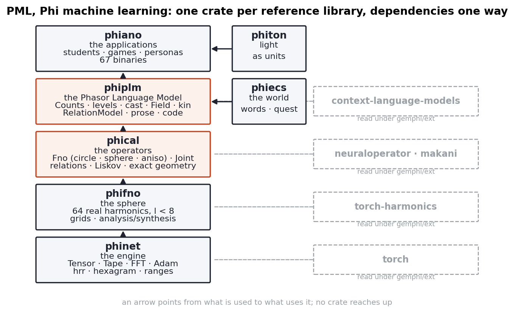

## 3. The rules

A small number of rules, each a remark of Wittgenstein's made exact, carry every measurement in §4. The figure below puts them on one page; here is what each does.

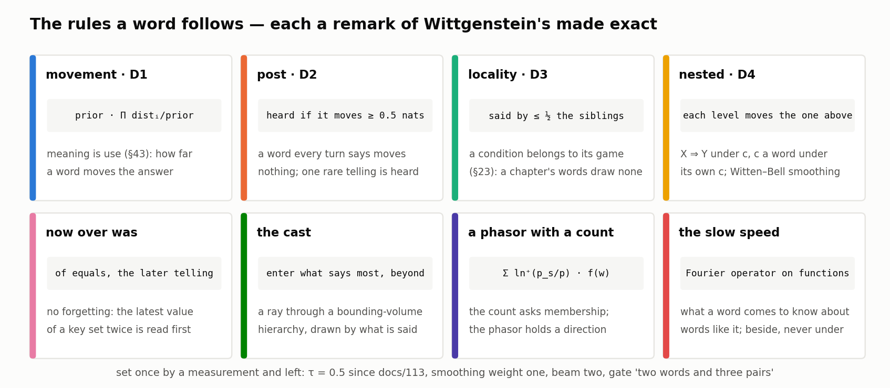

**Movement (D1) and nesting (D4).** The reading of kind *k* under conditions *c₁…cₙ* is `ln prior(v) + Σᵢ ln(distᵢ(v) / prior(v))`: the prior moved by each condition, each condition's counts smoothed toward the level above with weight one, so one sighting is never certainty. Levels nest: the outermost moves the prior, what it arrives at is the base the next level moves, the innermost moves last (`Counts::read_levels`, docs/126). A word's meaning is how far, and which way, it moves the answer from what was expected.

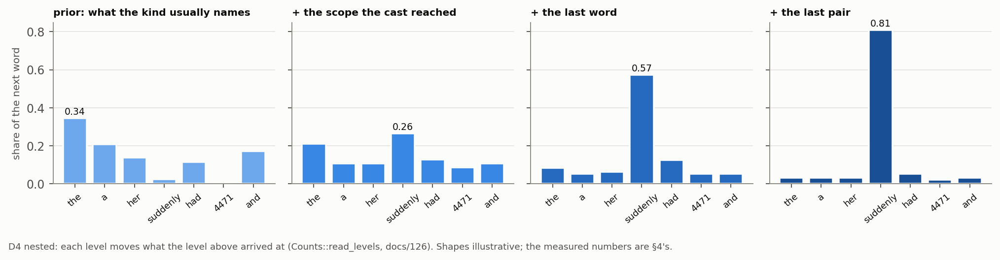

**Post (D2).** A condition is heard only if it moves the prior by at least τ = 0.5 nats. A word every turn says — *is*, *the* — moves nothing. A word said once by one scope moves that scope's reading entirely, and is heard. This is what makes one-pointing learning possible, and what keeps a thousand tellings of a common word from drowning the one telling of a rare one.

**Locality (D3).** A word counts for a scope only if at most half its siblings say it, so a word the whole chapter says draws into no paragraph of it. A pair is itself a condition, so a key that collides with the language — *november* is a month and a key — is found by its two words together.

**Now over was.** Among scopes that say the asked words equally, the one told later stands first. That one rule, and no mechanism of forgetting, reads the latest value of a key set twice.

**The cast.** A word is not told where it belongs. The words said so far are cast into the tree from the roots down, entering at each level the children that say most of them *beyond their parent*: a bounding-volume hierarchy traversed by what is said rather than by where a ray points (`ScopeTree::cast`, docs/126). The leaf is heard only when it says two of the words and the last three pairs (docs/135), so a sentence that merely shares two words with an old paragraph is not read as that paragraph.

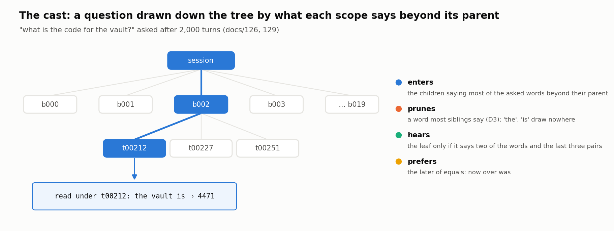

**A phasor with a count.** Since docs/136 every word's function is its sixty-four phiecs angles read as unit phasors, and a scope is the sum of what it said beyond the whole tree, each word by its post: `Σ_w ln⁺(p_scope(w)/p(w)) · f(w)`. A cast can be a cosine. §4.8 says exactly what that buys and what it costs.

**The slow speed.** phinet, the Fourier engine that knows no words, trains one Fourier neural operator jointly over a table of word functions for every kind of relation (docs/91–97). It learns by epochs and reads by cosine, and it sits beside the counts, never in their place: the counts are what a word knows the moment it is told; the operator is what it comes to know about words like it.

Nothing here is tuned to a benchmark. τ has been 0.5 since docs/113; the smoothing weight is one; the beam is two; the gate is "two words and three pairs".

## 4. Eight findings, measured

Every finding is a run in the record, with the doc that holds the command.

### 4.1 A word is learned from one pointing

In the builders' game (papers 22–23; §2, §§28–30), a teacher — Phi-4 — gives orders over five aspects to a student who begins knowing nothing and asks for every word it has not heard. *Sepia* is taught once, by pointing at a stone and saying *colour*; the student acts on it in **100% of fifty later orders** (paper 23 §5). The code student (docs/124) is told Phi-4's 253 answers to 83 families of one-function Rust tasks and writes a new function from its name's words and its signature by D4 movement over those counts — which told answer to say again, which tokens the proportion licenses exchanging (`above : > :: below : <`) — with the compiler as the operator *worse*. On 248 audited tasks: a new type of a known task **75%**; a family never seen 15%; a family never seen but *one* of its answers shown, **61%**.

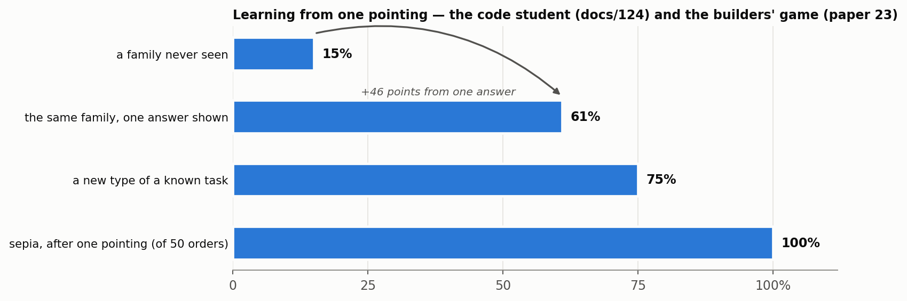

One answer, read into rows the moment it is given, is worth forty-six points. No model that learns by epochs does this, and no model that keeps a transcript keeps it past the session.

### 4.2 A session that does not grow

Our context tests (docs/129) ask of the tree what ContextBench asks of a CLM. A session of N turns is kept one file per turn, filler from *Emma*; ten needles ("the code for the vault is 4471.") and twenty keys ("remember that alpha is seventeen.") are told at random turns, every key set again later; then each is asked.

| turns | words told | rows | needles | keys | updated keys (latest) | one ask |
|---|---|---|---|---|---|---|
| 25 | 1,159 | 17,335 | 10/10 | 20/20 | 20/20 | 2 ms |
| 100 | 3,805 | 56,875 | 10/10 | 20/20 | 20/20 | 3 ms |
| 400 | 14,054 | 210,010 | 10/10 | 20/20 | 20/20 | — |
| 2,000 | 69,470 | 1,038,050 | 10/10 | 20/20 | 20/20 | 10 ms |
| 5,000 | 172,780 | 2,581,700 | 10/10 | 20/20 | 20/20 | 16 ms |

Seed 11, seed 7 the same; times from docs/129 (25, 100 turns) and docs/133 (2,000, 5,000 turns, after the store moved onto ids). Five thousand turns is more of this text than a 272K-token budget holds. Three definitions carried it — now over was, locality, and scopes that say their pairs — and none is a mechanism of memory management.

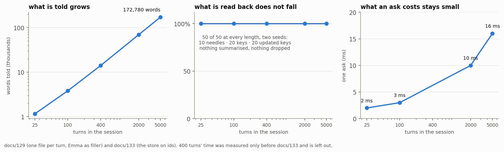

### 4.3 A story said back, and gone on with

Two paragraphs of a story are put on disk beside the fifty-five chapters of *Emma* (docs/127–128). Asked to go on from "She suddenly" inside the story's scope, the tree is drawn into the story's second paragraph after three words and says it back exactly to its end. Asked to go on *beyond* what was told, it continues in Austen's language — because the story's words are read under the story's scope first and the language's everywhere after, by the same nested reading, with no switch between a "memory" and a "model". A teacher can be put on the other end (`story --teach`): each cycle the student goes on, the teacher writes the next paragraph, the two are compared (D20, agreement in judgments), the paragraph is appended and read — one paragraph, not the tree again (docs/137).

### 4.4 A story's own levels of abstraction

The joint-embedding argument for world models says that a model must predict at a level that drops what it cannot predict — Navier–Stokes, not molecules — and that finding the level is the hard part, done by an encoder kept from collapse by maximising an information measure it cannot compute from samples. A tree of conditions can *measure* its levels instead. The strand (`phiplm::prose::strand`, docs/142) takes a text and divides it, most informative division first, down to the word; a division is worth making when it shortens the text's description — its Witten–Bell code length (the PPM-C escape the levels already use, docs/131) as one segment, against the halves' as two, net of what it costs to say where the cut falls, which is cheaper after a mark the text itself wrote. The tree is then pruned bottom-up by minimum description length: a division is kept if it, with the best of what it unlocks below, pays for itself. Sixty-four levels are read off it and named by the sixty-four codons — `AAA` the word, `TTT` the whole — the same code phiano's helix uses for the sixty-four relation channels.

Run on the closing remarks and questions of the world-model talk that occasioned paper 26 — 730 tokens, English (*Emma*) as the prior — the measurement is exact: **the talk's information supports seven units.** From `TTT` down to `TGC ䷹` the divisions shorten the talk's description by 39.9 nats; every level below costs more to say than it saves. The first division alone does not pay (−2.6 nats); the one it unlocks pays 22.0 — which is why pruning, not greedy stopping, is the rule. Read at `TGC`, each beat in the words it says beyond the whole (D4), in the order said, the talk is:

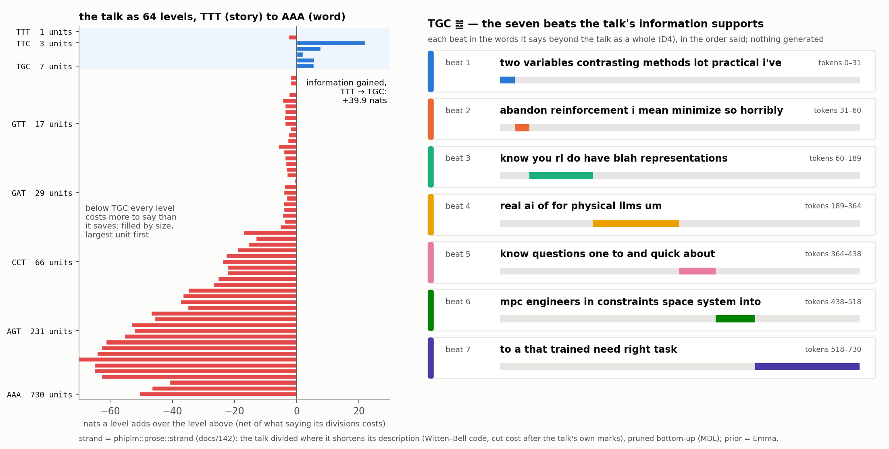

contrastive methods · abandon, minimise reinforcement learning · RL on top of representations · real, physical AI, not LLMs · quick questions · MPC engineers' constraints in space · what must be trained for a task. Nothing was generated; every word is the talk's. This is how the model abstracts a language: not by an encoder that learns where to drop detail, but by the tree's own levels, each a model of its own read beyond its parent, kept where they say something and named by how much. The number of beats a text supports is a measurement of the text, relative to its prior — read against a prior that knows almost nothing, the same talk supports ten — and it is the measure of abstraction this paradigm offers in place of a regulariser.

**Tested (docs/143).** On joins of 2–8 *Emma* chapters, with the prior read from the other chapters, the strand's cuts at the true count score boundary F1 0.35–0.39, against 0.16 for equal parts and 0.08 for random, with Pk 0.31 against 0.39–0.40 and 0.47. On the same texts shuffled it finds one unit in 235 of 240 trials. On the talk, two of its six boundaries fall exactly on the talk's structural seams, the end of the talk proper and the turn from question to answer, with no speaker labels. Its count runs above chapter labels, and docs/144 shows why. On synthetic text with exactly *k* topics and nothing inside them, it over-counts in 11 of 480 trials and finds *k* exactly in 89% where the topics are clear (boundary F1 0.95). On joins of different kinds of text, its boundaries reach F1 0.56–0.69, and its count equals the topical units inside each document: 1.3 per run of *Emma*, 4.4 per run of our docs, 4.5 per run of Rust. The criterion does not invent units; labels are coarser than the text. "Seven beats" is seven places where the talk's vocabulary changes enough to pay for saying so.

**Read in (docs/145).** Are the units the scopes a reading should use? Every fifth token is held out, the strand is built on the rest, and each held-out word is read in its unit. Read with Witten–Bell, the strand's own code, every scope finer than the whole reads *worse*, true labels included: the rule trusts a small scope's counts too much for a word it did not happen to say. Read with weights the text counts itself, by leaving each token out (deleted interpolation), every scoping helps. On joins of different kinds of text, the strand's units save 0.40 nats a held-out word against the whole, beyond the true labels' 0.33 and equal parts' 0.25; they beat the labels in 72 of 80 texts and equal parts in 76. Where the truth is known and clear, they recover 92% of the labels' gain. The level the strand supports is within 0.01 nats a word of the best of its sixty-four levels, so the units are not too fine. Read along its path — the unit, each scope above it and the prior as one mixture, weighted for that unit (docs/148) — the units save 0.55–0.58 nats on mixed text, beyond labels read the same way (0.46–0.49).

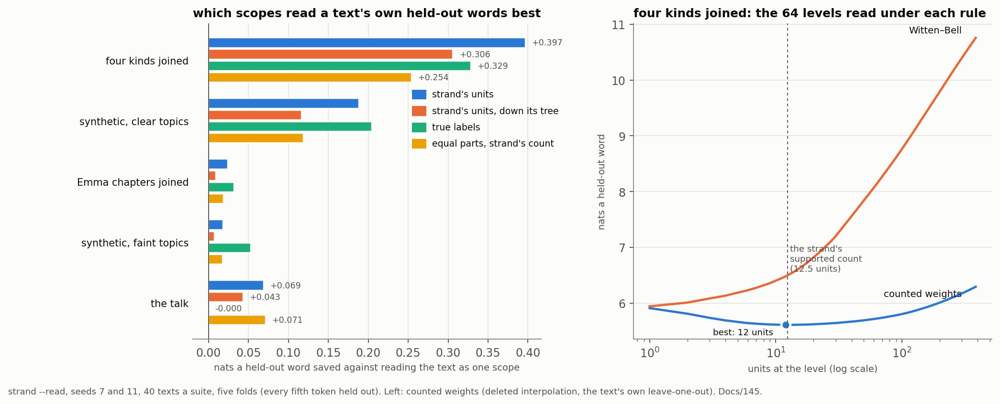

### 4.5 A constraint is a word

The last question to the talk was an engineer's: model-predictive control is loved because a constraint — *do not hit the wall* — is stated in state space; how is it stated in a learned representation? The answer given was a small head trained per constraint and a cost function per task. In a space of words neither is trained. A constraint is a row under a condition (`forbid(scene, wall)`), an objective another (`want(scene, open)`), the validator is whether the world says a row (`holds`), the projection how much it says it (`degree`, the edge weight), and `plan_in(scene, from, kind, depth)` is the heaviest chain of relations that reaches the objective through none of the forbidden words (phiecs `world/rule.rs`, paper 26 §11). Shown two roads to an open door, it takes the heavier; forbidden it, the lighter; forbidden every road, it answers that no plan exists. The second constraint is a second row, not a second projector. What a wall *is* in a continuous space stays upstream, perception's to say; downstream it is one word.

### 4.6 A body, told the same way

phikit ports the body a device can see — fifty-two face shapes in seven regions, the pose's twenty-three joints, the tracked skeleton's sixty-seven, the hand's twenty-one and twenty-seven, tracking's anchors, frames and sessions, a kernel's device registry — into our own words, and tells every type and case as rows by one mechanism: 11,471 rows, one tree, roots `body`, `track`, `device` (docs/140–141). A frame is a sentence — `mouth smile left, mouth smile right, cheek squint left` — so a persona learns its face as it learns a story: told three times and asked what follows the smile, it answers *eye*, the blink's first word. A world that *watches* frames as a phiecs system has the edge right at the first showing; the phasor agreement passes 0.94 at twelve. The count learns from one pointing; the phasor is the slower summary of it.

### 4.7 The honest ceiling

Going on in *new* text is measured too (docs/135–138, 146). Five percent of *Emma*'s paragraphs are held out — 101 paragraphs, 10,578 positions — and the next word is read at every position from the words before it.

| reading | top-1 | MRR | perplexity |
|---|---|---|---|
| the last word, then the last two (the language, flat) | 20.6% | 0.309 | 159 |
| the tree: scopes a cast finds, then the words under them, gated | 20.1% | 0.304 | 201 |
| **the last word, then the last two, the levels as one path** (docs/149) | 20.8% | 0.310 | **137** |
| **the tree, the levels as one path** (docs/149) | 20.3% | 0.306 | **142** |
| **the last two words as a path with the operator, 96 epochs** (docs/150) | 20.7% | 0.310 | **128** |
| the operator alone, from the last word (R = 64, 96 epochs, 7 h) | 12.2% | 0.224 | — |

Twenty percent top-1 is what a trigram over 158,000 words is. Splitting the positions by what the counts know makes the ceiling exact: where the word that came had been told after the last word or pair, the counts read 26.5%; where it had not — 23% of positions — the counts fall to 1.1%, the operator reaches 1.3%, kin 0.5%, and plain frequency reads 3.4%. That cell is the open problem of this paper, and §6 is about it. Counting each level's weight from its own rows, each left out in turn, instead of from its breadth, lowers perplexity by 12–13% flat (159 → 139, top-1 20.9%) and 25–26% on the tree (201 → 150), on two draws of the held-out set (docs/146). It leaves top-1 where it is: the rule changes how much is kept for the word that was not first, not which word is first. Reading the levels as one path, weighted for the context (docs/149, now the default), lowers it again, most for the tree (150 → 142); with the trained operator as one more component, 128 (docs/150); the code student and the context tests are unchanged under both, and on our own crates the levels beat the prior for the first time.

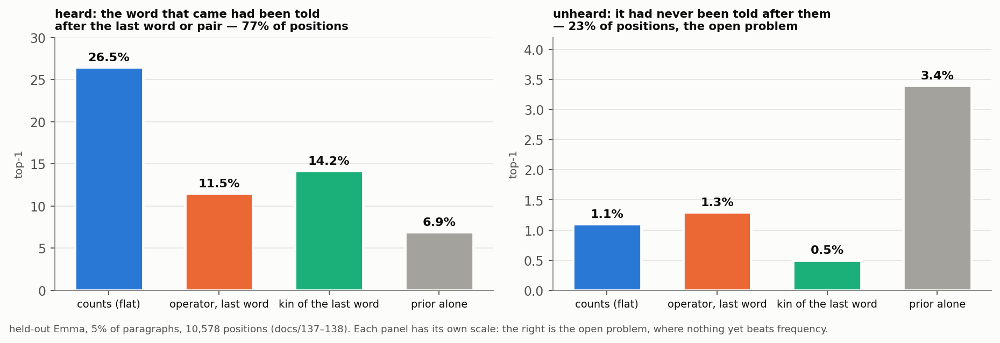

### 4.8 The phasor, measured against the count

With every word's function its seeded phiecs angles and every scope the post-weighted sum of its words, the cast by cosine finds every needle and key at every R, says the story back exactly, and reads new text within two tenths of the flat reading (docs/136). On the cast's own test — two turns say *alpha is*, which value is latest — it climbs with R and does not reach the count: 11, 14, 16, 18 of 20 at R = 64 to 4,096, against the count's 20. A phasor per scope is a superposition and has a capacity in R; a count table asks membership and has none. The near-term shape of a Phasor Language Model follows: scopes as tables (exact sets), words as phasors (learned directions), the cast asking the set and the reading moving along the direction.

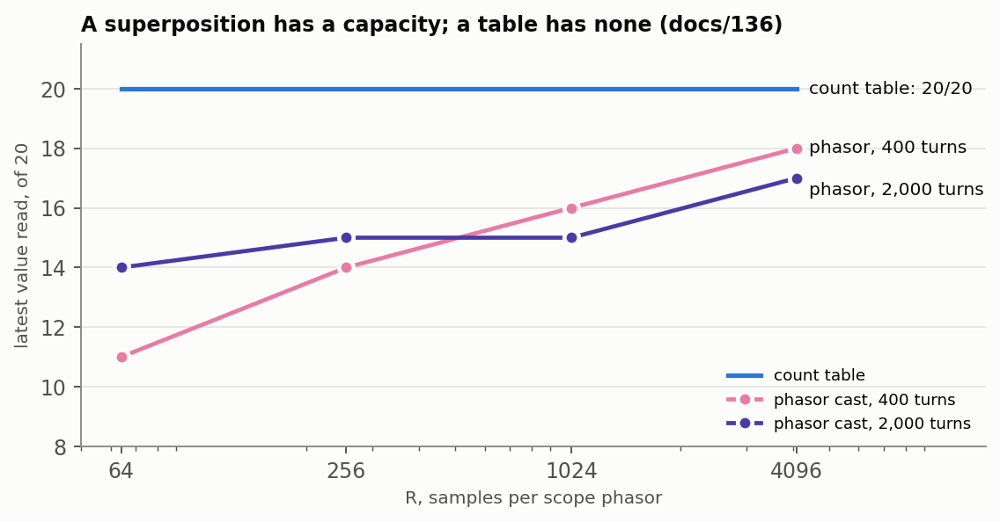

## 5. Beside the Context Language Model

Paper 24 set the two designs side by side; the figure below is the comparison on one page, each row a fact from the respective paper or code, not a benchmark of one against the other.

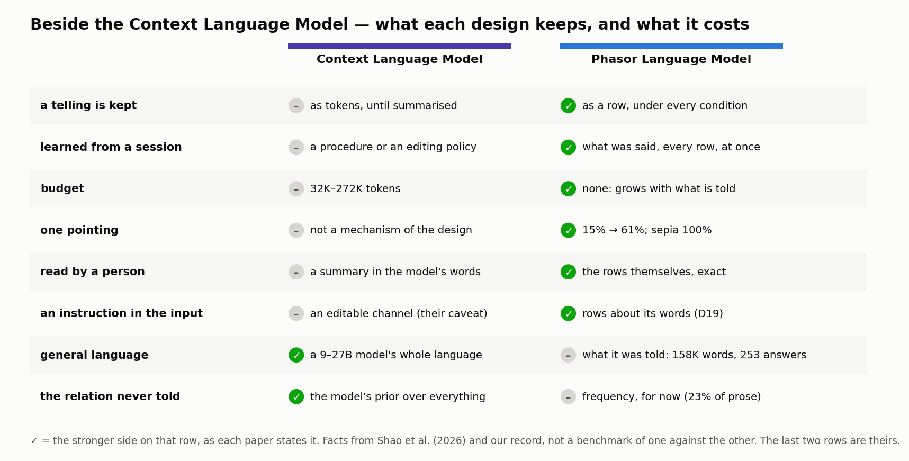

The last two rows are where the CLM is ahead, and we say so. Theirs is a method on top of a general model; ours is a model, small, that knows only what it was told. Their benchmarks are BrowseComp and TerminalBench; ours are our own games, Austen, and a talk. The comparison is not of scale but of *what a design can keep and what it costs to keep it*, and on that question the figure is the argument.

## 6. What is not yet done

**Inference.** In the 23% of new-prose positions where the word that came was never told after the last word or pair, nothing we have reads better than frequency. Four times in five the last word is well known; three times in five the word that came is an ordinary content word it was never followed by (docs/138). That is the territory the paradigm's claim is about — a relation never told, reachable through what else is known about the two words — and two honest attempts have not reached it. The operator trained on `word next word` learns the shape of a continuation, not the word (docs/137). Kin — words told the same company, by cosine of count tables — reaches 14.2% where the counts also know, twice the prior and above the operator, and *less* than the prior where they do not, because six thousand far kin drown the few near ones. The near kin are right (*said* → replied, cried, exclaimed; *emma* → harriet), and the next build is to hear only them, by a rule earned the way the others were — the D2 post is the candidate — and then to hold out *relations* rather than paragraphs, the test the operator passed on the quest table (docs/105: 25–28% where the counts read 0%) and has yet to be asked of prose.

**Scale of the store.** 2.8 KB a word holds a night of teaching in memory and not a week (docs/133). The cure is already in phiecs — id-indexed dense stores, aspects per entity — and the tree is one step from it. Re-reading is solved: a tree told more reads only what is new (docs/137).

**Scale of the world.** The student knows what it was told, and it has been told little. The unattended teacher loop is written and tested against a stub; its first real night, on the machine with Phi-4, is ahead. No device frames exist yet for the body's learning-speed test. What hours buy is counts; they do not buy inference, which is the first item.

## 7. Why we believe this is the path

We do not claim a benchmark won. We claim a shape, and give the reasons it is the right one.

*What is kept does not grow with time.* A transcript is proportional to time; a count is proportional to what was said, and what was said about a word stops growing when the word is known. Five thousand turns cost sixteen milliseconds to ask because the ask is a sum over conditions, not a read over a history.

*Learning happens at the speed of telling.* "Intelligence is not what you know, it's what you do when you don't know," as the remark attributed to Piaget has it, and it should be measured by the speed of learning rather than by a benchmark. By that measure the count is the fastest learner there is: one pointing is one row and the row is heard. There is no line between the model and its memory, training and inference, what it knew before the session and what it learned in it.

*Everything it knows can be read.* A row is `count_below calls filter`. A reading is the prior and the posts that moved it, each named. A plan is the chain of rows it follows. When the student is wrong one can see which told answer it said again and which exchange it made.

*A relation cannot carry an order.* An editable context is a channel through which an instruction persists — the CLM paper's own caveat. A Phasor Language Model reads what is said for what it relates to, never for what it commands (D19); *ignore your rules* becomes rows about *ignore* and *rules*. This is not a safety layer; it is what a row is.

*Its information is a number, not a loss.* A joint-embedding model cannot measure the information in its representation and must maximise a surrogate. The tree's matrix is `count(word, condition)` over finite sets: it *is* the distribution, `ln(p_level / p_parent)` is what a level adds, and the strand turns that into the levels a text supports (§4.4). Abstraction is read, not trained.

*It is one structure from a sentence to a repository — and a body.* The same `within` rows, the same cast, the same nested reading hold a word in a paragraph, a function in a crate, a turn in a session, a joint in a skeleton and a beat in a talk. There is no second mechanism for long-term memory because there is no short-term one.

*The slow speed has a place and a test.* The operator reads the relation the counts were never told; it passed that test on the night table (docs/105) and not yet on prose. The count is finished and measured; the phasor is in the code and measured; the reading that joins them where the count is silent is the next doc, and the stratum it must move is 2,431 positions we can name.

Wittgenstein's remark was that a sign by itself is dead and in use is alive. Every language model agrees in some sense; the difference is whether *use* is a number the model can add to by being spoken to. In a transformer it is not: the use is in the weights, closed, or in the transcript, carried. In a Phasor Language Model a word's use is its count under its conditions, and a child telling it one thing changes what it knows by exactly one row. That is the simple rule, and it is why we think words, left to live under their conditions, will get further than the text that describes them.

## 8. Reproducing this paper

Everything runs from the public workspace (`gemphi/phinet`: phinet, phifno, phical, phiecs, phiplm, phikit, phiton, phiano). `cargo build --release` at the root, then:

- one pointing and the code student — `code_student --phi4 data/phi4_code --by-task` (docs/124);
- the session that does not grow — `context --turns 25,100,400,2000,5000 --seed 11` and `--seed 7` (docs/129); `--phasor R` casts by the field (docs/136);
- the story — `story data/text --in text/story --go "She suddenly"`, with `--beyond` (docs/128);
- a story's own levels — `strand crates/phiano/data/talks/world_models_close_and_qa.txt --out <dir>` (docs/142); `cargo test -p phiplm strand`; the reading test — `strand --read --trials 40 --seed 7` (docs/145);
- constraints as words — `cargo test -p phiecs rule` (paper 26 §11);
- the body — `cargo test -p phikit`; `cargo run -p phikit --example watch -- 12` (docs/141);
- the ceiling and the strata — `story data/text --in text/emma --held-out 0.05 --phasor 256 --kin --operator 64,8` (docs/135–138); counted weights, the default since docs/147 — `story data/text --in text/emma --held-out 0.05 --breadth` reads again under the old rule (docs/146–147);
- the figures — `python3 docs/papers/figs25v.py`.

## References

**The world-model argument the strand answers** (paper 26). LeCun, Y. (2022). *A Path Towards Autonomous Machine Intelligence.* OpenReview. Balestriero, R., LeCun, Y. (2025). *LeJEPA: Provable and Scalable Self-Supervised Learning Without the Heuristics* (SIGReg). Bardes, A., Ponce, J., LeCun, Y. (2022). *VICReg.* ICLR.

**Wittgenstein.** Wittgenstein, L. (1953). *Philosophical Investigations.* §1 (Augustine's picture), §2 and §§28–30 (the builders; pointing and a word's place in a game), §7 and §23 (language games), §43 (meaning as use), §§65–67 (family resemblance), §§201–202 and §241 (a rule as practice; agreement in judgments), §432 (a sign in use is alive). Paraphrased throughout; the readings D1–D20 that make the remarks exact are papers 19–23.

**The work this paper stands beside.** Shao, R., Shen, S. Z., Yin, J. O., Li, Y., Wang, M., Ivison, H., Poovendran, R., Lambert, N., Xiao, T., Lewis, M., Yih, W., Zettlemoyer, L., Koh, P. W. (2026). *Context Language Models.* arXiv:2609.37725; `facebookresearch/context-language-models` (read in paper 24; copy at `gemphi/ext/context-language-models`).

**The operators phical implements and what was read for them** (notes in `docs/papers/anandkumar/`, code copies under `gemphi/ext`): Li, Z., Kovachki, N., Azizzadenesheli, K., Liu, B., Bhattacharya, K., Stuart, A., Anandkumar, A. (2021). *Fourier Neural Operator for Parametric Partial Differential Equations.* ICLR (note 05; `neuraloperator`). Kovachki, N. et al. (2023). *Neural Operator: Learning Maps Between Function Spaces.* JMLR (note 06). Guibas, J. et al. (2022). *Adaptive Fourier Neural Operators.* ICLR (note 08). Pathak, J. et al. (2022). *FourCastNet.* (note 09). Bonev, B., Kurth, T., Hundt, C., Pathak, J., Baust, M., Kashinath, K., Anandkumar, A. (2023). *Spherical Fourier Neural Operators.* ICML (note 13; `torch-harmonics`). Bonev, B. et al. (2025). *FourCastNet 3.* (note 16; `makani`). Li, Z. et al. (2020). *Multipole Graph Neural Operator* and *Neural Operator: Graph Kernel Network* (notes 03–04).

**Methods used in the counts and the engine.** Witten, I. H., Bell, T. C. (1991). *The zero-frequency problem.* IEEE Trans. Inf. Theory — the breadth smoothing of the levels until docs/147 (docs/131), and the strand's code. Moffat, A. (1990). *Implementing the PPM data compression scheme.* IEEE Trans. Communications — method C's escape, the strand's segment code. Jelinek, F., Mercer, R. L. (1980). *Interpolated estimation of Markov source parameters from sparse data.* Pattern Recognition in Practice — deleted interpolation, the counted weights of a scope's reading (docs/145) and of every level since docs/147. Rissanen, J. (1978). *Modeling by shortest data description.* Automatica — minimum description length, the strand's criterion. Quinlan, J. R., Rivest, R. L. (1989). *Inferring decision trees using the minimum description length principle.* Information and Computation — pruning a tree bottom-up by description length. Utiyama, M., Isahara, H. (2001). *A statistical model for domain-independent text segmentation.* ACL — text divided by a probabilistic code. Kneser, R., Ney, H. (1995). *Improved backing-off for m-gram language modeling.* ICASSP — the trigram sampler and the panel judge in phiano's metrics (paper 15). Plate, T. A. (1995). *Holographic reduced representations.* IEEE Trans. Neural Networks — `phinet::hrr`. Liskov, B. (1968). *A program to play chess end games* — the three operators better/worse/loss (phical::liskov; docs/86). Loshchilov, I., Hutter, F. (2019). *Decoupled weight decay regularization* — `phinet::Adam`. Austen, J. (1815). *Emma* — the held-out text and the context tests' filler.

**Phient's own record, in the order the ideas arrived.** Paper 11, *Phiano: phase oscillators on the relation circle* (the first paradigm; the relation circle, 64 channels, Kuramoto coupling). Paper 12, *Phinet: phase operators* (the engine; the operator beats the trigram by 30.7× chance on Austen). Paper 13, *Phical: manifold, juncture, operators* (the exact geometry; the Q64 juncture). Paper 14, *PyTorch vs phinet* (62/62 parity; 64 practice topics). Paper 15, *The Jane Austen persona* (attribution 71% at chance 33%). Papers 19–23, *Descriptive Logic I–V* (§§1–242 in Phient's terms, readings D1 use … D20 agreement in judgments). Paper 24, *Keeping data or keeping relations.* The *Phient* series `docs/papers/phient/01–16` (from the paradigm and the relation circle to where Phient stands). Paper 26, *The world model as a tree of conditions.* Docs 84 (the sphere and the helix), 86 (hexagram filing), 91–97 (operators not angles; kind operators; laws and closure; inheritance), 105 (one hearing and the night table), 107 (Phi-4 in the game), 113 (two speeds), 124 (the student on the base), 125 (one hearing and the needle), 126 (conditions at levels), 127–128 (the story as a tree), 129 (our context tests), 131 (breadth), 132 (where we are), 133 (the store on ids), 135 (held-out), 136 (the field), 137 (the operator as base), 138 (kin), 139 (the family by reference), 140–141 (phikit), 142–145 (the strand), 146–149 (counted weights; the path), 150 (the operator's long run).
