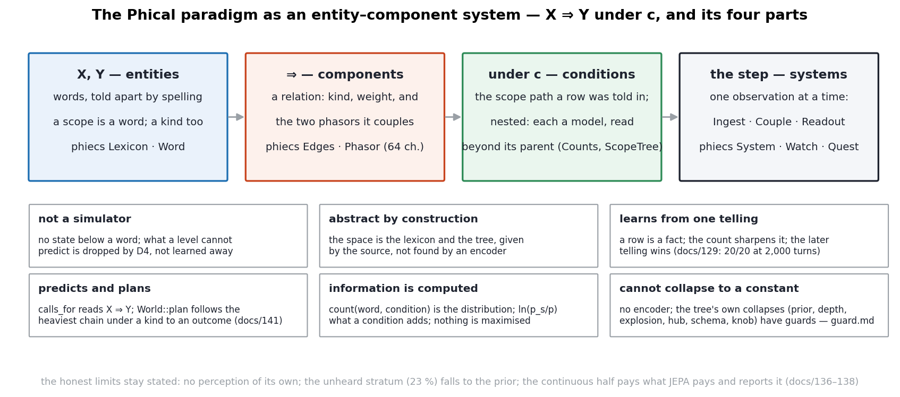
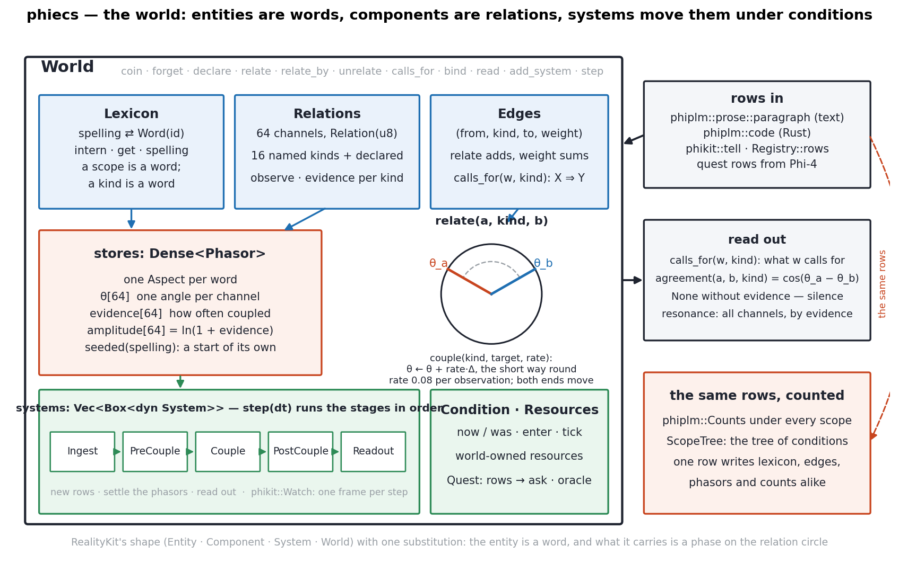
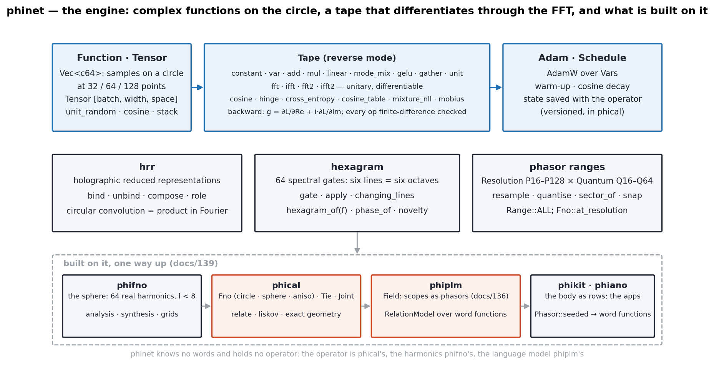
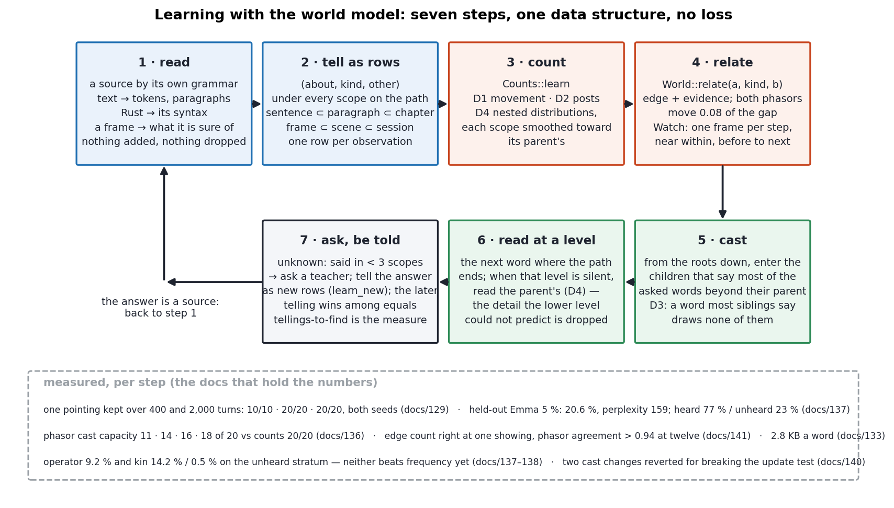
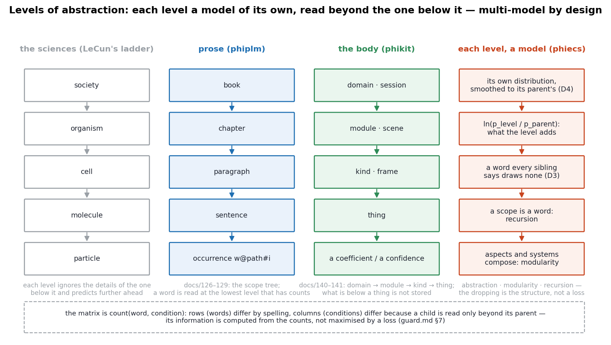
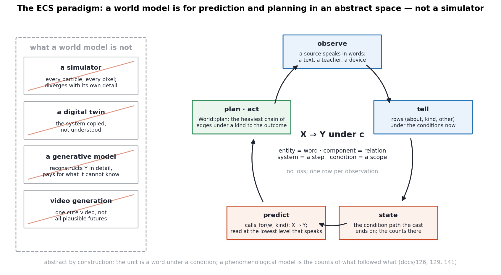
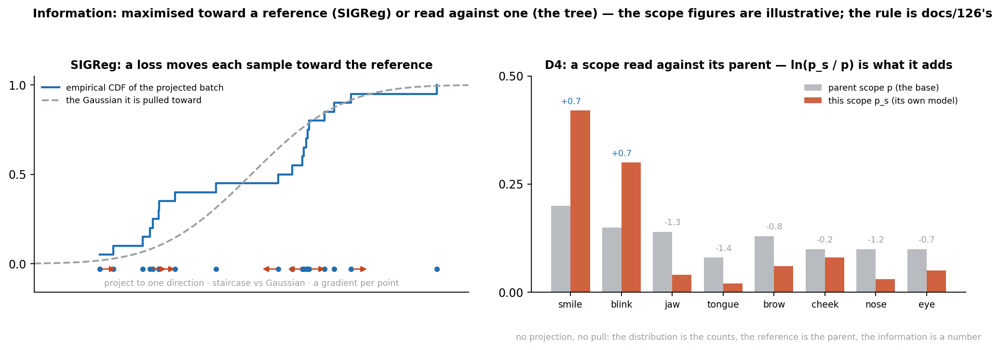
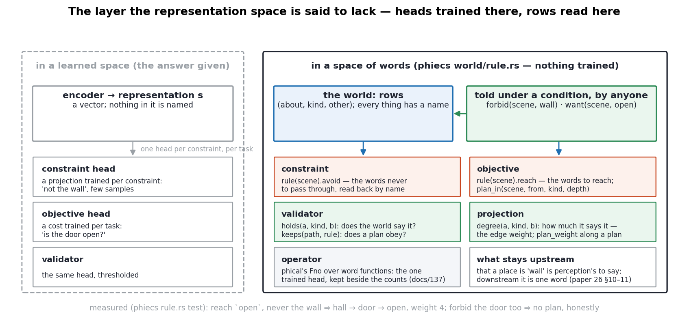

# The World Model as a Tree of Conditions

## Phient's Entity–Component Paradigm, Against Simulation

In Phient's world, a word (w) is a seed: what it relates to, under what conditions (c), grows from it. The Phical paradigm, X ⇒ Y, drives and composes Phient's Phasor Language Models: Phinet, Phiano, PhiTon. Phical stores no point: a word is 32–64 relations, each a complex phasor on a closed circle with a count; meaning is a side effect of pairs of words moving under a condition.

### Abstract

A world model, on the account now gaining ground, is a phenomenological model of a system and its environment, learned so that one can predict and plan — not a simulator of the system's every particle, not a digital twin, not a generative model that reconstructs the future in its minute details, and not a video generator. It should work in an abstract space, because every science works at a level that drops the details of the level below, and because a prediction that carries too much detail diverges from reality. The joint-embedding predictive architecture (JEPA) reaches that abstract space by training an encoder and preventing its collapse with an information-maximisation loss, most recently by pulling the batch's projections toward an isotropic Gaussian (SIGReg). This paper presents Phient's alternative, which has been built and measured over a hundred and forty-one numbered experiments: a world model that is an entity–component system whose entities are words, whose components are relations carrying a phasor and a count, and whose conditions nest into a tree in which every level is a model of its own. It never reconstructs, because it holds nothing below a word. Its abstract space is given by the source, not found by an encoder. It learns from one telling and is corrected by telling again. Its information content is computed from counts rather than maximised toward a reference. It predicts by reading X ⇒ Y at the lowest level that speaks and plans by following the heaviest chain of relations under a kind to an outcome — with a constraint stated as a word to avoid and an objective as a word to reach, no head trained for either. It uses no reward: learning is by observation throughout, and the sample-efficiency the field asks of a world model is the measure it keeps, tellings to find a thing. We draw the two engines (phiecs, the world; phinet, the differentiable engine the continuous half runs on), walk the seven learning steps, report what was measured — one pointing kept over two thousand turns, held-out text in two strata, the body of a persona learned from frames, a plan read from a world that watched a face — and state plainly where the joint-embedding programme does what this one does not: it perceives. The two are not rivals but positions: an encoder is a candidate front end to the tree, and the tree a candidate world model behind an encoder.

## 1. What a world model is for

The argument we answer runs as follows. A system that must act in the world — a robot that touches things, a plant, a patient — cannot be reduced to a small set of equations the way a free-standing robot's dynamics can; what is needed is a learned, phenomenological model of the system and its interactions, so that one can predict what follows an action and plan the sequence of actions that reaches an outcome. That is the oldest idea in optimal control (Bellman, 1957; Kalman, 1960). But the model must not be a simulator: every science predicts at a level that drops the detail of the level below — Navier–Stokes, not molecules; psychology, not particle physics — because detail that cannot be predicted does not merely cost compute, it makes the prediction diverge. So a world model should work in an abstract representation space; it should not be generative, because a generative model is trained to reconstruct Y in all its detail and pays for every detail it cannot know; and video generation, whatever it is called, is a different problem.

We agree with every step of this, and we built the opposite thing from the one the argument then proposes. JEPA's step is to *learn* the abstract space: encode X and Y, predict the encoding of Y from that of X and the action, and keep the encoder from collapsing to a constant by maximising the information in its output. Phient's step is to *take* the abstract space from the source: a word is already the level at which a text, a teacher or a device speaks, and a condition is already the level at which it was said. From there, everything is a count and a relation. The rest of this paper is what that commits us to, drawn, measured and compared.



*Figure 1. The Phical paradigm X ⇒ Y under c, as an entity–component system: entities, components, conditions, the step; and the six things that follow from it.*

## 2. The paradigm: X ⇒ Y under c as an entity–component system

Apple's RealityKit puts entities in a world, hangs components on them, and runs systems over both. That is the right shape for a world model of meaning, with one substitution: the entity is a **word**, and what it carries is not a position in space but a phase on the relation circle. Phient's crate phiecs is that sentence as a data structure (docs/phient 08; paper 25 §2).

**Entities** are words, told apart by their spelling. A scope — the paragraph, the chapter, the frame, the session, the kind, the module — is a word too; so is a kind of relation. This is the recursion that lets a condition be related to, counted under, and be a condition for further conditions.

**Components** are relations. A row `(about, kind, other)` is an edge of a kind with a weight, and the kind is one of sixty-four channels on which every word carries a phasor: an angle, an evidence count, an amplitude `ln(1 + evidence)`. To relate two words under a kind is to record the edge, count the kind, and move both angles on that channel a step toward each other, the short way round. This is Kuramoto coupling (paper 11) reduced to its one necessary line, and it is the whole of learning in the world.

**Conditions** are the scopes a row was told under, and they nest. Every row is counted under every scope on its path, so each scope holds a distribution over what was said in it, smoothed toward its parent's — Witten and Bell's zero-frequency estimate applied level by level (docs/126, 131). Each level is therefore a model of its own, and the tree is a multi-model system by design: the sentence's model nested in the paragraph's nested in the chapter's; the frame's in the scene's in the session's; the thing's in its kind's in its module's in its domain's.

**Systems** run over the world one observation at a time, in five stages — Ingest, PreCouple, Couple, PostCouple, Readout — an observation pipeline rather than a frame pipeline. phikit's `Watch` is one: a frame per step, the shapes said together related `near`, each shape said related `before` each the next frame says.

Nothing else is stored. There is no encoder, no decoder, no latent variable, no reconstruction, and no loss in the base. What is fitted — the relation operator of phical, trained with a margin hinge on cosine similarity against a sampled decoy (a sample-contrastive criterion, in the joint-embedding vocabulary) — sits on top of the counts and is measured against them (docs/137).

### 2.1 Where the learned information is

The entity–component system is at once an abstraction space (a level is an entity), a modular space (aspects and systems compose) and a recursive space (a scope is a word; an answer is a source), and what is learned is not stated in it anywhere. No line in the world says *a smile is followed by a blink*. There is an edge of kind `before` with a weight of twelve; two angles on that channel that have moved toward each other; an evidence count on each; and a scope under which the frames were told. The fact is spread across the entity (two words in the lexicon), the component (the relation and the phasors it couples), the system (the step that coupled them) and the condition (the scene) — present only in their interplay, which is what the paradigm's own sentence means by *meaning is a side effect*. A network's weights hold knowledge implicitly too; the difference is that every piece of this one can be read back by name — `calls_for(smile, before)` lists the blink and its weight, `agreement(smile, blink, before)` the angle, the counts under the scene the distribution, `plan` the chain. Implicit, yet surveyable (Wittgenstein §122; D15 in papers 19–23): nothing is stated, and nothing is hidden. This is also why the information content can be computed (§8): the interplay is a finite table, not a sample of an unknown density.

## 3. phiecs, drawn



*Figure 2. phiecs — the world. The Lexicon interns spellings; Relations are the sixty-four channels; Edges are the rows; the one Aspect every word carries is its Phasor; Systems run in stages; the same rows are counted into phiplm's Counts and ScopeTree.*

The figure reads as the code does. `coin` makes a word; `declare` makes a kind (and interns it as a word); `relate(a, kind, b)` records, counts and couples; `calls_for(w, kind)` reads X ⇒ Y off the edges, heaviest first; `agreement(a, b, kind)` is `cos(θ_a − θ_b)` and is `None` when either side has no evidence on the channel — silence is not agreement; `resonance` is the agreement across channels weighted by the smaller evidence. `plan(from, kind, to, depth)` follows the heaviest chain of edges under a kind from one word to another, and `reach` lists everything a word leads to within a depth. The world's words seed the field's word functions (`Phasor::angles()`, docs/136), so the discrete and the continuous halves start from the same place.

## 4. phinet, drawn



*Figure 3. phinet — the engine the continuous half runs on: complex functions on the circle, a reverse-mode tape with a unitary FFT, Adam, holographic binding, the sixty-four spectral gates, the phasor ranges; and the crates built on it, one way up.*

phinet knows no words. It is what torch is to neuraloperator (docs/139): a `Tensor` of complex functions sampled on a circle at 32, 64 or 128 points; a `Tape` whose ops include a differentiable unitary FFT, spectral mode mixing, and the losses the family uses; `Adam` with a schedule; `hrr` (Plate's holographic reduced representations); `hexagram` (the sixty-four gates, six lines as six octaves of the spectrum); and the phasor `Range`s between resolutions and quanta. Every gradient is finite-difference checked. phifno (the sphere), phical (the operators and the exact geometry), phiplm (the field and the relation model), phikit and phiano stand on it in that order and never reach up.

The division between the two engines is the honest one. phiecs counts and learns from one telling; phinet differentiates and learns from many. The counts are the base; the operators are an addition over them, kept beside them until they are shown to find what the counts find — and as of docs/137–138 they do not yet in the unheard stratum (operator 9.2 %, kin 14.2 % and 0.5 %, against the frequency prior).

## 5. The learning steps



*Figure 4. Seven steps, one data structure, no loss — with the docs that measured each.*

1. **Read** a source by its own grammar: text into tokens and paragraphs; Rust by its syntax; a tracked face into the sentence of the shapes it is sure of; a framework into its names' words. The reader adds nothing and drops nothing: a name is its words, a frame is a sentence.
2. **Tell** every observation as a row under every scope on its path. One row per observation; no epochs.
3. **Count** (D1 the word's movement, D2 its posts, D4 the nested distributions). Each scope's column of the matrix `count(word, condition)` is filled by exactly the rows told under it.
4. **Relate** the same rows in the world: an edge, evidence, two phasors a step closer.
5. **Cast** a question's words into the tree: from the roots down, enter the children that say most of the asked words *beyond their parent* (D3: a word most siblings say draws none of them).
6. **Read at a level**: the next word where the path ends; when that level is silent, the parent speaks. The detail the lower level could not predict is dropped — by the structure, not by an encoder.
7. **Ask, be told**: what the tree does not know it asks for; the answer is a source and goes back to step 1; the later telling wins among equals, so correction is telling again.

The measure of the system is the number of tellings a thing needs before it is found — Piaget's measure, on the remark attributed to him that intelligence is what you do when you don't know, and should be judged by the speed of learning rather than by a benchmark (docs/140).

## 6. Each level is a model of its own



*Figure 5. Levels of abstraction: the sciences' ladder beside the tree's — each level a distribution of its own, read beyond the one below it.*

The levels argument is usually made against the simulator: you cannot predict the room by simulating its particles. In the tree the argument is the architecture. A paragraph's scope is a model of the words said in it; the chapter's is a model of all its paragraphs; the book's of all its chapters; D4 makes each the base of the one below, and a cast reads at the lowest level that has counts and otherwise one up. The prediction is always made by the smallest model that has something to say, with the larger models standing behind it. Chemistry's structure that is not apparent in physics is, here, exactly `ln(p_level / p_parent)`: what a level adds beyond its parent, in nats, per word.

What phiecs supplies to this, in the user's three words: **abstraction** — a level is an entity, with a phasor, relatable, a condition for levels below; **modularity** — aspects and systems compose, and the crates stack one way (phinet ← phifno ← phical ← phiplm ← phikit ← phiano, phiecs beside); **recursion** — scopes within scopes to any depth, answers that become sources, a world whose phasors seed the field the same tree casts into.

## 7. Prediction and planning, measured



*Figure 6. The loop a world model is for — observe, tell, state, predict, plan and act — and the four things it is not.*

**Prediction** is a cast and a read. On held-out *Emma* (5 %, 10,578 positions) the tree reads the next word at 20.6 % accuracy and perplexity 159, in two strata it reports rather than averages: 77 % of positions where the condition was heard, 23 % where the base falls to the prior (docs/137). On the context tests of docs/129 — a thing pointed at once, then four hundred or two thousand turns of other things — the thing is found 10/10 · 20/20 · 20/20 at both seeds, and an update told later wins over the earlier telling.

**Planning** is a chain of relations under a kind. The smallest honest measurement is the body (docs/141): a world shown a smile followed by a blink, and a yawn followed by the tongue, each `n` times with a rest between.

| repetitions | smile L ~ smile R (`near`) | smile L → blink L (`before`) | smile L → tongue | jaw → tongue | `follows(smile L)` |
|---|---|---|---|---|---|
| 1 | −0.577 | 1.000 | −0.601 | −0.613 | blink L 1, blink R 1 |
| 3 | 0.029 | 0.990 | −0.765 | −0.003 | blink L 3, blink R 3 |
| 12 | 0.949 | 0.997 | −0.992 | 0.947 | blink L 12, blink R 12 |
| 48 | 1.000 | 1.000 | −0.998 | 1.000 | blink L 48, blink R 48 |

`World::plan` on that world answers `mouth smile left → eye blink right` and `jaw open → tongue out`, and *none shown* for `mouth smile left → tongue out`, which never followed. Read honestly, the table says two things. The edge counts — the discrete half — are right at the first showing. The phasor agreement — the continuous half — is the seed at one showing (smile → blink reads 1.000 because two seeded angles happened to lie 0.1 apart; jaw → tongue, equally shown, reads −0.613) and needs about twelve showings at the coupling rate before related pairs stand above 0.94. That is docs/136's finding again, in the body: the count learns from one pointing; the phasor is a slower, superposable summary of it.

**The body itself** is the paradigm applied to a device (docs/140–141). phikit ports the Rust ARKit binding, the joint and shape vocabularies of Apple's Vision and ARKit headers and the kernel registry of IOKit into our words — fifty-two shapes in seven regions, the pose's twenty-three joints in seven groups, the skeleton's sixty-seven, the hand's twenty-one and twenty-seven, tracking's anchors, frames and sessions, the registry's planes, services and keys — and tells every type and case as rows by one mechanism: 11,471 rows, roots `body`, `track`, `device`, uniform depth. A cast lands when the asked words are one thing's (`jaw open`, `excessive motion`, `device tree`, `bedroom`) and ties when two things rightly have them (`left elbow` is the pose's and the skeleton's; a `floor` is a plane's classification, a room's surface and a mesh's class). A frame is a sentence — `mouth smile left, mouth smile right, cheek squint left` — and a persona learns its face as it learns a story: told three times, asked what follows the smile, it answers the blink.

## 8. Information: measured, not maximised



*Figure 7. Left: SIGReg, as presented — the batch projected to one direction, its empirical cumulative distribution against a Gaussian's, a gradient per point toward the reference. Right: D4 — a scope's counts against its parent's distribution; `ln(p_s / p)` is what the scope adds. The scope figures are illustrative; the rule is docs/126's.*

The joint-embedding programme's central difficulty, stated by its author, is that the information content of a representation cannot be measured from a finite batch of points, because the proper definitions need the distribution and only samples are in hand. Hence the surrogates — variance and covariance terms (VICReg), redundancy reduction (Barlow Twins), sample contrast (CLIP and its kin) — and most recently SIGReg: project the batch to a direction, compare the staircase of its empirical cumulative distribution with a Gaussian's, and move every point toward where the Gaussian would have it, an isotropic Gaussian being the distribution under which the variables are independent. The matrix of samples by variables is made informative by making its rows different (sample-contrastive) or its columns different (dimension-contrastive).

The tree's matrix is words by conditions, with a count in every cell, over a finite lexicon and a finite tree. It *is* the distribution. Its reference is not a Gaussian but the parent scope's distribution, and what a scope adds is `ln(p_s / p)` per word — read, not pulled; a word every sibling says adds nothing (D3). The rows differ because words are told apart by spelling; the columns differ because a child's column is read only beyond its parent's, so two conditions that say the same thing add nothing by D4 and draw nothing by D3. Nothing is projected and nothing is pulled toward anything. The information that was and was not there is a reported number: the two strata of §7.

We do not claim this settles the joint-embedding problem; it dissolves it for a representation that is already discrete and counted. Where Phient uses a continuous summary of itself — the field of phasors (capacity 11, 14, 16, 18 of 20 against the counts' 20 of 20; docs/136), the coupled phasors of §7, phical's operator — the collapse question is real again, and there our answer is the same as everyone's: a hinge against a decoy, evidence kept, agreement undefined without it, and a baseline the summary must match before it replaces anything.

## 9. Collapse, and what guards it

A joint-embedding system collapses when its encoder ignores the input and emits a constant. The tree has no encoder, so not that; but a counting tree has collapses of its own, each met in a numbered doc, each with a guard that is a rule of the structure rather than a knob (`docs/guard.md`).

| collapse | the trivial solution | the guard | measured in |
|---|---|---|---|
| prior | the biggest scope wins every cast | locality (D3), the nested base (D4) | docs/126, 129, 135, 141 |
| depth | the deepest path wins | one scope per thing, uniform depth | docs/140, 141 |
| explosion | every occurrence its own scope; 2.8 KB a word | the store reported with the accuracy; the field as an addition | docs/133, 136, 137 |
| hub | every angle on a busy channel meets | evidence kept; silence is not agreement; hubs are conditions | docs/141 (the corpus case is open) |
| schema | our prior typed into the tree | nothing hard-coded; a name is its words; a frame is a sentence | docs/140, 141 |
| knob | a heuristic beside the base | build on the base; measure before asserting; revert what breaks the earlier test | docs/124, 137, 138, 140 |

Two of these were paid for in this very line of work: two changes to the cast that improved the body's tree broke the update test and were reverted (docs/140), and an asserted cause for the unheard stratum was measured false and corrected (docs/138 §3).

## 10. Where the joint-embedding programme is ahead, and the join

It perceives. A JEPA encoder turns pixels into a representation; the tree begins where something already speaks in words — a text, a teacher (Phi-4 in the quests), a device (ARKit's face tracker, whose fifty-two named coefficients phikit reads into our words at the edge and nowhere else). The honest statement of the relation is therefore position, not rivalry: an encoder is a candidate front end to the tree, and the tree is a candidate world model behind an encoder — the place its representations could be told as words under conditions, counted, planned over, and have their information read exactly. Apple's tracker is the encoder phikit uses today; a learned one would be another source of sentences, and the tree would not change.

The other limits stay as stated: the unheard stratum falls to the prior; the continuous half pays what JEPA pays and reports it; the store is 2.8 KB a word; no device frames exist yet on our machine, so the learning-speed test on a body — a persona shown one new gesture once and asked for it after a session of others — is the next measurement, not a reported one.

## 11. Observation before reward; constraints in the words

Two remarks from the end of the talk complete the comparison.

**Minimise reinforcement learning.** The argument: reward is the most sample-inefficient signal there is; learn by observation first — a world model — and use reward only on top of good representations, where few samples are needed. The tree is the observation-first case taken to its end. Everything in the base is learned by being told: one row per observation, no reward anywhere, and a thing is found after one telling (docs/129). There is no reinforcement learning in Phient at all, and the place "on top" is occupied by two things that are not reward either: the teacher cycle, in which the tree asks for what it does not know and is told (docs/124 §3, docs/130), and the relation operator, trained by a hinge against a decoy and kept beside the counts (docs/137). We do not claim this is better than reward where reward is the only signal; we note that for every task so far the signal was a telling, and that the measure we keep — tellings to find a thing — is the sample-efficiency the argument asks for, counted directly.

**Constraints and objectives in the representation space.** The question put to the speaker was the engineer's: model-predictive control is loved because constraints — do not hit the wall — can be stated in state space, so how does one state them in a learned representation space? The answer was that another layer is needed: a small head trained per constraint, and a cost function per task objective (is the door open), each from few samples. We take the answer seriously and build the layer — and in a space of words none of it is trained, because the constraint, the objective, the validator and the projection are already written in the words the world is written in (Figure 8).



*Figure 8. The layer: heads trained on a learned representation, against rows read from a world of words. phiecs `world/rule.rs`.*

- A **constraint** is a row told under a condition: `forbid(scene, wall)` relates the scene to the wall under the kind `avoid`. Anyone who speaks the world's words can tell it — the engineer and the model alike. The exchange's sharpest point was that a learned space needs *a different projector for each constraint*; here the second constraint is a second row under the same condition, and the tenth is a tenth — `rule(scene).avoid` is a list, and no projector exists to be duplicated.
- An **objective** is a row of the kind `reach`: `want(scene, open)`.
- A **validator** is a read: `holds(a, kind, b)` is whether the world says the row; `keeps(path, rule)` is whether a plan ends on a word to reach and passes through no word to avoid.
- A **projection** is a read too: `degree(a, kind, b)` is how much the world says it — the edge's weight — and `plan_weight` is that product along a plan. The task objective's cost function — *is the door open or not* — is `holds(door, before, open)` for the yes-or-no and `degree` for the how-much, both read from what the world was shown; nothing was trained for the task, and the second task costs no second cost function.
- The **operator** is the one trained head Phient has — phical's Fourier operator over word functions (docs/91–97, 137) — and it is kept beside the counts, not under them.

`rule(scene)` reads a condition's constraint and objective back from its rows, heaviest first, and `plan_in(scene, from, kind, depth)` is the plan under them: the heaviest chain of relations under a kind that reaches the first goal it can through none of the forbidden words. Tested in the smallest honest case: a hall that leads to `open` through the door (shown twice) or over the wall (once); told to reach `open` and never the wall, the world plans `hall → door → open` with weight 4; forbidden the door as well, it answers that no plan exists rather than inventing one. Because nothing in the world is stated (§2.1), anything can be: the constraint layer is not an addition to the architecture but a reading of it.

What this does not give is the thing the engineer's constraint usually is: a region of a continuous state space. A wall is a word here only after something has said *wall* of a place — a device, a map, a person. That is §10 again: perception is upstream of the tree. Downstream of it, a constraint is one word and costs nothing to add.

## 12. Reproducing this paper

```
cargo test -p phiecs plan                                   # World::plan, plan_avoiding, reach
cargo test -p phiecs rule                                   # forbid, want, rule, holds, degree, plan_in
cargo run -p phikit --example watch -- 12                   # the table of §7 and the plans
cargo run -p phikit --example ask -- "jaw open" "floor"     # the casts of §7
cargo run --release --bin context -- --turns 2000 --seed 2  # one pointing, kept
cargo run --release --bin story -- --heldout 0.05           # the two strata
python3 docs/figs_world.py                                  # figures 1–8
```

## References

**The argument answered.** LeCun, Y. (2022). *A Path Towards Autonomous Machine Intelligence.* OpenReview (the JEPA position paper: prediction in representation space; the hierarchy of abstraction; world models for planning). Balestriero, R., LeCun, Y. (2025). *LeJEPA: Provable and Scalable Self-Supervised Learning Without the Heuristics.* arXiv (SIGReg — sketched isotropic Gaussian regularisation). Bardes, A., Ponce, J., LeCun, Y. (2022). *VICReg: Variance-Invariance-Covariance Regularization for Self-Supervised Learning.* ICLR. Zbontar, J., Jing, L., Misra, I., LeCun, Y., Deny, S. (2021). *Barlow Twins: Self-Supervised Learning via Redundancy Reduction.* ICML. Assran, M. et al. (2023). *Self-Supervised Learning from Images with a Joint-Embedding Predictive Architecture* (I-JEPA). CVPR. Bardes, A. et al. (2024). *Revisiting Feature Prediction for Learning Visual Representations from Video* (V-JEPA). Radford, A. et al. (2021). *Learning Transferable Visual Models from Natural Language Supervision* (CLIP). ICML. The talk itself was relayed to us in transcript; we answer it as relayed.

**World models and control.** Bellman, R. (1957). *Dynamic Programming.* Princeton. Kalman, R. E. (1960). *A New Approach to Linear Filtering and Prediction Problems.* J. Basic Eng. Ha, D., Schmidhuber, J. (2018). *World Models.* arXiv:1803.10122. Sutton, R. S., Barto, A. G. (2018). *Reinforcement Learning: An Introduction*, 2nd ed. (Dyna; planning with a learned model).

**Wittgenstein and Piaget.** Wittgenstein, L. (1953). *Philosophical Investigations*: §2 and §§28–30 (pointing; a word's place in a game), §23 (language games), §43 (meaning as use), §§65–67 (family resemblance), §§201–202 (a rule as practice). Paraphrased; the readings D1–D20 are papers 19–23. Piaget, J. — the remark on intelligence as what one does when one does not know is attributed to him on the slide that reached us (docs/140); his *The Origins of Intelligence in Children* (1952) is the source of the framing by stages and assimilation.

**Methods used in the counts and the engine.** Witten, I. H., Bell, T. C. (1991). *The zero-frequency problem.* IEEE Trans. Inf. Theory — the level-by-level smoothing (D4; docs/126, 131). Kuramoto, Y. (1975). *Self-entrainment of a population of coupled non-linear oscillators* — the coupling rule of the Phasor (paper 11). Plate, T. A. (1995). *Holographic reduced representations.* IEEE Trans. Neural Networks — `phinet::hrr`. Loshchilov, I., Hutter, F. (2019). *Decoupled weight decay regularization* — `phinet::Adam`. Li, Z. et al. (2021). *Fourier Neural Operator for Parametric Partial Differential Equations.* ICLR — phical's operator. Austen, J. (1815). *Emma.*

**The work this paper stands beside.** Shao, R. et al. (2026). *Context Language Models.* arXiv:2609.37725 (paper 24; `gemphi/ext/context-language-models`). Apple's RealityKit, whose entity–component shape phiecs keeps with one substitution; the Rust ARKit binding `rust-ios-ar`, the Vision, ARKit and IOKit headers, read once and ported into our words (docs/140–141).

**Phient's own record.** Paper 11 (the relation circle, Kuramoto coupling), 12 (the engine), 13 (the exact geometry), 14 (parity with PyTorch), 19–23 (Descriptive Logic I–V), 24 (keeping data or keeping relations), 25 (Phasor Language Models). Docs 124 (the student on the base), 126 (conditions at levels), 129 (our context tests), 131 (breadth), 133 (the store), 135 (one workspace), 136 (the field of phasors), 137 (the operator as the base), 138 (kin), 139 (the family by reference), 140–141 (phikit). The approach documents at the workspace root: `docs/training.md`, `docs/guard.md`, `docs/ecs_vs_jepa.md`, `docs/world_model.md`, `docs/paradigm.md`.
