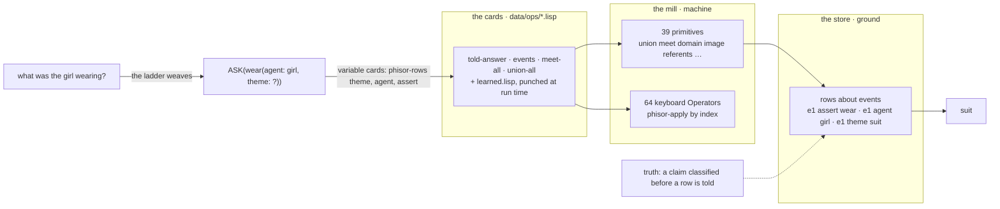

# The Cards and the Mill

## Ada Lovelace's Notes as the Specification phisor Meets

In Phient's world, a word (w) is a seed: what it relates to, under what conditions (c), grows from it. The Phical paradigm, X ⇒ Y, drives and composes Phient's Phasor Language Models: Phinet, Phiano, PhiTon. Phical stores no point: a word is 32–64 relations, each a complex phasor on a closed circle; meaning is a side effect of pairs of words moving under a condition, and they move by the error of what was expected — toward what came, away from what did not.

> *Dedicated to Augusta Ada Lovelace (1815–1852), who first saw that a machine of numbers could weave the patterns of thought — in this project's reckoning the most brilliant mind who ever turned mathematics into music.*

### Abstract

In 1843 Ada Lovelace appended seven Notes to her translation of Menabrea's sketch of Babbage's Analytical Engine. The Notes are usually read for two sentences — the loom that weaves algebraical patterns, and the engine that originates nothing. They hold a good deal more: a science of operations distinct from the things operated on; a store kept apart from a mill; two kinds of card, one saying *what* to do and one saying *to what*; cards that can be backed so a few of them run a cycle of unbounded length; the freedom to arrange one computation many ways; a machine that acts on any objects whose relations can be stated, music among them; a numbered trace in which every operation is accounted for; and the limit that the machine does what it is ordered and anticipates nothing. This paper lists those ideas — her gems — and sets each beside the part of phisor that carries it on the day of writing, 2026-11-08, with the test or measurement that shows it does. The occasion is that the last of them fell into place today: the mill's 64 Operators became callable from the Lisp (`phisor-apply`), and operators are now **operation cards** — lambdas kept in files, read into every machine at its birth and punched at run time — rather than rows cut into the mill. The evaluation is honest about what is partial (arrangement, variable cards as a named thing) and what she described that phisor does not do.

## 1. Why a specification, and why hers

phisor did not set out to build Babbage's engine. It set out to be an intermediate language between English and a machine: a sentence read as a speech act over a frame, grounded as rows about an event, and a question answered by operating on those rows. The parts that came out of that — a reader that writes structure and carries no word, a store of rows, a machine that operates on them, a guard that refuses to let the machine make things up — turned out to be the four parts Lovelace named, and docs/lovelace.md recorded the correspondence as an analytic model, four ideas to four modules.

Today the user said: *we think Lovelace provided all the answers we need.* Read as an instruction, that is a specification — not four ideas but all of them, and for each the question: does phisor do this, is it measured, and if not, what is the gap. This paper is that reading. It is not a claim that the resemblance makes phisor right. Her Notes describe a machine; phisor's numbers are measured against bars declared before each run, and the correspondence says only that the architecture has a shape, and that the shape is an old and well-understood one.

## 2. Her gems

What follows is every distinct idea in the Notes that bears on a machine for language, each in her words where the words are hers (the verbatim excerpts the project keeps are in `crates/phiano/data/corpora/lovelace/notes_excerpts.md`; a sentence given without quotation marks is a paraphrase), and then where it lands in phisor.

### 2.1 A science of operations, apart from the objects operated on (Note A)

> "The science of operations, as derived from mathematics more especially, is a science of itself, and has its own abstract truth and value."

> "…the peculiar and independent nature of the considerations which … belong to operations, as distinguished from the objects operated upon."

This is the founding distinction. An operation has its own laws — what composes with what, what undoes what, what is idempotent — whether the things it is applied to are numbers or not.

**Where it lands.** The Phical paradigm, X ⇒ Y, is the operation taken as the primary thing, and `phical::keyboard` is the science of operations made literal: 64 Operators, each a frozen row with its index, arity, operand types, result type, and its declared laws — idempotence, an exact or approximate inverse, and the composition tables of `keyboard::laws`. The row says nothing about any particular phasor or class; it says what the operation *is*. The index table is a frozen record (`tests/keyboard/index.golden`), re-recorded only with the old table, the new and a stated reason.

**Measured.** The table's two structural assertions (the index bijection, the family partition) run on every build; the laws are tested in `keyboard/tests.rs`; the agreement check (`machine::agree`) runs all 64 against a frozen operand set and compares the machine's bytes to the Rust reader's.

### 2.2 The engine acts on anything whose relations can be stated — music included (Note A)

> "The engine might compose elaborate and scientific pieces of music of any degree of complexity or extent."

> "Many persons … imagine that because the business of the engine is to give its results in numerical notation, the nature of its processes must consequently be arithmetical and numerical, rather than algebraical and analytical. This is an error."

The objects need not be numbers. Anything whose "mutual fundamental relations" can be expressed in the science of operations is material for the engine.

**Where it lands.** phisor's operands are the keyboard's nine types — phasor, class, level, variation, kind, act, frame, row, word — and only the first is a number in any ordinary sense. A word is a handle; an act is a handle; a row is `(about, kind, other)`. phiclm's Lisp operates on *relations* (Russell's algebra: `union`, `meet`, `domain`, `image`, `referents`…), and the answer to "what was the girl wearing?" is `image(union(rows(theme)), domain(meet(…)))` over rows about an event — algebraical, not numerical, exactly her point. The phasor itself is her music: a word is 32–64 relations, each an angle on a closed circle, and meaning is where pairs of words come to rest.

**Measured.** `examples/converse`: told four sentences, asked four questions, four answers (docs/211). Every operand type round-trips through the machine-word carriage (`machine::word`, Property 20).

### 2.3 The loom: structure woven, no thread carried (Note A)

> "The Analytical Engine weaves algebraical patterns just as the Jacquard-loom weaves flowers and leaves."

The pattern in the cloth is the pattern in the cards, in another material. Nothing of the card is in the silk; only its structure.

**Where it lands.** The ladder. A sentence written in mode 16, 32 or 64 is one class token per word in the word's order, and not one word of the sentence. `lovelace::weaves_no_thread` states the property — every token below the mode's class count, never a word — and the reader builds an `Act` whose template blinds the fillers: *a girl was wearing a blue suit* and *a boy was wearing a white cap* are one template, `ASSERT(wear(agent: $N, theme: $N{$A}), past, progressive)`.

**Measured.** The property test; the harness's act round-trip (86%) and function purity (53.4% against a 56.7% bar, docs 234) — honest numbers for how much of the guide the loom weaves soundly: about a third of its sentences.

### 2.4 Tabulate or develope (Note A)

> "While the Difference Engine can merely tabulate, and is incapable of developing, the Analytical Engine can either tabulate or develope."

**Where it lands.** Paper 11 (§7.3) read phiano's `relational_score` as the Difference Engine: fixed gears, a fixed train of wheels, able only to read what the corpus set into them. The Analytical Engine is the learner (`phient::lineup::learner`): told sentences, it moves its phasors by the error of what it expected and *develops* a model it was not given. The two are measured on the same held-out sentences: the counted phasors (running mean, never corrected) against the learner corrected by its error — 15.3% top-1 against 21.6% on the guide's test (docs/216).

### 2.5 The store and the mill (Notes A, D)

Quantities are kept on columns — the store — and brought into the mill to be operated upon; where a thing is kept is not where it is worked on.

**Where it lands.** `ground` is the store: an act laid out as rows about an event, held and not computed on. `machine` is the mill: phiclm's Lisp host over those rows, every operation a lambda. The division is literal in the code — `ground.rs` imports nothing from `machine`, and `machine` reads rows only through the host's `phisor-rows`.

**Measured.** `told`'s two tests: the English loop, and the algebra alone over hand rows (docs/211).

### 2.6 Two kinds of card: operation cards and variable cards (Notes D, G)

The engine took operation cards, which say *what* the mill is to do, and variable cards, which say *which* columns of the store it is to do it to. The separation lets one sequence of operations be applied to any data, and one set of data be worked by any sequence.

**Where it lands — as of today.** This was the gap until this morning, and it is the one the user's instruction *dynamically add operators and move fast* closed. The mill is fixed: 64 keyboard Operators and 39 Lisp primitives, law-checked, their indices frozen. Every other operator is a card — `machine::ops`: a `(define name (lambda …))` kept in `data/ops/*.lisp`, read into every machine at its birth (`ops::load`), and punched at run time by `ops::add`, which appends the card to `learned.lisp` and defines it in the running machine in one move, so the next machine is born knowing it. The crate ships four cards (`meet-all`, `union-all`, `events`, `told-answer`), and `told` answers through `told-answer`: the shape of the question is a card in a file, not a shape built in Rust. The variable cards are the names the card is applied to — `(told-answer (list (phisor-rows "theme")) (list …))` names the store's columns by Kind, and the same card over a different world answers a different question.

Also as of today, the 64 are reachable from the Lisp: `(phisor-apply 11 (list 1 0) (list 0 1))` is centroid, and the lowering's own lambdas (`phisor-op-11-centroid`) evaluate. Until this morning the host answered that call with "not built yet", and the mill ran only inside the agreement check — the paper's claim that *machine lowers and runs the 64 operators* was true of the test, not of answering.

**Measured.** `ops::tests`: a machine is born knowing 64 Operators and the four cards; a card punched is known now and by the next machine, is not doubled, and a form that is not a `define` of a lambda is refused. `host::tests`: the Operators by index; a short call or wrong type is a named error, not a panic. 29 machine tests.

**The count.** The user asked, before the cards, whether the mill needed 1024 Operators rather than 64. The Notes answer it as the code does: a new operation is a card, never a wheel. Six primitives composed answer every question the reader can read; none of the 64 is called in answering yet. The standing rule (phisor TODO): before adding a row to the mill, count which operations the guide's questions invoke.

### 2.7 Backing the cards: cycles from few cards (Notes C, E, G)

A chain of cards can be moved backward so the same operations run again on new variables — a cycle — and cycles can nest, so a short chain performs an unbounded computation. Note G's Bernoulli table is built of such cycles.

**Where it lands.** Recursion. phiclm's Lisp has `define`, `lambda`, `if`; a card can name itself, and `meet-all` does: `(if (= (length rs) 1) (car rs) (meet (car rs) (meet-all (cdr rs))))` — one card over any number of relations. Babbage's engine would have run forever on a cycle that never closed; phiclm's machine runs under a step cap (`STEP_CAP`, a million) and reports the cap it hit in the Verdict rather than spinning.

**Measured.** `meet-all` over three relations in `ops::tests`; the step cap in `agree` (Requirement 7 criterion 14).

### 2.8 Arrangement: many orders of the same processes (Note D)

> "In almost every computation a great variety of arrangements for the succession of the processes is possible, and various considerations must influence the selections amongst them for the purposes of a calculating engine."

**Where it lands — partial.** The lowering bounds a lowered operation to 1–64 O-code steps and `lovelace::operation_cards` reads the count; the Lisp evaluates a card's composition in the order written. Nothing chooses among arrangements for economy. The learner has an analogue — the curriculum: the same text in a different order (wide text first, then the guide; the guide beside each new slice) gives different models, and docs 207–217 are a record of choosing the arrangement by measurement. But that is the human arranging, as she meant it; the engine does not arrange for itself. **Not done.**

### 2.9 The engine stops on an impossible order

Menabrea's sketch, which the Notes annotate, has the engine halt on an operation it cannot perform rather than carry on with a wrong result.

**Where it lands.** A `Fault` — arity, operand type, the family's own — is returned in place of a value, never beside one (`keyboard::apply`); from the Lisp it is the error text naming the operator and the operand. The detector's five classes do the same for a claim. **Measured** in `host::tests` and `truth`'s tests.

### 2.10 The trace: every operation accounted for (Note G)

The Bernoulli table numbers each operation, names the variables it reads and writes, and shows the value on every column after every step — the first execution trace.

**Where it lands.** `machine::agree` is that discipline over the 64: every Operator applied to every frozen operand, the machine's bytes beside the reader's, the first differing byte named, and a `VerdictRecord` for a run that did not complete. The harness records (docs 208–217 of phinet) and the learner's docs (203–217 of phiano) carry the same habit outward: every run its table, every number against a bar declared before it, every instalment that bought nothing recorded as nothing (docs 210, 213, 215).

### 2.11 It originates nothing; it anticipates nothing (Note G)

> "The Analytical Engine has no pretensions whatever to originate anything. It can do whatever we know how to order it to perform."

> "It can follow analysis; but it has no power of anticipating any analytical relations or truths."

**Where it lands.** `truth`, the Falsehood_Detector: a claim out of an oracle is classified — unreadable, degenerate, contradicting, unsupported, consistent — before a row is told from it, and a claim the world does not support is marked, not written in. And the day's ruling of no data in code is the same limit from the other side: every word list, every card, every irregular verb is in a file the human can read and edit, so *what we know how to order it to perform* is always visible and always the human's. The learner fits the limit too: told sentences, it does what it is ordered — move toward what came, away from what did not — and the model it develops is the order's consequence, which is her "follow analysis", not her "anticipate".

### 2.12 General symbols in successions of unlimited variety (Note A)

The engine's value to science, she wrote, would be in combining general symbols in successions of unlimited variety and extent — composition over a finite alphabet.

**Where it lands.** A card is a composition; a card can call a card; the keyboard's 64 and the 39 primitives are the alphabet. The unlimited variety is in the files, not the mill.

## 3. The ledger

| her idea | Note | phisor | state |
|---|---|---|---|
| a science of operations, apart from its objects | A | `phical::keyboard`: typed rows, frozen index, laws | done, measured |
| acts on any objects whose relations can be stated | A | nine operand types; Russell's algebra over rows; the phasor circle | done, measured |
| weaves structure, carries no thread | A | `ladder`; `weaves_no_thread`; templates blind their fillers | done; coverage a third of the guide |
| tabulate or develope | A | counted phasors vs the learner corrected by its error | done, measured side by side |
| the store apart from the mill | A, D | `ground` / `machine` | done |
| operation cards and variable cards | D, G | `machine::ops`: cards in files, punched at run time; `phisor-rows` names the columns | **done today**; variable cards not a named thing |
| backing the cards: cycles | C, E, G | recursive cards; the step cap; her Bernoulli program runs (paper 28) | done |
| arrangement for economy | D | `engine::arrange`: the shortest agreeing trace among cards (paper 28); the curriculum still arranged by hand | done at one question's scale |
| stops on an impossible order | (Menabrea) | `Fault` in place of a value; the detector's classes | done |
| the trace: every operation accounted for | G | `agree`; `engine::answer_traced` (paper 28); the records | done |
| originates nothing, anticipates nothing | G | `truth`; no data in code; the learner follows its order | done |
| general symbols in unlimited succession | A | cards composing cards over a fixed alphabet | done |

Twelve ideas: ten done and measured, one done today, one partial — and paper 28, written the same day, closes the partial one and runs her program. What is not hers but is phisor's own — the learner's phasors, the kinds found by the river, the guide's split — is outside this ledger on purpose.

## 4. Evaluation

**What the reading buys.** Three decisions today were made faster and better for having her frame. *Do we need 1024 operators?* — no: a new operation is a card, not a wheel, and the Notes say so in the distinction between the mill and the cards. *How do we add operators dynamically?* — as she did: a file of cards read in at the start, a new card punched and fed in, the mill untouched. *Where does the loop (told English → asked English) stand?* — exactly at her "whatever we know how to order it to perform": it answers what the reader reads and the cards cover, and the honest gaps are the reader's coverage (a third of the guide) and the cards not yet written (a clause filling a role, told force other than assert, an order over events).

**What it does not buy.** Arrangement. Her Note D is about choosing the order of processes for economy, and nothing in phisor chooses: the curriculum that took the learner from 19.7% to 21.6% top-1 and 119.6 to 95.3 perplexity (docs 209–216) was arranged by hand, one run at a time, each run a measurement. That is the human's work in her account too, but a machine that recorded *which arrangement paid* and proposed the next one would be within her limit — it follows analysis — and is the natural next card.

**Where the limit bites.** "No power of anticipating any analytical relations or truths" is a standing warning for the learner's documentation, and docs/213 is the day's example: "still improving at epoch 8" was two points read as a trend, and eight more epochs bought nothing. The machine did not anticipate; the writer did. The records now say what was measured and not what was expected.

**The count, settled.** The keyboard's 64 stays 64. The mill's operations are a frozen, law-checked alphabet; the language's operations are cards, in files, as many as the data pays for, appended by the run that learns one. This is the no-data-in-code ruling applied to operators, and it is what the Analytical Engine was.

## 5. What is next, in her terms

- **Variable cards as a thing**: the Kind names a card is applied to are arguments today; a named variable card (a file of which Kinds a question's roles map to) would let the same `told-answer` serve a different world's row shapes without a Rust change.
- **An arrangement card**: the learner's curriculum recorded as cards — which text, which share, which order — so the next instalment is proposed from the record rather than from the writer.
- **Cards for the reader's gaps**: a clause filling a role (a sub-event, `events` composed), told force other than `assert`, an order over events for *before* and *after*.
- **The measure she kept**: a count, in the harness, of which primitives, Operators and cards the guide's questions invoke — the trace, over the language.

## Status

2026-11-08. Code this paper rests on: `phisor::machine::host::apply` (the 64 from the Lisp), `phisor::machine::ops` (cards), `phisor::lovelace` (the five correspondences — the cards added today), `data/ops/core.lisp`. phisor 29 machine tests, all green. The learner it mentions: `tatoeba3_guide.ckpt`, 21.6% / 42.3% / 95.3 on the guide's held-out test, 21.3% / 41.7% / 123.5 on never-told Tatoeba (docs/216, 217).

## Sources

- A. A. Lovelace, "Notes by the Translator", appended to L. F. Menabrea, *Sketch of the Analytical Engine Invented by Charles Babbage*, in R. Taylor (ed.), *Scientific Memoirs*, vol. 3 (1843), pp. 666–731. Notes A–G; the Bernoulli trace is Note G.
- The project's verbatim excerpts: `crates/phiano/data/corpora/lovelace/notes_excerpts.md`.
- The earlier reading, four correspondences: `phinet/docs/lovelace.md`; paper 11 §7.3 for the Difference Engine reading.
