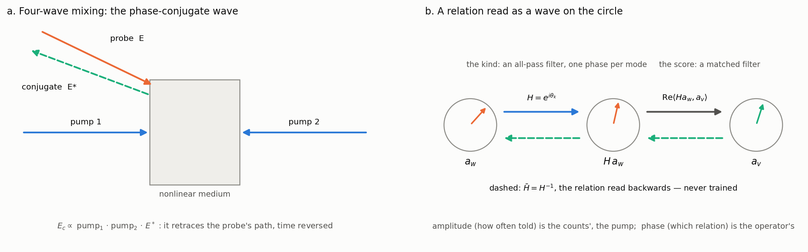
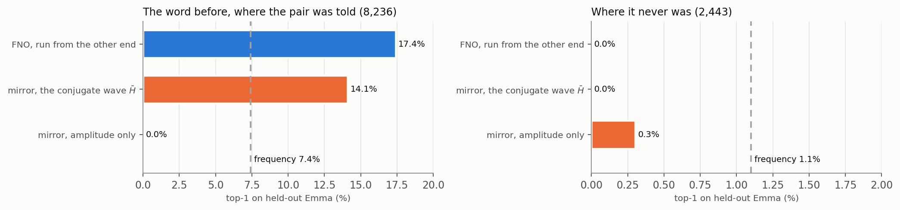
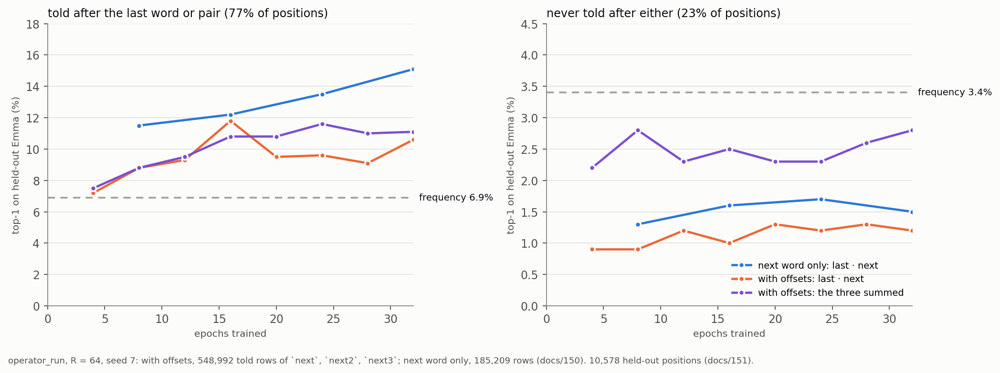
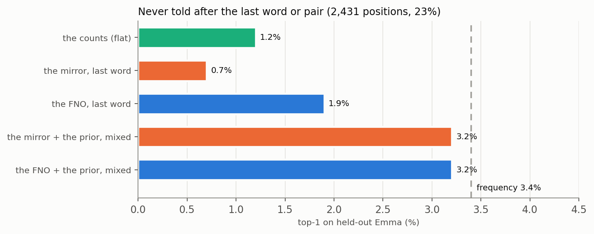

# Waves That Read Back

## Phase Conjugation in Phasor Language Models

In Phient's world, a word (w) is a seed: what it relates to, under what conditions (c), grows from it. The Phical paradigm, X ⇒ Y, drives and composes Phient's Phasor Language Models: Phinet, Phiano, PhiTon. Phical stores no point: a word is 32–64 relations, each a complex phasor on a closed circle with a count; meaning is a side effect of pairs of words moving under a condition.

### Abstract

A phase-conjugate mirror sends a wave back the way it came, as if time ran backwards, and undoes on the return trip the distortion the wave picked up on the way in. David Pepper's accounts of the effect move in a fixed order:

1. the ordinary mirror against the conjugate one;
2. the distorted beam made whole again;
3. the four-wave mixer as a hologram written and read in real time;
4. the pumps that can make the returned wave stronger than the one that arrived.

We follow that order and read each step into Phient's Phasor Language Models, where a word is a function on a circle and a relation is read by correlating one function with another. We then measure every step on held-out *Emma*, on the strata used since docs/137. Six findings:

1. **The readout already conjugates.** It is a matched filter, Σ q·conj(a). Reading it by amplitude alone, without phase, falls from 18.3% top-1 to 0.1%: phase carries the whole reading.
2. **The Joint FNO does not commute with conjugation.** The defect is 1.87 of its output's size, and it comes from the split GELU, the biases and the complex weights.
3. **The mirror is exact.** A new operator, `phical::conjugate::Mirror`, makes every kind an all-pass filter $e^{i\theta_k}$: the FNO's spectral path at one channel and unit modulus. Its conjugate filter H̄ reads every relation backwards with nothing trained for it.
4. **Reading backwards finds the word before** 14.1% (mirror) and 17.4% (FNO, run from the other end) of the time where the pair was told: twice frequency's 7.4%. Where the pair was never told it finds nothing (0.0%). The conjugate inverts what was told and does not invent.
5. **Frequency is the pump.** Mixed into the operator's reading, with weights counted on paragraphs the operator never saw, it brings the never-told stratum level with frequency itself (3.1–3.6% against 3.4%). That accounts for what docs/151's offsets appeared to add there.
6. **One fault was found and fixed along the way.** The operator had never been allowed to predict a word followed by itself. Every told-stratum operator figure since docs/136 was about 2.6 points low.

The lowest held-out perplexity is now 126.5. Radar's matched filter is in the model. Its coherent integration helps only where the integrated readings carry the answer. Resonance, the idea behind Tesla's magnifying transmitter, maps onto counts as stored energy and onto the softening temperature as bandwidth, and onto nothing more.

## 1. Two mirrors

Throw a ball at an ordinary mirror at an angle, and it comes off at the mirror angle and goes somewhere else. Pepper's picture of a phase-conjugate mirror is that the ball comes straight back along the path it arrived on, whatever the angle: the motion of the incoming wave played in reverse, like a film run backwards (Pepper 1986).

For a wave of one frequency, the field at a point is a complex number z = A·$e^{i\theta}$:

- **the amplitude A** is how strong the wave is;
- **the phase θ** is where it is in its cycle.

The conjugate mirror returns z\* = A·$e^{-i\theta}$. Reversing the phase at every point of a single-frequency wave is the same as reversing time.

Phient's words are built of the same two quantities (paper 11, paper 25 §2). A word is 32–64 relations, each a phasor with a count:

- **phase** says which relation it is: where the word stands on that relation's circle;
- **amplitude** says how strongly it holds: in the Phasor, ln(1 + evidence); in the counts, how many times the row was told.

So the first question the optics asks of the model is concrete: what is z\* of a relation? The answer is the relation read the other way. `w ⇒ v under next` read backwards is `v ⇐ w`, the word before. If the model has a conjugate, it has the reverse of every relation it learned, without learning it.

## 2. The distortion undone

Pepper's second picture is the one that made the effect useful:

1. a clean beam passes through a piece of frosted glass and comes out scrambled;
2. a conjugate mirror sends the scrambled wave back;
3. on its second pass through the same glass the scrambling is undone, and a clean beam emerges.

The glass did something to every part of the wave. The conjugate, sent back through it, undoes exactly that.

In Phient the glass is the operator that reads a relation. A word's function goes in, an answer function comes out, and the answer is correlated with every word (§3). Whether the reading can be run backwards depends on one property of the operator, the one the glass has: it must commute with conjugation, F(x̄) = conj F(x). It must also commute with a global phase, F($e^{i\varphi}x$) = $e^{i\varphi}F(x)$, so that a phase-shifted wave is read as the same wave shifted.

Our Joint FNO (Li et al. 2021; docs/113, 137) does neither (§5.2). Its activation is a GELU applied to the real and imaginary parts separately, its layers add biases, and its weights are complex. All three break the symmetry. The operator that keeps both is the one whose every step is a pure phase shift: the all-pass filter, $H_k$ = $e^{i\theta_k}$ for each Fourier mode k. It changes no amplitude, so it loses nothing; its inverse is its conjugate, H̄. That operator is the mirror of §4.

## 3. A hologram written and read at once

Pepper's account of how a conjugate mirror is made is four-wave mixing (Yariv & Pepper 1977).

1. Two strong pump beams meet head-on in a nonlinear medium.
2. The probe, the wave to be conjugated, enters at an angle.
3. The probe and one pump interfere and write a grating in the medium, a hologram written in real time.
4. The other pump, arriving from the opposite side, reads the grating and is diffracted into a wave that carries the probe's phase reversed: the conjugate.

The returned field is proportional to pump₁ · pump₂ · probe\*, a product of three waves, one of them conjugated (Figure 1a).

*Figure 1. (a) Degenerate four-wave mixing: two pumps and a probe make the conjugate, which retraces the probe's path. (b) A relation read as a wave in Phient. The kind is an all-pass filter H = $e^{i\theta_k}$, and the score is the matched filter Re⟨H $a_w$, $a_v$⟩. The dashed path is H̄ = H⁻¹, the same relation read backwards, never trained. Amplitude (how often a relation was told) is the counts', the pump; phase (which relation) is the operator's.*

The model has the same three parts.

- **The hologram is the table.** Every told row writes into it: in the counts, as an increment; in the operator, as a gradient step on the word's function. phinet has carried the hologram's own algebra from the start (Plate 1995; `phinet::hrr`): `bind` multiplies a function by a role, and `unbind` multiplies by the role's conjugate.
- **The reading is a matched filter.** Both learned readers answer `w ⇒ ?` by producing an output function q and correlating it with every word's function: Re Σ q·conj($a_v$) / (|q| |$a_v$|) (`phinet::cosine`). That is the matched filter of radar and optics: the received wave times the conjugate of each template. The conjugate product was in the readout before anyone asked for it.
- **The probe is the word read; the pumps are the word's function and the kind's.** In the FNO they are added before the operator acts. In the mirror the kind multiplies, as the pumps multiply in the mixer.

## 4. The mirror (`phical::conjugate`)

**The model.** A word is a unit spectrum $a_w$: R = 64 Fourier coefficients. The unitary FFT keeps every inner product, so this is the same function the FNO's table holds. A kind is one phase per mode. A relation is read as

$$s(w, \mathrm{kind}, v) = \mathrm{Re}\,\langle H a_w, a_v\rangle = \mathrm{Re}\sum_k e^{i\theta_k}\, a_w(k)\, a_v(k)^{*},$$

which is a cosine, since |H $a_w$| = 1. Because H is unitary, Re⟨H $a_w$, $a_v$⟩ = Re⟨$a_w$, H̄ $a_v$⟩. So H̄ $a_v$ is the time-reversed wave: it reads which word v came after. Hⁿ carries a word n steps on.

**What it is in the literature.** The mirror is RotatE (Sun et al. 2019), equivalently ComplEx restricted to unit-modulus relations (Trouillon et al. 2016), written as a Fourier operator. It is also the FNO's spectral weight $R_k$ cut to one channel and $|R_k| = 1$, and it is `hrr::bind` with a learned role.

**Training.** The mirror trains on the FNO's rows, decoys, hinge and margin. Every gradient is closed-form, because the score is bilinear:

- ∂s/∂$a_w$ = H̄ $a_v$;
- ∂s/∂$a_v$ = H $a_w$;
- $\partial s/\partial\theta_k = -\mathrm{Im}\,(H_k\, a_w(k)\, a_v(k)^{*})$.

Updates use lazy Adam, with the touched words brought back to unit norm. An epoch over 174,107 rows takes about a second; the FNO's takes about two hundred.

**The ring test.** `conjugate::tests` trains twelve words in a ring, told only `w_i next w_{i+1}`:

- read forward, the ring gives $w_{i+1}$;
- read by H̄, it gives $w_{i-1}$, which was never told;
- read by H², it gives $w_{i+2}$ for most of the ring.

On the ring, every one of the optics' promises holds.

## 5. Measured on held-out *Emma*

**The setup** follows docs/135–152. *Emma*'s paragraphs are split by hash.

- **Held out:** 5% of the paragraphs (101 paragraphs; 10,578 positions; seed 7).
- **Strata:** the positions split by whether the word that came had been told after the last word or pair (8,147, the told stratum) or never (2,431, the open stratum) (docs/137).
- **Training:** the operators of this section train on the paragraphs outside a 10% share (174,107 `next` rows).
- **Fitting:** anything fitted, such as a mixture weight or a temperature, is fitted on the 5% between the two shares, paragraphs no reader saw (docs/152).
- **Scores:** top-1 · MRR.

### 5.1 Phase carries the reading

A matched filter can be read coherently, by the real part, which needs the phases to agree. It can also be read by its envelope, the modulus, which keeps only amplitude. On the same operator:

| last word, told stratum | coherent (real part) | envelope (modulus only) |
|---|---|---|
| Joint FNO, 32 epochs | 18.3% · 0.296 | 0.1% · 0.005 |
| mirror, 128 epochs | 14.1% · 0.245 | 0.1% · 0.003 |

Everything either operator learned is in phase.

### 5.2 The FNO is not a conjugate mirror

Measured over 1,000 of the trained FNO's inputs (`FnoWave::defects`):

- ‖F(x̄) − conj F(x)‖ / ‖F(x)‖ = 1.85–1.87 at every checkpoint;
- ‖F($e^{i\varphi}x$) − $e^{i\varphi}F(x)$‖ / ‖F(x)‖ grows from 0.78 at epoch 8 to 0.99 at epoch 32.

The defects are the size of the output itself, and training makes the phase defect worse. The FNO can still be read backwards, but only by running its filter from the other end: F($a_u$ + $a_{\mathrm{next}}$) for each of the 6,877 words u, correlated with the word that came after.

### 5.3 The relation read backwards

*Figure 2. The word before, read from the word after, with no `prev` relation ever trained.*

| the word before… | FNO, run from the other end | mirror, H̄ | envelope only | frequency |
|---|---|---|---|---|
| the pair was told (8,236) | **17.4% · 0.248** | 14.1% · 0.227 | 0.0% | 7.4% · 0.163 |
| the pair was never told (2,443) | 0.0% · 0.008 | 0.0% · 0.004 | 0.3% | 1.1% · 0.042 |

Where the pair was told, the word before is found twice as often as frequency finds it. The mirror does it by one conjugate filter; the FNO by 6,877 forward passes, cached. Where the pair was never told, neither finds it. A conjugate wave retraces the path the forward wave took, and there was no forward wave.

### 5.4 Forward, and the powers that do not compose

| forward reading | told stratum | open stratum |
|---|---|---|
| Joint FNO, last word | **18.3% · 0.296** | 1.9% · 0.052 |
| mirror, last word | 14.1% · 0.245 | 0.7% · 0.032 |
| mirror, the word two back by H² (untrained) | 1.2% · 0.033 | 0.2% · 0.010 |
| mirror, the word three back by H³ (untrained) | 0.1% · 0.007 | 0.0% · 0.003 |
| the mixed reading's own perplexity, no counts | FNO **146.6** · mirror 196.9 | |

- **The FNO reads forward better.** Its width and nonlinearity buy 4.2 points on the told stratum, and 25% lower perplexity, over the mirror's single phase per mode.
- **The powers that carried the ring two steps carry *Emma* nowhere.** The word after next is not `next` applied twice.
- **Training the offsets as kinds of their own does not rescue them.** With `next2` and `next3` trained (`mirror_run --ahead 3`), the mirror's `next` reading fell from 14% to 4.7%: one spectrum per word could not hold three phase relations. The FNO, with width, fell from 15.1% to 10.6% (docs/151, Figure 3).

*Figure 3. The FNO trained on the words one, two and three ahead (docs/151), against the FNO trained on the next word only. These were read before the fault of §5.6 was fixed, which lowers the told stratum by about 2.6 points and leaves the open stratum as it is.*

### 5.5 The pump: frequency, and where its weight is fitted

In the mixer, amplitude comes from the pumps. In the model, amplitude is the counts, and the counts' unconditioned reading is frequency, the prior. `story/reader.rs` mixes the prior with the operator's softened reading by `relate::mixture_weights`, the counted rule of docs/149 (docs/152).

**Where the weights are fitted matters.** Fitted on rows the operator trained on, the prior's weight is 0.005. Fitted on unseen paragraphs, it is 0.085, and both strata read better. On the open stratum, across four checkpoints of the dev-split run:

| epoch | 8 | 16 | 24 | 32 | frequency |
|---|---|---|---|---|---|
| FNO + prior, fitted on unseen rows | 3.1% · 0.072 | 3.2% · 0.074 | **3.6% · 0.077** | 3.2% · 0.074 | 3.4% · 0.076 |

*Figure 4. The open stratum at epoch 32 (mirror: epoch 128). Mixed with the prior, both operators come level with frequency, and the FNO passes it at one checkpoint of four.*

- **The mixture is level with frequency, not past it.** That is about what docs/151's offsets reached (2.2–2.8%). Their gain there is accounted for by frequency.
- **Nothing yet reads the never-told stratum clearly better than frequency.** It is the paradigm's hardest claim: a relation reached through what else is known.

### 5.6 A fault found on the way

`RelationModel::answers` leaves out the word it is asked about. That is right for `cat · is-a`, wrong for `next`: *Emma*'s dashes are two tokens, `- -`, and a word can follow itself.

- **The fault:** every operator reading from docs/136 to docs/151 went through `answers`.
- **The fix:** `cosines_under` and the waves now read every value.
- **The effect:** the same operator's told stratum rises from 15.7% to 18.3%; its open stratum does not move.

As a base, the corrected reading costs 0.7–1.4 in perplexity, because it puts probability on repetition everywhere. Both are reported in docs/152 §3, and the choice is left open there.

### 5.7 The ceiling, now

Held-out *Emma*, seed 7; flat reading (the last word, then the last two):

| base the levels move from | perplexity | top-1 | doc |
|---|---|---|---|
| the prior, levels in the chain form, breadth weights | 159.0 | 20.6% | 135 |
| the prior, counted weights | 139.3 | 20.9% | 146 |
| the prior, the path form | 137.0 | 20.8% | 149 |
| the next-word FNO, epoch 96 | 128.0 | 20.7% | 150 |
| the next-word FNO, epoch 32 | 127.6 | 20.7% | 151 |
| the dev-split FNO + prior, fitted on unseen rows (word itself left out) | **126.5** | **21.0%** | 152 |
| the same, every value read | 127.2 | 20.9% | 152 |

Each step is a change of form or of fit, never of a knob. Top-1 has stayed at the trigram's 20–21% throughout. These steps decide what probability is kept for the words that were not first.

## 6. Radar, read for words

Radar is the engineering of the matched filter, and four of its pieces have a place here.

- **Matched filtering:** the received echo is correlated with the conjugate of the transmitted pulse. That is Phient's readout (§3), and §5.1 is why it works.
- **Coherent against envelope detection:** a coherent receiver keeps phase, an envelope detector does not. In the model, the envelope throws the reading away (§5.1).
- **Coherent integration:** radar sums N echoes as complex values, after aligning their phases, to raise the signal above the noise. docs/151's "offsets summed" was that sum. It helped where each offset had been trained to carry the answer (the FNO with offsets). It hurt where the offsets were powers that do not carry it (the mirror: 5.9% summed against 14.1% for the last word alone). Integration adds what each echo carries; it does not create it.
- **Beamforming and CFAR:**
  - an array weights its elements to point the beam; the counted mixture weights point the reading (§5.5);
  - a CFAR detector sets its threshold against the local noise; the D2 post (KL ≥ τ against the prior, paper 19) sets when a condition speaks.

## 7. Resonance, and what the magnifier is not

Tesla's magnifying transmitter was a resonant transformer: an air-core coil driven at its own frequency, storing energy in a standing wave until the voltage at its top was very large. What carries over is the driven, damped oscillator.

- **Energy builds where the drive matches the resonance.** In the model, a relation builds up a count by being told again and again; the count is the stored energy, the amplitude the pump supplies.
- **The bandwidth is set by the Q.** In the model, the softening temperature sets how sharply a reading picks out its peak. It is fitted on unseen rows; T = 0.1 for every reader here.

Tesla's claims of power sent to a distance were never demonstrated, and nothing in this paper rests on them. Paper 11's Kuramoto coupling is the part of the model that oscillates; the magnifier adds a vocabulary for it, not a mechanism.

## 8. What we built, what is right, what is missing

**Built for this paper:**

- `phical::conjugate` (`Mirror`, `Moments`, `Told`; closed-form training; two tests);
- `phiano` `mirror_run`;
- `waves/` (`Wave`, `FnoWave` with its symmetry defects, `MirrorWave`, the forward and backward tables);
- `story/reader.rs` generalised to any reading, with the prior as a component;
- `--dev` on `operator_run` and `story`.

**Right:**

- the readout is a matched filter;
- counts and operators split amplitude and phase between them;
- the mirror reads every relation backwards for free, and twice as well as frequency.

**Fixed:** the operator now reads a word after itself (§5.6).

**Missing:**

- **An FNO that commutes with phase.** A modReLU activation (Arjovsky et al. 2016) and no biases would keep the FNO's width and give it the mirror's free inverse.
- **A pumped mirror.** A gain $|H_k| \ne 1$ per mode is ComplEx in full, and its conjugate becomes the adjoint rather than the inverse. Yariv and Pepper's mixer can reflect more than it receives; the model's equivalent would be a relation read back stronger than it was told.
- **A reader of the never-told stratum that beats frequency.** That is still the open problem of docs/137–152.

Wittgenstein asks us to look at how a word is used rather than for an object behind it (PI §43). The conjugate is a way of looking twice at one use, from both ends. It shows us nothing that was not told.

## 9. Reproducing this paper

From `phinet/crates/phiano`:

- `cargo test -p phical conjugate`
- `operator_run data/text --in text/emma --r 64 --epochs 32 --every 8 --dev 0.10 --out data/runs/operator_r64_s7_dev10`, then `operator_run … --dev 0.10 --measure data/runs/operator_r64_s7_dev10/epoch_32.relate`
- `mirror_run data/text --in text/emma --epochs 256 --every 32 --dev 0.10 --out data/runs/mirror_r64_s7_dev10` (and `--ahead 3`)
- `story data/text --in text/emma --held-out 0.05 --seed 7 --operator 64,32 --dev 0.10 --model data/runs/operator_r64_s7_dev10/epoch_32.relate`
- `python3 docs/papers/figs27.py`

Outputs are in `data/runs/waves/`, `data/runs/mixed_prior/` and the run directories.

## References

**Phase conjugation.**

- Yariv, A., Pepper, D. M. (1977). *Amplified reflection, phase conjugation, and oscillation in degenerate four-wave mixing.* Optics Letters 1(1). The four-wave mixer and its gain.
- Pepper, D. M. (1986). *Applications of optical phase conjugation.* Scientific American 254(1). The two mirrors, the distortion undone, the real-time hologram. Paraphrased.
- Zel'dovich, B. Ya., Popovichev, V. I., Ragul'skii, V. V., Faizullov, F. S. (1972). *Connection between the wave fronts of the reflected and exciting light in stimulated Mandel'shtam–Brillouin scattering.* JETP Letters 15. The first conjugate mirror.

**Relations as phases.**

- Sun, Z., Deng, Z.-H., Nie, J.-Y., Tang, J. (2019). *RotatE: Knowledge graph embedding by relational rotation in complex space.* ICLR.
- Trouillon, T. et al. (2016). *Complex embeddings for simple link prediction.* ICML.
- Plate, T. A. (1995). *Holographic reduced representations.* IEEE Trans. Neural Networks (`phinet::hrr`).
- Arjovsky, M., Shah, A., Bengio, Y. (2016). *Unitary evolution recurrent neural networks.* ICML (modReLU).

**Operators.**

- Li, Z. et al. (2021). *Fourier neural operator for parametric partial differential equations.* ICLR.
- Kuramoto, Y. (1975). *Self-entrainment of a population of coupled non-linear oscillators* (paper 11's coupling).

**Radar.** North, D. O. (1943, repr. 1963). *An analysis of the factors which determine signal/noise discrimination in pulsed-carrier systems.* Proc. IEEE 51 (the matched filter).

**Resonance.** Tesla, N. (1914). US patent 1,119,732, *Apparatus for transmitting electrical energy* (the magnifying transmitter).

**Wittgenstein.** *Philosophical Investigations* (1953), §43, paraphrased.

**Phient's own record.**

- Papers 11 (the relation circle), 19 (D2, the post), 25 (Phasor Language Models), 26 (the tree of conditions).
- Docs 113 (the Joint FNO), 135 (held-out *Emma*), 136, 137 (strata; the operator as the base), 146–147 (counted weights), 149 (the path form), 150 (the operator's long run), 151 (offsets), 152 (frequency as the pump; the dev split; the fault), 153 (phase conjugation).
