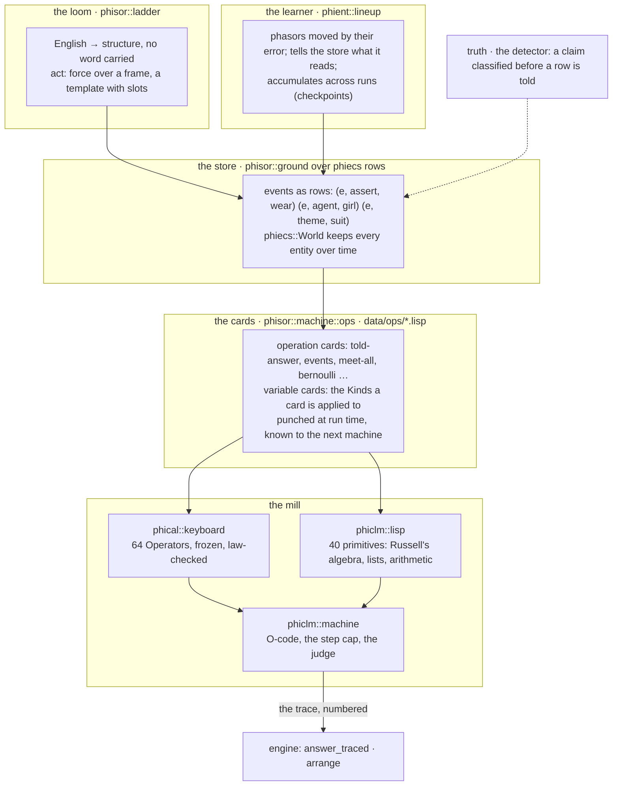

# Note G Runs on the Mill

## Lovelace's Program, Trace and Arrangement in phisor, and the Engine as the Core of the Computation

In Phient's world, a word (w) is a seed: what it relates to, under what conditions (c), grows from it. The Phical paradigm, X ⇒ Y, drives and composes Phient's Phasor Language Models: Phinet, Phiano, PhiTon. Phical stores no point: a word is 32–64 relations, each a complex phasor on a closed circle; meaning is a side effect of pairs of words moving under a condition, and they move by the error of what was expected — toward what came, away from what did not.

### Abstract

Paper 27 set Lovelace's twelve ideas against phisor and left two of them short: the trace of Note G was carried only by the agreement check over the keyboard, and the arrangement of Note D was not done at all. This paper closes both and runs her program. (1) Her Bernoulli table — the first published algorithm — is written as four operation cards in `data/ops/bernoulli.lisp` and runs on phiclm's Lisp: B1, B3, B5, B7 to within 10⁻⁹, with the cycle of her backed cards as recursion and the engine stopping on a division by zero as Menabrea's engine stopped on an impossible order. (2) Every run now leaves Note G's trace: each column fetched from the store (`phisor-rows`, her variable card) and each operation performed in the mill (`phisor-apply`, her operation card), numbered in order with its result — `engine::answer_traced` answers a question and hands the table back beside the answer. (3) `engine::arrange` makes Note D's choice: given several cards for the same operation, it runs each on the same question and store, keeps the ones that agree, and chooses the shortest trace. Then the paper draws the whole: phisor as the core of the computation — the loom, the store, the cards and the mill — with phical the keyboard, phiclm the machine, phiecs the store's rows and phient the learner that fills the store, and says where the balance between what is fixed, what is a card and what is learned sits, and why.

## 1. Her program, as cards

Note G's table computes the Bernoulli numbers in her numbering — B1 = 1/6, B3 = −1/30, B5 = 1/42, B7 = −1/30 — from the relation

> 0 = A0 + A1·B1 + A3·B3 + … + B(2n−1), with A0 = −½·(2n−1)/(2n+1), A1 = 2n/2, and each next coefficient the last times (2n−2k+3)(2n−2k+2)/((2k−1)(2k)).

Her table is a cycle: the cards that compute one term are backed and run again for the next, reading the Bernoulli numbers already found off the store. Written as cards for phisor's mill (`crates/phisor/data/ops/bernoulli.lisp`):

```lisp
(define note-g-a0   (lambda (n) (* -0.5 (/ (- (* 2 n) 1) (+ (* 2 n) 1)))))
(define note-g-coef (lambda (n k) (if (= k 1) n (* (note-g-coef n (- k 1)) (/ (* (- (* 2 n) (- (* 2 k) 3)) (- (* 2 n) (- (* 2 k) 2))) (* (- (* 2 k) 1) (* 2 k)))))))
(define note-g-sum  (lambda (n k) (if (= k n) 0 (+ (* (note-g-coef n k) (bernoulli (- (* 2 k) 1))) (note-g-sum n (+ k 1))))))
(define bernoulli   (lambda (m) (let ((n (/ (+ m 1) 2))) (- 0 (+ (note-g-a0 n) (note-g-sum n 1))))))
```

Four cards; the cycle is `note-g-sum` calling itself and `bernoulli` for the numbers already found. The mill had no division — phiclm's 39 primitives were Russell's algebra, lists and a little arithmetic — so `/` was added, its 40th, refusing a zero divisor as the engine refused an impossible order. The test `note_g_runs_on_the_mill` loads the cards into a machine over an empty store and reads `(bernoulli 1)`, `(bernoulli 3)`, `(bernoulli 5)`, `(bernoulli 7)`:

| her B | the mill | exact |
|---|---|---|
| B1 | 0.16666666666666666 | 1/6 |
| B3 | −0.03333333333333333 | −1/30 |
| B5 | 0.023809523809523808 | 1/42 |
| B7 | −0.03333333333333333 | −1/30 |

each within 10⁻⁹; and `(/ 1 0)` is an error, not a number. The program is not a special case in the code: it is a card file like `core.lisp`, read at every machine's birth, and `converse --ops` lists it beside `told-answer`.

## 2. The trace

Note G's table is as much the trace as the program: operation 1, operation 2 …, each with the variables it read and the column it wrote. phisor's host now keeps that table. Every call the Lisp makes on the host is a numbered [`Step`](../../../phisor/src/machine/engine.rs): a **store read** — `phisor-rows kind`, the variable card, which column was brought to the mill and how many rows it held — or a **mill operation** — `phisor-apply`, the operation card, with its operands and its result, or its fault. `engine::answer_traced` answers a question over what was told and returns the trace beside the answer.

Told *tom was reading a book*, asked *what was tom reading?*:

```text
 1  rows   assert   3 rows
 2  rows   agent    3 rows
 3  rows   theme    3 rows
 →  book
```

Three columns fetched — the predicate under its force, the fixed role, the hole's role — and the algebra between them (`meet`, `domain`, `image`) runs in the Lisp's own primitives, which are not host calls and so not steps: the trace counts what crosses between the store and the mill, which is what her table counted too. A `where` question fetches every preposition column the store holds, and the trace shows each.

## 3. The arrangement

Note D: "In almost every computation a great variety of arrangements for the succession of the processes is possible, and various considerations must influence the selections amongst them." Paper 27 marked this *not done*: the learner's curriculum was arranged by hand, one measured run at a time.

`engine::arrange` is the engine making the choice, within her limit. Given several cards for the same operation — each a `(define told-answer (lambda …))` that replaces the shipped card for one run — it runs each on the same question over the same store, takes the answer most cards agree on, sets aside the cards that disagree, and chooses, among those that agree, the one whose trace is shortest: the fewest columns fetched and operations performed. The test gives it three:

| card | what it does | steps | answer | chosen |
|---|---|---|---|---|
| `wasteful` | the shipped card, with the hole's column fetched a second time | 4 | suit | |
| `shipped` | `image(union-all(roles), domain(meet-all(relations)))` | 3 | suit | **yes** |
| `wrong` | reads the agent off the events instead of the hole | 3 | girl | disagreed |

The engine chose `shipped`; `wrong` is reported by name, not silently dropped; and an empty set of cards is an error, not a choice. This is the whole of Note D at the scale of one question. The arrangement she meant — the order of a long computation chosen for economy — is the same choice over longer traces, and the learner's curriculum (which text, which share, which order; docs 207–217) is the next place to run it: each instalment a card, its measured gain the step count, the next instalment proposed from the record rather than from the writer.

## 4. The engine as the core, and the balance

The user's instruction, 2026-11-08: *her ideas could weave language and anything, and we need to lean more on that — make phisor integrated and the core part of our computation with phiclm and the rest, and find the balance.* Here is the whole as it stands, in her terms.



**Where the balance sits, and why.** Three things could hold the knowledge of how to answer a question: the mill, the cards, or the learner. The day's measurements place each.

- **The mill is fixed and small.** 64 Operators and 40 primitives, their indices and laws frozen. Asked whether it should be 1024, the answer from both the Notes and the code is no: nothing in answering English calls a keyboard Operator yet, six primitives composed answer every question the reader reads, and a new operation is a card. The mill grows only when a measured operation is missing and cannot be composed — the standing rule in phisor's TODO.
- **The cards hold the language's operations.** `told-answer` is a card; so is `bernoulli`; so will be *before*, *who*, a clause filling a role. They are files, read at birth, appended by the run that learns one — the no-data-in-code ruling applied to operators. This is where phisor grows fastest and cheapest: a card is one line, needs no build, and the next machine knows it. The cost is that a card is only as good as the primitives it composes; a card cannot reach what the mill does not offer.
- **The learner holds what no card can write.** Which word follows which, in what register, is not a card — it is 25 to 43 thousand words of phasors moved by their error over 440 thousand sentences, and it accumulates (docs 208–217: 19.7% → 21.6% top-1, 119.6 → 95.3 perplexity; both registers improving). It fills the store the cards read; it does not replace them. Her limit holds here exactly: it follows the analysis it is ordered to perform and anticipates nothing.
- **The loom is the bottleneck, and it is on the cards' side of the balance.** The reader writes about a third of the guide's sentences soundly, and only object questions. Every sentence shape it gains is more store for the cards to answer over. Its word lists are files already; its rules are the next thing to become cards.

So the integration is this: phisor is the engine — loom, store, cards, mill — and the other crates are its parts. phical is the mill's fixed keyboard; phiclm is the mill's machine and the language the cards are written in; phiecs is the store's rows and the world they live in; phient is the learner that fills the store and the lineup that measures it; philog reasons over what the store holds; phiano is one app on the engine. The balance tips toward the cards and the store, away from the mill, and that is the Analytical Engine's own balance: a fixed mill of modest size, an unbounded supply of cards, and a store that grows with what the machine is told.

## 5. What paper 27's ledger now says

| her idea | was | now |
|---|---|---|
| the trace: every operation accounted for | `agree` over the keyboard; the records | **`engine::answer_traced`**: every run of the language leaves Note G's table |
| arrangement for economy | not done; the human arranged | **`engine::arrange`**: the engine chooses the shortest agreeing trace |
| backing the cards: cycles | recursive cards | **her own program runs**: `bernoulli.lisp`, B1–B7 |
| stops on an impossible order | Faults | and **division by zero** in the mill |

Twelve ideas, twelve done; the arrangement at the scale of one question, with the curriculum named as its next scale.

## Status

2026-11-08, 00:50. `phisor::machine::engine` (`Step`, `answer_traced`, `arrange`, `Arrangement`, `Tried`), `data/ops/bernoulli.lisp`, phiclm `/`. phisor 37 machine and lovelace tests green. Lovelace's Notes are in the corpus whole: `crates/phiano/data/corpora/lovelace/sketch_of_the_analytical_engine.txt` (27,284 words, Fourmilab's transcription of the 1843 *Scientific Memoirs* text).

## Sources

- A. A. Lovelace, "Notes by the Translator", in L. F. Menabrea, *Sketch of the Analytical Engine Invented by Charles Babbage*, *Scientific Memoirs* vol. 3 (1843). Note D on arrangement; Note G for the Bernoulli table and the limit.
- Paper 27, *The Cards and the Mill*, for the twelve ideas and the earlier ledger.
