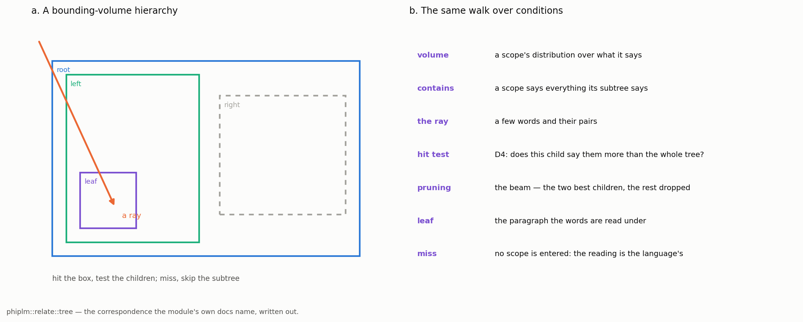

# Sixteen Trees, and the Bounding-Volume Hierarchy Among Them

## What the system holds, family by family, and where a ray fits

In Phient's world, a word (w) is a seed: what it relates to, under what conditions (c), grows from it. The Phical paradigm, X ⇒ Y, drives and composes Phient's Phasor Language Models: Phinet, Phiano, PhiTon. Phical stores no point: a word is 32–64 relations, each a complex phasor on a closed circle with a count; meaning is a side effect of pairs of words moving under a condition.

### Abstract

A user told the system an eighty-six-token story of their own writing and asked which trees the system actually holds, and where a bounding-volume hierarchy sits among them. The answer is sixteen, and it is not a taxonomy written for a paper: they are enumerated in `phiano/src/bin/forest/trees.rs`, each with a node, a child relation, a ray, the module that holds it, and the way a BVH maps onto it. This paper takes them one at a time against that code, in six families: *drawn through*, *built by splitting*, *read at every level*, *the condition itself*, *neighbourhood rather than nesting*, and the machine's own. The measurements are `bin/forest`'s of 2026-10-12: 86 tokens and 58 distinct words, told as the single paragraph `scope:text/story/ch2/p1` into *Emma*'s 2,315 paragraphs — 2,314 without it — 2,969,690 rows counted and 69,896 words in the tree; 27 casts; 83 relations told under a condition; 563 edges; 16 words *Emma* never heard; 11 conditions holding a post at one reading; 64 strand levels; 1 root. The correspondence to a real BVH is then written out term by term, and three breaks are stated: a box contains a point or does not, while a distribution only makes a word more or less likely; a BVH's sibling volumes are disjoint by construction, while scopes overlap; and a BVH is built to make a query cheap, while the scope tree is built by what it was told, so a badly-shaped text gives a badly-shaped tree. Three of the sixteen are weaker than their entry claims.

## 1. The question, and why it is answerable

The question came with a story: eighty-six tokens, in capitals, with its own misspellings. One of the three things asked of it was structural — *which sixteen trees does this hold, and where is the bounding-volume hierarchy?* It is answerable because the list is part of the system rather than a reading of it: `trees.rs` holds sixteen entries of six strings each, and `bin/forest` attaches to nine of them a count measured on the story, so the enumeration can be checked against the code each entry names and against the run's numbers.

Each entry below is read against the module it names — node, child, ray, and, where `FOREST_FACTS.md` gives one, what this story measured — and where the code does not support it, §9.4 says so. None of this is understanding: that a word's meaning is its use (§43) is what the apparatus tests, not what it has shown. Papers 25 and 26 make the positive case for the paradigm; docs/155 is the short version of this measurement.

*Figure 1. The sixteen as `trees.rs` enumerates them: each card names the node and the ray, the colour is the family of §2, the corner figure is what this story measured. Nine carry a number.*

## 2. What makes a family

What sorts a tree into a family is **what the walk is for** — not what the node holds, which runs from a scope to a span of tokens to a value on a tape. The families are not disjoint: tree 3 both builds by splitting and is read at every level, because 4 reads it.

**Drawn through** (1, 9, 16). A query enters at the top and is admitted or refused at each step by a test against the node, so most of the tree is never visited; the walk creates nothing.

**Built by splitting** (2, 3, 8). The walk *is* the construction — a directory read, a span divided where division pays, an oracle asked. In BVH terms: the scene graph, the builder, a lazily-built hierarchy.

**Read at every level** (4, 5, 6, 13, 15). The same object exists at several resolutions at once and a reading mixes them, the coarse answering where the fine is silent. In BVH terms: levels of detail, the node stack, the mip chain.

**The condition itself** (7, 12). The node is not a container but *the condition under which other things are read*: nesting is `told under`, not `contains`, and there is no geometry.

**Neighbourhood, not nesting** (10, 11). There is no parent: a word's kin are the words told the same company, and a word's channels are the angles it has moved on. Both are trees only by courtesy.

**The machine's own** (14). One structure belongs to the differentiable engine, not to the language; its entry begins "not a BVH".

## 3. Drawn through

### 3.1 · The scope tree

The node is a scope — a text, a chapter, a paragraph, and a word too, since a kind and a condition are words. A child is told by a `within` row and nothing else: `add_rows` keeps rows of kind `within` whose subject starts with `scope:`, and a scope never a child is a root. A scope holds its subtree by the telling: `prose::paragraph` tells each word occurrence `within` every scope on its path. The ray is a few words and their pairs; `cast_under` walks from the roots down, scoring each child by `attraction` (how many asked conditions it says *and* at most half its siblings say, D3, plus the summed `ln((count + base) / (total + 1) / base)` of its smoothed `says` counts, D4) and entering the best `beam`. The volume is the distribution, the hit test is D4's movement in nats, the pruning is the beam.

Measured: **27 casts**, six words each taken three apart, into *Emma* alone with `beam = 2`; two went to the story's own earlier chapter, 25 into *Emma*. "it was on a sunday afternoon" entered `ch04/p8`, whose own words are *and, mrs, goddard, had, miss, a*, with 27 conditions said along the path and 6 by the leaf alone, attraction 0.055. A cast made of function words finds paragraphs full of function words.

### 3.2 · The code tree

The node is a crate, a module, a file, a function; the child relation is the compiler's own nesting read as `within` rows. `code::files::read_files` walks every `.rs` under a directory, parses it with `syn`, and for each top-level function emits a `within` row to every component of the file's path, so `data/above/above_i64.rs` becomes three nested scopes holding the function. The ray is a function's words, cast to find where a new function belongs. It is the same tree as 3.1 over a different text: `relate::tree` consumes `within` rows and knows nothing of prose, and a grammar rather than a blank line supplies them, so a boundary is not guessed. Measured on this story: nothing; it is prose. Its number is docs/126's — on our own crates, 713 files and 25,900 rows, the levels reading came out *worst* of three (0.138 against a flat 0.149, prior 0.169), and on Phi-4's 253 answers the cast changed no answer.

### 3.3 · The forest

The node is a whole told text with its own root, and the child relation is the one the tree lacks: the roots stand beside each other under no parent — `ScopeTree::roots()`, the scopes never a child. The ray is a story cast into every root at once, visible in `cast_under` as a special floor: at the root level the threshold is `f64::MIN`, so every root is scored and the beam alone decides. As a BVH it is the top-level structure over several scenes, a BVH of BVHs. Measured: **2,314 *Emma* paragraphs** beside the story's own, and **1 root** — `relate::scopes` makes every path component a scope and the corpus lives under one directory, so `text/emma/…` and `text/story/…` are both within `scope:text`. This telling has no forest in it, only a single-rooted tree.

## 4. Built by splitting

### 4.1 · The text tree

The node is a directory, a `.txt` file, or a blank-line paragraph; the child relation is the file system's own nesting, with the paragraph a leaf. `prose::walk` sorts each directory's entries, recurses, and for a `.txt` file splits on a blank line, normalises whitespace, and emits `p1`, `p2`, … under the file's stem. There is no ray: reading a text builds this tree, and every prose `within` row originates here. In BVH terms it is the scene graph the volumes are fitted to; a builder groups the objects the scene has, and here the blank lines are those objects. Measured: the story's own scope is **`scope:text/story/ch2/p1`**, one paragraph and one leaf, inside a text tree of **2,315 paragraphs**.

### 4.2 · The strand's cut tree

The node is a span of tokens, `start..end`; a child is one of the two halves a division makes, the division being the one gaining the most nats against the parent's distribution. `Cut::divide` scores a candidate as the span's code length as one segment minus the two halves' as two, minus the cost of saying where the cut falls (`ln(n − 1)`) and the two tree flags it adds (`2 ln 2`); a segment's code length is its tokens predicted in order with Witten–Bell escape, centred on the parent's distribution. There is no ray: the tree is built once, down to the single token, then *pruned*, a span's `value` being its own gain plus its children's, floored at zero.

As a BVH this is the *builder*, the sharpest correspondence of the sixteen: an SAH build also enumerates candidate splits, scores each by a cost model, takes the best, recurses, and stops where no split beats a leaf. The difference is the cost — expected ray–box tests there, a description length in nats here. Measured: **86 tokens**; the tree's size follows from the code, not the run — the unit test fixes sixteen tokens at fifteen divisions, so eighty-six give eighty-five and 171 spans, arithmetic on an invariant.

### 4.3 · The quest's walk

The node is a word asked of an oracle; a child is a word the answer named, at depth + 1. `push` adds a spelling if its depth is within `self.depth` and it has not been asked; `next_word` pops from the *front* of a `VecDeque` and records it in `asked`, so a cycle in the language is not a loop. The ray is the frontier: the walk goes outward from the seed, breadth first, bounded by `DEFAULT_DEPTH = 3` and `DEFAULT_BUDGET = 64`. As a BVH it is the build queue of a hierarchy built lazily — a node exists once something asks for it, and the structure is the transcript of what was asked, which `Step` keeps verbatim. Measured: nothing; no quest was run. Its child relation is not containment in either sense: a word the oracle named is not inside the word asked, and the frontier is what it has in place of a volume.

## 5. Read at every level

*Figure 2. `bin/strand` on this story with* Emma *as the prior: the units of each of the sixty-four levels, spaced geometrically, and the nats each level gains over the one above. Trees 3, 4 and 5 in one picture.*

### 5.1 · The sixty-four levels

The node is a unit of one level, named by a codon: `AAA` the word, `TTT` the whole story. A child is the cut tree pruned to `m(k)` units, computed rather than declared — `units[k] = round(n^(j/63))`, clamped to at least one more than the level above and at most `n`. `level(k)` is `cut.units_at(units[k])`: the spans alive after that many divisions. The ray is a word asked at a level: `unit_of(k, i)` binary-searches that level for the span holding token `i`. As a BVH these are levels of detail, one tree read at the resolution the query can afford; `informative_level` returns the finest level the story's information supports. Measured: **64 levels** in `levels.tsv` — but sixty-four is `phinet::codon::CODONS`, a constant of the code, so the measurement is only that the file has sixty-four rows. What the run measured about the *story* is Figure 2; docs/142–145 are the record.

### 5.2 · The reading path

The node is a unit on the path from the word up to the whole story; the child relation is the unit's parent in the cut tree. The ray is the word being read, and what makes this a tree of its own rather than a view of 5.1 is what happens to the ancestors: they are not chosen between, they are *mixed*, and the weights are counted. `Scopes::path` computes each token's share in every scope of the chain and in the prior and hands the lot to `mixture_weights`; with `left_out` set, the unit's own tokens are the rows, each taken out of every count it is in — deleted interpolation. `read_path` returns `Σ_j π_j · c_j(w)/n_j + π_prior · prior(w)`. A parent is two children, so a weight serving the parent carries the sibling's words into each child's reading, and docs/148 measured that this costs the tree its place. As a BVH this is the node stack, except that the whole stack is read. No count is defined.

### 5.3 · The tree of knowing's levels

The node is a condition — a scope, the last word, the last pair, or a word under a scope. The child relation is *finer than its parent*, in the order `Knowing::next` fixes: each scope of the path a cast found, coarse to fine; then the last word, everywhere and under each inner scope; then the last pair, the same way. The ray is the words said so far, and what comes back is the next word's distribution. In `read_levels` a condition must first earn a post against the prior — `Σ x ln(x/y)`, at least `tau` nats (D2) — and one that does moves the reading from where the levels above arrived at, by `ln(d/p)` per value. A level never told moves nothing, so a path never seen reads as its nearest told ancestor. As a BVH it is the traversal's *result* turned into an answer: a BVH's comes from the leaf, while here every node on the path contributes by a counted weight. Measured: **11 posts**, the conditions holding a post at *one* reading — that of what follows the whole story, not an average.

### 5.4 · The sphere's degrees

The node is a degree `l` of the real spherical harmonics; its children are the `2l + 1` orders, tied to one weight. The arithmetic is why sixty-four keeps recurring: `Σ(2l+1)` for `0 ≤ l < 8` is `8² = 64`, so the same channels that are a Fourier series on the circle are a band-limited function on the sphere, packed as `k = l² + l + m`. The ray is a word read at a lower degree: `degree_gate(coeffs, L)` zeroes every coefficient whose `degree_of(k)` exceeds `L`. As a BVH these are mip levels, the coarse a bound on the fine, and the bound is literal in `degree_energy`. The entry's "tied to one weight" is exact under `Tie::Sphere`, where `Fno::new` makes one slot per degree; under `Tie::Anisotropic` the grouping is finer, so several weights share a degree. The entry names both ties and describes the first. No count is defined.

### 5.5 · The Fourier modes

The node is a mode of the operator's spectral weight; the child relation is the cutoff — the modes kept below it, the rest zeroed by the mask. `Fno::new` builds the mask once (on the circle, `m < modes || m + modes >= s`, keeping the low signed frequencies at both ends of the FFT) and initialises `R` with every masked slot zero; `mask_modes` re-imposes it, because an optimiser step does not. The ray is a function passed through: low modes carry it, and a high mode must earn its place. As a BVH this is the coarse bound again, in frequency, and `at_resolution` turns it into a hierarchy, since the kept low frequencies exist at every power-of-two `space`. No count is defined; what the story measured of the operators belongs to paper 27. Of 84 positions the Joint FNO reads the next word first at 6 and the mirror also at 6; read backwards by the conjugate filter, never trained for it, the FNO is first at 6 and the mirror at 4.

## 6. The condition itself

### 6.1 · The condition tree, X ⇒ Y under c

The node is a word, and a condition which is itself a word. A child is a condition told under another condition — the recursion the paradigm names, and the reason a scope, a kind and a condition are all words in one lexicon. `Under` maps `(condition, word)` to a list of `(target, weight)`, `relate` adds to it, and `calls_for` returns them heaviest first. The ray is a word plus the condition it is read under, and the fallback is D4's nesting at its simplest: the condition's edges when it has any for the word, otherwise the word's plain edges. As a BVH these are nested volumes with no geometry — the enclosure is `told under`, and there is no extent to intersect. Measured: **83 relations told under a condition**, under the two the story turns on: `it` under `rising` calls for `was` and `finally`, under `resolving` for `suddenly`; `a` under `rising` calls for `sunday` and `great`. Every weight is 1.0, which is what a single telling gives; 83 counts distinct entries, not tellings.

### 6.2 · The helix

The node is a directory of the facet's tree, coded as a codon; the child relation, as the entry has it, is the channel's place on the helix — sixty-four codons, three bases of four. The ray is `ls`, `grep` and `cat`: the file system is the query language. `codon(k)` is `k` in base four over `ACGT`, the hexagram is `k`'s six bits, and `(x, y, z)` is the codon's place on a B-DNA helix at 10.5 codons per turn and 0.34 nm rise, so every code is also a position in space. The layout is `strands/<aa>/<word>.dna` beside `codons/<CODON>/words.tsv`, and `write` and `read` round-trip the lexicon exactly. The entry calls this a BVH written to disk, the path naming the node. It is the weakest of the sixteen: the two indexes are each one level deep, and the sixty-four codons are a *flat* set — `ACG` does not hold `ACT`, and nothing in `helix::code` arranges them into a hierarchy. A path walk through a one-level index is a hash lookup with a slash in it. The helix is an addressing scheme in which a position in a space is a path on a disk; that is not a BVH. No count is defined.

## 7. Neighbourhood, not nesting

### 7.1 · The kin tree

The node is a word; a child is not nesting but neighbourhood — the words told the same company. `build_kin` makes two posting lists, the right company from each word's `next` table and the left from the pairs a word closes (`pair:u w`, off the `says` table); `kin(word)` accumulates the cosine on each side against every word sharing a context, and kinship is the mean of the two, closest first. A word with no kin has none; nothing is declared. This is family resemblance (§67) with counting in place of looking. The ray is a word never told after the last one: `kin_base` mixes the kin's `next` distributions, each smoothed toward the prior, weighted by kinship. As a BVH it is the fallback when a ray misses every volume. Measured: **16 words *Emma* never heard** — finally, downed, exceeded, threshold, onto, ego, andn, position, launching, american, occured, evertihng, outcomes, loveful, machine, insulated: two misspellings, one coinage, the rest later English. After "…has exceeded the", with `of` as the word that must follow, the slot offers *rest* (−5.6), *idea* (−5.8), *sort* (−6.0). The system does not know what `threshold` means. It knows the shape of the hole.

### 7.2 · The phasor's channels

The node is a word; its children are sixty-four relation channels — `MAX_KINDS` in `phiecs::relation`, `CHANNELS` in `phical`, the same number twice — each an angle, an evidence count and an amplitude `ln(1 + evidence)`. The ray is two words compared: `agreement(a, b, kind)` is `cos(θ_a − θ_b)` and is `None` when either side has no evidence on the channel, because silence is not agreement; `resonance` is the agreement across every channel both have moved. `couple` is the whole of learning in the world: move the channel a step toward the target the short way round, count it, update the amplitude. As a BVH this is the node's *bounds*, if a BVH stored orientation instead of extent — a box is an extent in a metric space, a phasor a direction on a circle with no space around it.

Measured: **58 words** and **563 edges**, with kinds `before` and `after` for each adjacent pair and `near` for every pair within a stretch of six; `it` on `near` sits at θ 5.056, amplitude 3.434, evidence 30. The most resonant pairs are `the · of` at 0.973, `holding · launching` and `moved · love` at 0.952, `senses · action` at 0.948 — the first two function words everywhere together, the rest pairs the story put in the same company.

## 8. The machine's own

### 8.1 · The operator's tape

The node is a value on the autograd tape — a tensor, an optional gradient, the `Op` that made it, and whether it requires one. A child is that operation's inputs: `Add`, `ModeMix`, `Fft`, `Tie` and the rest of the enum. The ray is the backward pass: `backward` clears every gradient, seeds the scalar output with one, then iterates from the output index down to zero, accumulating into each node's inputs. The entry's first clause is "not a BVH but the same discipline: a node knows its children, and the walk visits each once". That is right, with one qualification: a tape is a DAG, not a tree. A value used by two ops has two parents, and the reverse iteration is correct *because* indices are monotone — a node's inputs sit earlier, so when the loop reaches `i` every contribution to its gradient has been added. The single visit is bought by the topological order, not by the structure. No count is defined: the tape knows no words.

## 9. The bounding-volume hierarchy itself

### 9.1 What a real one is

A bounding-volume hierarchy is a tree over a scene's primitives in which every node stores a **volume**, usually an axis-aligned box, enclosing its children's and therefore every primitive beneath it. **Contains** is geometric and total: a point is inside a box or it is not.

A query is a **ray**. The traversal tests it against a node's box; on a **hit** it descends and tests the children; on a **miss** it skips the whole subtree, which is the point. The **hit test** is a slab intersection; **pruning** is the miss. A **leaf** holds a few primitives, and only there is the real intersection computed. The **build** decides how well this works: the surface-area heuristic scores a split by the expected cost of its two children — their surface areas, times the primitives each would hold — takes the best, and stops when no split beats a leaf. Nothing in the scene dictates the grouping.

### 9.2 The correspondence

| BVH | the scope tree |
|---|---|
| volume | a scope's distribution over what it says |
| contains | a scope says everything its subtree says |
| the ray | a few words and their pairs |
| hit test | D4: does this child say them more than its parent does? |
| pruning | the beam — the best children kept, the rest dropped |
| leaf | the paragraph the words are read under |
| miss | no scope is entered: the reading is the language's |

*Figure 3. A bounding-volume hierarchy beside the same walk over conditions. The correspondence is the comment at the top of `phiplm::relate::tree`, where it has stood since docs/126.*

Six of the sixteen are parts of this picture rather than separate structures: 1 is the hierarchy, 3 the builder, 4 and 13 its levels of detail, 5 the node stack, 16 the top level over several scenes.

### 9.3 Where it breaks

**A box contains a point or it does not; a distribution only makes a word more or less likely.** A ray–box test is a predicate: yes or no, exact, and a wrong answer is a bug. The cast's test is a quantity in nats with no zero that means *outside*. Every scope says something about every word, because every scope's distribution is smoothed toward its parent's and the parent's toward the prior, so there is no miss. Attraction across the 27 casts runs from 8.763 to −40.963, and the cast at −40.963 still returned a leaf: "great position and he was in" was drawn into `text/story/ch1/p1` and read there, where a ray would have missed the scene. A miss has to be *imposed*, and in this run none was — `bin/forest` calls `cast_under` with `min = f64::MIN`, so the beam alone pruned. `Knowing::next` imposes one afterwards — a leaf counts as heard only if it says `HEARD` of the asked conditions by itself and all of the last pairs — which is a test applied after the walk, not a property of it.

**A BVH's sibling volumes are disjoint by construction; scopes overlap in what they say.** An SAH builder partitions primitives: each goes to exactly one side, which is what makes the expected-cost model mean anything. Two sibling paragraphs say almost all the same words — the facts file counts `to` in 1,630 of *Emma*'s paragraphs, `and` in 1,524, `the` in 1,486. The tree's answer is D3: a condition said by more than half the siblings is not counted as said. That is a *correction* for overlap, not an absence of it, and it has a cost: where the asked words are nearly all function words, D3 suppresses most of them and the cast lands on whichever paragraph is dense in the few that survive.

**A BVH is built to make a query cheap; the scope tree is built by what it was told.** The builder's freedom is to group primitives however minimises expected cost. The scope tree has none: its shape is the `within` rows, from the directory, the file and the blank lines. One enormous paragraph gives a two-level tree with nothing to choose between; ten thousand one-sentence files give scopes so small that the attraction differences are noise. A badly-shaped text gives a badly-shaped tree, and no care in the traversal recovers it. Tree 3 exists because of this: where no directory gives the levels, the strand builds them by a cost model.

### 9.4 Three entries the code does not support as written

- **Tree 9** says the node includes "a token of its body". The `within` nesting in `code::files` runs directory → file → function and stops there; a function's name-words, types and calls are rows *about* it, not scopes inside it.
- **Tree 12** calls the helix "a BVH written to disk". Its two indexes are one level deep and the sixty-four codons are a flat set with no containment among them.
- **Tree 16** measured **1 root**: *Emma* and the story share `scope:text`, so this telling has a single-rooted tree and no forest.

Two numbers read narrowly: tree 4's "64 levels" is the row count of a file whose length is a constant of the code, and tree 6's "11 posts" is one reading's, not an average.

## 10. What the sixteen have in common

**A node holds what its children hold.** In the scope tree it is literal: every row is told `within` every scope on its path, so "a scope says everything its subtree says" is an invariant of the telling rather than a claim about it. A span's counts are its two halves'; a degree's energy is its orders'; a tape value is a function of its inputs. In the condition tree the holding is `told under`; in kin and the phasor's channels there is no parent at all, which is why §7 called them trees only by courtesy.

**Coarse to fine, the coarse standing behind the fine.** Every reading is made at the lowest level that has something to say. `read_levels` moves the prior by the outermost condition and then moves what that arrived at; `Strand::read` escapes from a span to its parent and from the root to the prior; `Under::calls_for` falls back to the word's plain edges; `degree_gate` drops the fine degrees; `kin_base` answers where the word was never heard. The detail a level cannot predict is dropped by the structure, not by an encoder — paper 26's argument, in sixteen instances.

**Every query is the same walk.** Enter at the top, test, descend into what the test admits, keep the path. The cast does it over scopes, the level lookup over spans, `read_levels` over conditions, `backward` over the tape in reverse, the quest over a frontier of words. What is tested changes — a movement in nats, a token index, a post against the prior, a gradient — and the walk does not. That is why §9.2's correspondence is worth drawing though §9.3 breaks it: the walk is shared, the predicate is not.

The system holds sixteen structures of this shape; thirteen are what their entry says; nine gave a number on one eighty-six-token story; and one is a bounding-volume hierarchy in five parts and not in three. None of it is evidence of understanding: the casts were drawn by function words, the readers put the right next word first at 6 of 84 positions, and sixteen of the story's words were never heard. §43's claim is what the structure is built to test; surveyability (§122) is what it keeps.

## Reproducing this paper

From `phinet/crates/phiano`:
- `cargo run --release --bin forest -- data/text --story text/story/ch2 --out data/forest/forest.json`
- `cargo run --release --bin strand -- data/text/story/ch2.txt --prior data/text/emma --out data/forest/strand`
- `python3 docs/papers/figs155.py && cd docs/papers && python3 build_forest_papers.py 29_SIXTEEN_TREES`

## References

**The structure**, tree by tree: `phiplm::relate::tree` (1, 9, 16), `prose` (2), `prose::strand` (3–5), `relate::levels` and `relate::path` (6), `relate::kin` (10), `phiplm::code` (9), `phiecs::condition::Under` (7), `quest` (8), `phasor` (11), `phiano::helix` (12), `phifno::sphere` (13), `phinet::tensor` (14), `phical::operator::fno` (15), `bin/forest`.

**Bounding-volume hierarchies.** Clark (1976), *Hierarchical geometric models for visible surface algorithms*, CACM 19(10); Rubin and Whitted (1980), *A 3-dimensional representation for fast rendering of complex scenes*, SIGGRAPH; Goldsmith and Salmon (1987), *Automatic creation of object hierarchies for ray tracing*, IEEE CG&A 7(5).

**Smoothing, description length, operators.** Witten and Bell (1991), *The zero-frequency problem*, IEEE Trans. IT 37(4); Jelinek and Mercer (1980), *Interpolated estimation of Markov source parameters*; Rissanen (1978), *Modeling by shortest data description*, Automatica 14(5); Li et al. (2021), *Fourier neural operator for parametric PDEs*, ICLR. **Wittgenstein.** *Philosophical Investigations* (1953), §§43, 67 and 122, paraphrased and cited by § only. **Phient's own record.** Papers 25–27; docs 126, 142–145, 149, 152–153, 155; and `FOREST_FACTS.md`.

