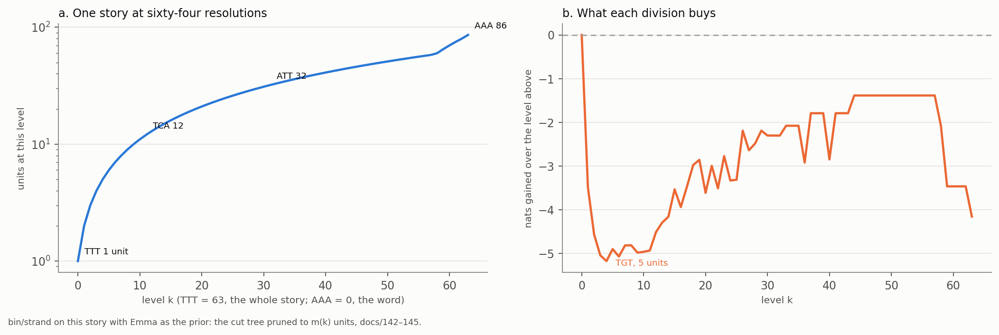

# The Strand: One Story at Sixty-Four Resolutions

## The Cut Tree, the Sixty-Four Levels and the Reading Path, Over a Single Text

In Phient's world, a word (w) is a seed: what it relates to, under what conditions (c), grows from it. The Phical paradigm, X ⇒ Y, drives and composes Phient's Phasor Language Models: Phinet, Phiano, PhiTon. Phical stores no point: a word is 32–64 relations, each a complex phasor on a closed circle with a count; meaning is a side effect of pairs of words moving under a condition.

### Abstract

Paper 28 read one eighty-six-token story against the scope tree *Emma* was told into, where the levels — text, chapter, paragraph — were given by the directory. This paper takes the three trees that build the levels when no directory gives them: the strand's cut tree, the sixty-four levels read off it, and the reading path up from a word to the whole. A text is divided where dividing shortens its description — the span's code length as one segment, less the two halves' as two, less what it costs to say where the cut falls — so the boundaries are drawn by the information each division gains against a prior, not by grammar. The pruned tree's leaves are the units the text's information supports; sixty-four levels, named by the codons `AAA` (the word) to `TTT` (the whole), are read off the built tree at resolutions spaced geometrically from one unit to one per token. A unit's signature is what it says beyond its parent, D4's `c · ln(p_unit / p_parent)` per word; and docs/148 found the honest way to read it, the unit and all its ancestors and the prior as one mixture with weights counted for the unit, not a chain down the tree. The measurements are `bin/strand`'s of this story with *Emma* (198,124 tokens) as the prior: 86 tokens, 58 distinct words, 85 divisions. The finding is stated plainly. Against *Emma* the story's information supports **one unit**: dividing it shortens its description by 0.0 nats, and every one of the sixty-four levels gains *negative* nats over the level above it, from −3.485 at two units to −5.176 at five. The levels are still read, and at twelve and thirty-two units the story's own beats appear — but the divisions are by information, so `sunday afternoon` is split down the middle, and the middle of the story, whose vocabulary *Emma* never heard, is left in one undivided block of forty-seven tokens. No understanding is claimed.

## 1. The ask: a text's own levels

Paper 26 §8 and docs/142 set the problem. A Phasor Language Model abstracts a language by its tree of conditions: every word is told under the scopes it was used in, each scope is a distribution over what was said there smoothed toward its parent's (D4), and a reading is made at the lowest level that has something to say, the levels above standing behind it. Each level is a model of its own. Paper 28 showed all of this at work over *Emma*, where the levels came free with the text — `read_tree` walks the directory, and the nesting it finds is the nesting it tells.

What was missing was a text that gives no nesting. A talk is one file; a story the user writes in a single paragraph is one scope. Between a word and a whole story lie the uses of every level in between — a pair, a phrase, a clause, a sentence, a turn, a section — and nothing in the file marks them. The strand (`phiplm::prose::strand`) finds them, and it finds them as information maximisation made exact: the text is divided where dividing shortens its description, the divisions are kept where they pay for themselves, and sixty-four levels are read off the result. This paper is that apparatus on one story, with the honest result reported rather than the hoped-for one.

## 2. The story

One story was told to the system, once, by the person who wrote it (quoted here as paper 28 quotes it, unaltered):

```
IT WAS ON A SUNDAY AFTERNOON WHEN IT FINALLY DOWNED ON OUR GENTLEMAN THAT HE
HAS EXCEEDED THE THRESHOLD OF HOLDING ONTO HIS EGO ANDN HAPPENED TO BE IN A
GREAT POSITION AND HE WAS IN THE PROCESS OF LAUNCHING HIS BUSINESS WITH HIS
AMERICAN COUNTER PARTS IN THAT MOMENT IT SUDDENLY OCCURED TO HIS WITTY SENSES
THAT SOMEHOW EVERTIHNG HAD ALWAYS WORKED FOR THE BEST OUTCOMES AND THAT MOVED
HIS HEART TO BE A STRONG AND LOVEFUL MACHINE THAT INSULATED HIS ACTION THAT
LOVE.
```

Eighty-six tokens, 58 distinct words. The reader lower-cases and changes nothing else: the misspellings `andn` and `evertihng`, and the coinage `loveful`, enter the lexicon as the words they are. Sixteen of the 58 words *Emma* never heard — among them `finally`, `downed`, `exceeded`, `threshold`, `launching`, `american`, `occured`, `outcomes`, `machine`, `insulated` — a fact that paper 28 measured against the scope tree and that governs, below, where the strand can and cannot cut. The prior against which the whole story is read is *Emma*, 198,124 tokens under `data/text/emma`, counted and Laplace-smoothed so that a word the prior never saw still keeps a share (`strand::prior`). That share is what makes a story's own vocabulary informative at the top of the strand.

## 3. The cut: dividing by information, not by syntax

The strand's cut tree (tree 3 of docs/155) is the *builder* of the levels, as the surface-area heuristic is the builder of a bounding-volume hierarchy: a top-down split that minimises a cost. Here the cost is a description length, and the correspondence to information maximisation is exact (docs/142–145; `prose::strand::cut`).

**The code.** A segment's description length is its tokens predicted in order with Witten–Bell escape (PPM method C) toward the parent's distribution: `p(t) = (c(t) + T · p_parent(t)) / (i + T)`, with `T` the types seen so far. This is the breadth smoothing the levels already use (docs/131), so no new knob enters.

**The division.** Dividing a span saves its code length as one segment, minus the two halves' as two. It costs what it takes to *say*: two tree flags (`2 ln 2`) and where the cut falls. Where is coded with the story's own marks as the codebook — one bit for "after a mark the text wrote" (a full stop, a comma), then a uniform choice within that class, `ln(n − 1)` at worst — so a cut is cheaper where the text already marked one, and nothing is assumed about which marks. A division is worth making when the save exceeds the cost. Information maximisation and minimum description length are one criterion here.

**The tree.** Every span's best division depends only on the span and its parent, so the whole tree is built first, top down, until every word stands alone — 85 divisions for this story. It is then pruned bottom-up by minimum description length: a division's value is its own gain plus the value of what it unlocks below, clipped at zero. **The pruned tree's leaves are the units the text's information supports** (`Cut::supported`). The first division alone need not pay for the tree to support many units — on the user's earlier talk (docs/142) the first division lost 2.6 nats but unlocked 22.0 below it, so the talk supported seven units where stopping at the first loss would have said one.

The division is therefore by information against the prior, and never by syntax. It will cut where the words begin to repeat differently, which often but not always coincides with a clause or a phrase; §7 shows the cases where it does not, on this story.

## 4. Sixty-four levels, named like DNA

The built tree holds a division at every count of units from one to eighty-six. The strand reads sixty-four of them. Level `k` is the division at `m(k)` units, spaced geometrically from one unit (`TTT`, `k = 63`) to one per token (`AAA`, `k = 0`), with one unit more per level wherever the geometry is slower than that (`Strand::units`). The order the levels are read in is the pruned tree's first, most information unlocked first; below the supported level, where no division pays, the largest unit is divided first at its best cut.

The number sixty-four is not discovered in the text; it is a resolution ladder chosen to match a code the system already carries. A codon is `k` in base four over the bases `A C G T`: `k = 16a + 4b + c`, so `AAA` is 0 and `TTT` is 63 — the same six bits a hexagram reads as its six lines, bottom first (`phinet::codon`). The code is shared with phiano's helix, where codon `k` is a word's relation channel `k`; here codon `k` is level `k` of a text. The hexagram glyph is carried alongside for the eye: `䷀` for `AAA`, `䷿` for `TTT`. Read honestly, "64 levels" is the length of a ladder fixed by the code, not a count the story supports — paper 29 §9.4 says as much — and what the story supports is reported in §7.

## 5. What a unit says: its signature

A unit is a scope — a span of tokens with its own count table, smoothed toward its parent's. What it *says* is not its text but its signature: the words it says beyond its parent, by D4's `c · ln(p_unit / p_parent)`, taken with a positive score and listed in the order the unit first says them (`Strand::signature`). This is the same quantity paper 28 uses to decide what a paragraph adds to its chapter; the strand reads it off a unit of its own making instead of a told scope.

For the whole story — `TTT`, whose parent is the prior itself — the signature is what the story says most beyond *Emma*:

> **finally downed that exceeded threshold his**

Five of these six are words *Emma* never heard or barely heard; the sixth, `his`, the story says six times in 86 tokens. A signature is what a beat carries that the beat above it did not, so a short unit's signature can be function words, and a unit of novel vocabulary carries that vocabulary. Nothing in a signature is generated: every word is the story's own.

## 6. This story at sixty-four resolutions



*Figure 1. Left: the units per level, from `TTT` (1 unit) through `TCA` (12) and `ATT` (32) to `AAA` (86), log scale — the cut tree pruned to `m(k)` units. Right: what each division buys, the nats gained over the level above; every value is below the dashed zero line, the trough at `TGT` (5 units, −5.176). `bin/strand` on this story with *Emma* as the prior (docs/142–145).*

The ladder, in nats gained over the level above (`levels.tsv`):

| codon | level `k` | units | nats over the level above | per token |
|---|---|---|---|---|
| `TTT` ䷿ | 63 | 1 | 0.000 | 0.000 |
| `TTG` ䷾ | 62 | 2 | −3.485 | −0.041 |
| `TTC` ䷽ | 61 | 3 | −4.568 | −0.053 |
| `TGT` ䷻ | 59 | 5 | −5.176 | −0.060 |
| `TGA` ䷸ | 56 | 8 | −4.818 | −0.056 |
| `TCA` ䷴ | 52 | 12 | −4.935 | −0.057 |
| `GTT` ䷯ | 47 | 17 | −3.939 | −0.046 |
| `GGA` ䷨ | 40 | 24 | −2.773 | −0.032 |
| `GAA` ䷠ | 32 | 32 | −2.303 | −0.027 |
| `CAA` ䷐ | 16 | 48 | −1.386 | −0.016 |
| `AAA` ䷀ | 0 | 86 | −4.159 | −0.048 |

*Table 1. Selected levels. The column is `Strand::gain(k)`, the information level `k` adds beyond level `k + 1`, summed over the divisions between them, net of their cost. Every value is negative.*

The levels divide the story into beats, each in the words it says beyond the beat above. The spans are from `story.dna`; the signatures are the lines of `story.md`.

**`TTT` ䷿ — the whole (1 unit).** *finally downed that exceeded threshold his.* The story against English: its own new words, and `his`.

**`TTG` ䷾ — two units.** The first division the story makes falls at token 13, between `gentleman` and the first `that`:

1. 0–13 · *it was on a sunday afternoon when it finally downed on our gentleman* — signature: it on sunday afternoon finally downed
2. 13–86 · *that he has exceeded … that love.* — signature: that he his be in and

The cut falls where the scene-setting gives way to the realisation, after a span the text did not mark but whose words stop repeating the opening's. It is a good boundary, and it loses 3.485 nats to make.

**`TCA` ䷴ — twelve units.** The level docs/155 calls "the clauses". The beginning and the end are carved finely; the middle is not:

1. 0–13 · *it … our gentleman*
2. 13–14 · *that*
3. 14–17 · *he has exceeded*
4. 17–19 · *the threshold*
5. 19–22 · *of holding onto*
6. 22–26 · *his ego andn happened*
7. 26–73 · *to be in a great position and he was in the process of launching his business with his american counter parts in that moment it suddenly occured to his witty senses that somehow evertihng had always worked for the best outcomes and that moved his heart*
8. 73–74 · *be*
9. 74–75 · *a*
10. 75–77 · *strong and*
11. 77–84 · *loveful machine that insulated his action*
12. 84–86 · *love.*

Unit 7 is forty-seven tokens — more than half the story — left in one block. This is not a flaw in the cut; it is the honest reading of the text. The middle of the story is where its unheard vocabulary clusters (`launching`, `business`, `american`, `counter`, `occured`, `evertihng`, `outcomes`), and words the prior never saw, said once, give nothing to repeat on, so no division inside that block pays enough to be made before the cheaper divisions at the edges. "The clauses" is a loose name: the strand finds the two that bound the opening and the handful that close the story, and leaves the undividable middle whole.

**`GAA` ䷠ — thirty-two units.** The phrases, and the clearest place to see that the cut is by information, not grammar. The opening is now eleven short units:

1. 0–2 · *it was*
2. 2–5 · *on a sunday*
3. 5–8 · *afternoon when it*
4. 8–11 · *finally downed on*
5. 11–13 · *our gentleman*

The cut between unit 2 and unit 3 falls after `sunday` and before `afternoon`: **`sunday afternoon`, a single noun phrase, is split down the middle**, because `a sunday` and `afternoon when` are each the more compressible grouping against *Emma*, not because any grammar was consulted. Unit 3 ends on `it` and unit 4 opens on `finally`, splitting `it finally downed`; unit 4 ends on `on`, leaving `our gentleman` to stand alone. Three of the opening's five boundaries fall inside a phrase. Lower down the same level reads `loveful machine` (77–79) and then `that insulated his action` (79–84) — here the grammar and the information agree.

The nats curve (Table 1, right panel of Figure 1) tells the rest. The deepest losses are the first few divisions: carving the story into three-to-eight beats costs roughly five nats each against *Emma*. The shallowest divisions, around forty-eight units, lose only 1.386 nats — which is `2 ln 2`, the price of the two tree flags with the cut falling free after one of the text's own marks and saving essentially nothing. The final descent to one word per unit costs more again, 4.159 nats at `AAA`. At no level is the number positive.

## 7. The honest finding: one unit

Run on this story, `bin/strand` reports:

> *86 tokens · prior 198124 tokens (data/text/emma) · 85 divisions*
> *the story's information supports 1 units: dividing it so shortens its description by 0.0 nats; the finest level within that is TTT ䷿ with 1 units; below it a division costs more to say than it saves.*

The story's information supports a single unit. Not one of the 85 divisions pays for itself against *Emma*, and so every one of the sixty-four levels in Table 1 gains negative nats over the level above it. This is the strand's own measurement, and it is the opposite of the talk's, where seven units were supported. Two things make the difference. The story is short — 86 tokens against the talk's 730 — so each division has little repetition to save on. And its content words are mostly words *Emma* never heard, said once; a word said once, smoothed toward a prior that never saw it, is evidence about nothing, so dividing to isolate it buys no compression.

The levels are read anyway, because the built tree holds a division at every count of units whether or not it is supported; §4's ordering says that below the supported level the largest unit is divided first at its best cut. That is exactly what produced the 47-token block of §6 and the split `sunday afternoon` — divisions made because the ladder asks for them, not because the story's information asks for them. The strand is honest about this twice over: the supported count is reported as one, and the nats column is left negative rather than shifted to look like a gain.

Said plainly: on this text the strand is a *resolution ladder with no supported rungs*. It still lays the story out coarse to fine, and the layout is legible — the opening scene, the realisation, the closing turn to `love` all fall where a reader would put them at the coarse levels — but nothing here should be read as the text's information *endorsing* those boundaries. It does not. Against a prior that knew almost nothing the same story would support more units (docs/142 found a talk's count rose against a one-word prior); the count is a measurement of a text *relative to what was expected of it*, and English is a demanding reference.

## 8. The reading path: a unit read through its ancestors

The reading path (tree 5 of docs/155) is how a unit is read once the levels exist. A unit sits on a path from itself up to the whole story, each step its parent in the cut tree, and the question docs/148 settled is how the scopes on that path combine.

The strand's own code reads a unit down the tree in the *chain* form: a unit's reading is its own share of a word mixed with its parent's reading, and the parent's weight is counted for the parent as a whole (`Strand::read`, Witten–Bell). docs/145 found this reads a unit *worse* than reading it straight under the whole, and docs/148 found why, and the fix. A parent is two children, so the weight that serves the parent carries the sibling's words into each child; no weight a unit chooses for itself undoes that. The cost is the form of the reading, not the counting of its weights — cross-fitting the weights on tokens the cut never saw did not recover it (docs/148).

The path form reads the unit, every scope above it to the whole, and the prior as *one* mixture:

`p(w) = Σ_j π_j · c_j(w)/n_j + π_prior · prior(w)`

The weights `π` are counted for this unit alone, on its own tokens, each left out of every count on the path it sits in — deleted interpolation with one context per unit (Jelinek & Mercer 1980), the Laplace rule over the soft counts (`Scopes::path`, `Scopes::read_path`, `Strand::unit_paths`). A scope that carries the sibling's words gets little weight, because the unit's own tokens do not need it; a scope that helps gets what it earns; and the path can always fall back to the flat reading of the unit, the whole and the prior, so it has no reason to read worse. Measured over five suites, it is the best reading of mixed text the system has — 0.55–0.58 nats a held-out word saved against reading the text as one scope, against 0.32–0.35 for the true labels read the old way (docs/148). docs/149 then carried the same path form to the tree of knowing, where it cut the tree reading's gap to the flat reading on held-out *Emma* from about ten perplexity points to four, and let the levels beat the prior on our own crates for the first time.

The reading path matters here less for this story — whose supported path is one unit deep — than for what it establishes: the levels a strand finds are read as a mixture counted for the word being read, not as a staircase, and the hierarchy earns its place only in that form.

## 9. The strand and the scope tree

The strand and the scope tree of paper 28 are the same coarse-to-fine idea twice. In both, a node holds a distribution over what it says, smoothed toward its parent's; the coarse level stands behind the fine; a reading is made at the lowest level that speaks, and what a level adds is `ln(p_level / p_parent)` in nats. Both are read by the path mixture of §8. The difference is where the levels come from.

- **The scope tree** takes its levels from a *told corpus*: the directory, the file and the blank-line paragraph give text ⊃ chapter ⊃ paragraph, and `read_tree` tells each row `within` every scope on its path. The levels are authored. A cast descends them as a ray descends a bounding-volume hierarchy (paper 28).
- **The strand** builds its levels over a *single text* where no directory gives them, by the cost model of §3. The levels are discovered, and the sixty-four codons name resolutions of one built tree rather than authored scopes.

The two meet in the system: `Strand::rows` tells every span as a scope `within` its parent and `says` its words, so a strand *is* a little scope tree, and a cast can be drawn into it as into any other — paper 28's "engineer constraint" lands in the engineer's half of a divided talk. The scope tree is the levels a language was told at; the strand is the levels a text supports when it was told at none. On this story the two give the same verdict from opposite directions: paper 28 found the cast drawn by function words because the story's new words have no bounding volume in *Emma*, and the strand finds no division supported because those same new words, said once against *Emma*, give nothing to compress. The story is legible to the structure and new to it at once.

## 10. What this shows, and what it does not

**A single text finds its own levels with nothing declared.** The strand divides the story 85 times, lays it out at sixty-four resolutions, and at the coarse levels the layout matches a reader's sense of it — the opening scene, the realisation after `gentleman`, the close on `love`. The division is by a stated criterion, description length against a prior, with one knob, the prior, and no grammar.

**The divisions are by information, not by syntax, and the paper says where that shows.** `sunday afternoon` is split between two units at thirty-two; `it finally downed` is split at the same level; the forty-seven-token middle is left whole at twelve, because its unheard vocabulary gives nothing to cut on. These are not errors to be tuned away: they are what dividing a short text of mostly-novel words against *Emma* produces.

**It does not show that the story has the structure the layout suggests.** Against *Emma* the story's information supports one unit; every level loses nats; the ladder has no supported rungs. The strand reports this rather than hide it, and the figure's nats panel sits entirely below zero. What the strand gives is a legible coarse-to-fine reading of a text and an honest measurement of how little of it that text's information, against this prior, will endorse. Wittgenstein's remark that the uses of a word are many, and none fixed once for all (§23), is the setting of the narrower question the strand asks — which stretch of a text a word's use should be read against — and §43's claim that meaning is use is the hypothesis the whole apparatus tests, not a result it reports. What the strand keeps is surveyability (§122): every division, its gain, its cost and its signature can be read back by name.

## Reproducing this paper

From `phinet/crates/phiano`:

```
cargo run --release --bin strand -- data/text/story/ch2.txt \
    --prior data/text/emma --out data/forest/strand
cargo test -p phiplm strand            # the cut, the levels, the path (with tests)
python3 docs/papers/figs155.py strand  # Figure 1 (fig/f155_strand.png)
cd docs/papers && python3 build_forest_papers.py 30_THE_STRAND
```

The first command prints the summary quoted in §7 and writes `data/forest/strand/{story.dna, levels.tsv, story.md}`, from which every number and every unit text here is taken. The span offsets are `story.dna`'s; the signatures are `story.md`'s; the nats curve is `levels.tsv`'s. `fig/f155_trees.png` (paper 29, Figure 1) places the cut tree, the levels and the reading path among the sixteen.

## References

**The structure.** `phiplm::prose::strand` — `cut.rs` (the cut tree, the builder), `mod.rs` (`Strand::units`, `level`, `unit_of`, `signature`, `gain`), `path.rs` (`Scopes::path`, `read_path`, `Strand::unit_paths`), `reading.rs` (`Scopes::fit`, `read`), `prior.rs`; `phinet::codon` (the sixty-four codons and hexagram glyphs, shared with phiano's helix); `bin/strand`. The cut tree is the information-theoretic analogue of the surface-area heuristic: MacDonald, J. D., Booth, K. S. (1990). *Heuristics for ray tracing using space subdivision.* Visual Computer.

**Smoothing and description length.** Witten, I. H., Bell, T. C. (1991). *The zero-frequency problem.* IEEE Trans. Inf. Theory 37(4) — the escape of the code (D4; docs/126, 131). Rissanen, J. (1978). *Modeling by shortest data description.* Automatica 14(5) — minimum description length, the division's criterion. Jelinek, F., Mercer, R. L. (1980). *Interpolated estimation of Markov source parameters* — deleted interpolation, the weights counted for the reading path (docs/145, 148). Austen, J. (1815). *Emma* — the prior of §2, 198,124 tokens. The story of §2 is the user's own, told once and quoted unaltered.

**Wittgenstein.** *Philosophical Investigations* (1953): §23 (the multiplicity of uses), §43 (meaning as use), §122 (surveyability), paraphrased and cited by § only; D1–D20 are papers 19–23.

**Phient's own record.** Papers 25 (Phasor Language Models), 26 (the world model, §8 the information argument), 28 (the forest, the scope tree as a BVH), 29 (the sixteen trees); docs 126 (conditions at levels), 131 (breadth smoothing), 142 (the strand, the talk), 143 (the strand tested on known boundaries), 144 (what the strand counts), 145 (reading in the strand's units), 148 (a unit read along its path), 149 (the levels as a path), 155 (the short form of the forest reading); and `docs/papers/forest/FOREST_FACTS.md`.
