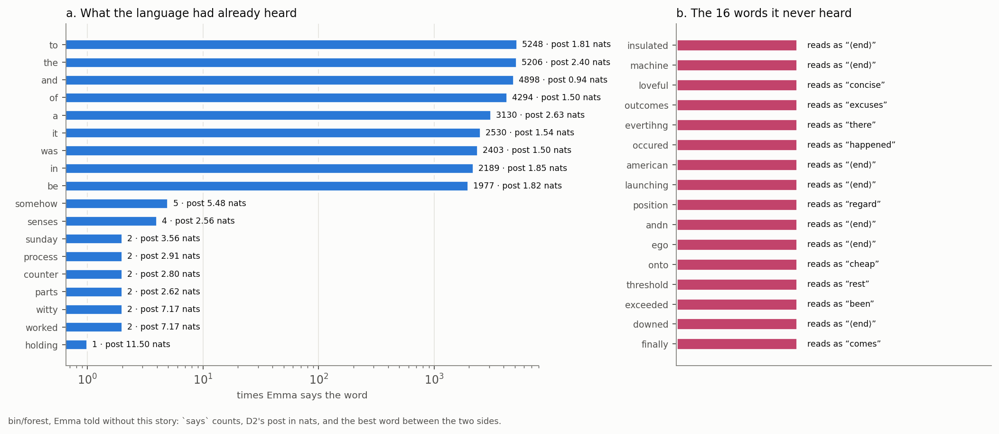

# A Word's Company: What the Forest Holds of Each Word

## Heard Counts, D2's Post, and Kin — Meaning as Use, Measured Word by Word

In Phient's world, a word (w) is a seed: what it relates to, under what conditions (c), grows from it. The Phical paradigm, X ⇒ Y, drives and composes Phient's Phasor Language Models: Phinet, Phiano, PhiTon. Phical stores no point: a word is 32–64 relations, each a complex phasor on a closed circle with a count; meaning is a side effect of pairs of words moving under a condition.

### Abstract

Paper 28 read one eighty-six-token story as a whole, cast into Jane Austen's *Emma*. This paper reads the same story word by word. For each of its fifty-eight distinct words `bin/forest`'s `words.rs` reports four measured things, and we report all four for all fifty-eight: how often the language heard the word (its `says` count in *Emma*); what it goes on to, both in *Emma* and in the story itself; how far it moves the next word's distribution away from the average, which is D2's post in nats (papers 19–23); and its kin, the words that were told the same company before and after. The numbers draw three contrasts sharply. First, frequency and post are not the same thing: `the` was heard 5,206 times and posts 2.40 nats, `and` 4,898 times and posts 0.94, the lowest of any word — a function word commits nothing about what follows — while `holding`, heard once, posts 11.50 nats, the largest of the fifty-eight, because its one recorded sequel is a point mass as far from the broad average as a distribution can get. Second, kin is meaning-as-use made literal (§43): a word is the company it keeps, so `his` is kin to `your, their, her, its` and `of` to `in, by, on, from`, the possessives and the prepositions falling together by the cosine of their neighbours alone, never declared. Third, and said plainly, the cosine over a sparse table is noisy: `sunday`, heard twice, is kin to `tradesman, knife, seminary, receipt`, and the sixteen words *Emma* never heard have no kin at all. `love`, heard 118 times, sits between the two — kin to `charity, housekeeping, infancy, blossom`, which is not romance but the company love keeps in *Emma*. Every number is from one run, tabulated in `FOREST_FACTS.md`; no understanding is claimed.

## 1. What the forest holds of a word

Paper 28 took the story whole and asked where it belongs. This paper takes it apart. `bin/forest`'s `words.rs` walks the story's tokens once, keeps each distinct word the first time it appears, and for each one reads four quantities off the language — *Emma* told without this story, 2,314 paragraphs, 2,969,690 rows, 69,896 words in the tree. The four are these.

- **Heard.** `count(None, says, w)` — how many times, over all of *Emma*, the word was said. This is the raw sighting count, not the paragraph count of paper 28's bounding volumes: `the` is said 5,206 times, `love` 118, `holding` once.
- **What it goes on to.** The words most often told after it — in *Emma* (`next`), and in the story itself (`scope|w` under `next`). The first is the language's habit; the second is what this writer did with the word.
- **The post.** D2 in nats: how far the distribution of words after `w` departs from the distribution of words after anything at all. This is tree 6's quantity, the tree of knowing's levels, read here at the single level of the last word.
- **Kin.** The words that keep the same company — the cosine of `w`'s left and right neighbour tables against every other word's. This is tree 10, the kin tree (`relate::kin`, docs/138).

Three of the sixteen trees of paper 29 are being read per word. Tree 6 gives the post; tree 10 gives the kin; and tree 11, the phasor's channels, gives the resonance of §7, the continuous echo of the same company. The reading adds nothing and declares nothing: a word's heard count, its sequels, its post and its kin are all read from counts that were already there before the story arrived.

## 2. The full reading

Table 1 is the whole of it: all fifty-eight distinct words in the order the story says them, with the four quantities for each. A word *Emma* never heard has a heard count of zero, no post, no sequel in *Emma* and no kin — only what the story put after it. The sixteen such words are the subject of paper 30; here they stand in the table as the blanks they are.

| word | said | post | next in *Emma* | next here | kin |
|---|---|---|---|---|---|
| it | 2530 | 1.54 | was, is, ., , | finally, suddenly, was | there, he, she, this |
| was | 2403 | 1.50 | not, a, the, very | in, on | is, seems, does, did |
| on | 693 | 1.72 | the, her, ,, his | a, our | in, by, contemplating, during |
| a | 3130 | 2.63 | very, little, great, few | great, strong, sunday | the, so, discussed, some |
| sunday | 2 | 3.56 | ,, any | afternoon | tradesman, knife, seminary, receipt |
| afternoon | 6 | 3.46 | -, and, it, next | when | sale, lime, militia, elegancies |
| when | 364 | 1.82 | he, she, i, the | it | that, if, while, though |
| finally | 0 | — | — | downed | — |
| downed | 0 | — | — | on | — |
| our | 99 | 4.89 | good, lives, little, _ | gentleman | your, their, his, bending |
| gentleman | 27 | 2.13 | -, in, !, . | that | crowd, personage, push, bluntness |
| that | 1802 | 1.28 | she, he, i, it | he, insulated, love | when, though, because, which |
| he | 1813 | 2.21 | had, was, is, could | has, was | she, there, it, who |
| has | 252 | 2.69 | been, not, a, he | exceeded | had, does, did, was |
| exceeded | 0 | — | — | the | — |

*Table 1, part i. The first fifteen distinct words. `said` is the `says` count in *Emma*; `post` is D2 in nats; the two `next` columns are what the word goes on to, in *Emma* and in the story; `kin` is the closest four by the cosine of left and right company. A dash is a quantity a word *Emma* never heard does not have.*

| word | said | post | next in *Emma* | next here | kin |
|---|---|---|---|---|---|
| the | 5206 | 2.40 | same, very, world, other | best, process, threshold | a, their, some, his |
| threshold | 0 | — | — | of | — |
| of | 4294 | 1.50 | the, her, his, a | holding, launching | in, by, on, from |
| holding | 1 | 11.50 | cheap | onto | eligibly, clerk, insulted, prone |
| onto | 0 | — | — | his | — |
| his | 1150 | 2.97 | own, father, wife, being | action, american, business | your, their, her, its |
| ego | 0 | — | — | andn | — |
| andn | 0 | — | — | happened | — |
| happened | 28 | 1.93 | ., to, ;, that | to | ceased, calculated, preconceived, known |
| to | 5248 | 1.81 | be, the, her, have | be, his | in, may, for, by |
| be | 1977 | 1.82 | a, the, so, very | a, in | spend, make, avoid, write |
| in | 2189 | 1.85 | the, a, her, his | a, that, the | by, on, contemplating, during |
| great | 265 | 4.22 | deal, pleasure, a, many | position | vast, good, donkey, minute |
| position | 0 | — | — | and | — |
| and | 4898 | 0.94 | the, i, she, , | he, loveful, that | but, though, till, that |

*Table 1, part ii. Words sixteen to thirty. `holding`, said once, holds the largest post of the fifty-eight; `and`, said 4,898 times, the smallest.*

| word | said | post | next in *Emma* | next here | kin |
|---|---|---|---|---|---|
| process | 2 | 2.91 | -, of | of | sale, result, shadow, rapidity |
| launching | 0 | — | — | his | — |
| business | 55 | 1.67 | ., ,, to, was | with | purpose, plan, subject, comfort |
| with | 1219 | 1.70 | the, a, her, all | his | by, in, for, from |
| american | 0 | — | — | counter | — |
| counter | 2 | 2.80 | , | parts | dialogues, medley, departed, fourth |
| parts | 2 | 2.62 | ,, of | in | suddenness, bottom, dignity, garden |
| moment | 111 | 1.53 | ,, ., -, ; | it | letter, fortnight, morning, speech |
| suddenly | 7 | 5.12 | ;, had, happened, it | occured | believed, liked, intends, keenly |
| occured | 0 | — | — | to | — |
| witty | 2 | 7.17 | things, word | senses | stranger, sharp, wonderful, little |
| senses | 4 | 2.56 | ,, and | that | brother, uncle, merits, son |
| somehow | 5 | 5.48 | or, there | evertihng | friday, bake, negligence, win |
| evertihng | 0 | — | — | had | — |
| had | 1628 | 2.18 | been, not, a, no | always | has, could, did, have |

*Table 1, part iii. Words thirty-one to forty-five. `witty`, said twice, posts 7.17 nats; its kin `stranger, sharp, wonderful, little` is the company a word met twice can only guess at.*

| word | said | post | next in *Emma* | next here | kin |
|---|---|---|---|---|---|
| always | 238 | 2.64 | the, been, at, be | worked | really, never, quite, called |
| worked | 2 | 7.17 | hard, such | for | accompanied, reached, received, makes |
| for | 1347 | 1.48 | the, her, a, his | the | by, with, in, on |
| best | 85 | 3.12 | of, ., ,, to | outcomes | sound, mantelpiece, rest, recollection |
| outcomes | 0 | — | — | and | — |
| moved | 7 | 5.39 | away, a, about, back | his | driven, remonstrated, disappointments, received |
| heart | 66 | 1.68 | ., ,, and, was | to | voice, father, mind, friend |
| strong | 44 | 3.61 | ., a, and, as | and | formal, formidable, good, bad |
| loveful | 0 | — | — | machine | — |
| machine | 0 | — | — | that | — |
| insulated | 0 | — | — | his | — |
| action | 6 | 4.36 | ,, ;, abroad, had | that | january, highbury, london, fact |
| love | 118 | 1.75 | with, ,, ., ; | . | charity, housekeeping, infancy, blossom |

*Table 1, part iv. The last thirteen distinct words. `love`, said 118 times, is kin to `charity, housekeeping, infancy, blossom` — the company love keeps in *Emma*, which is a household's, not a lover's.*

Forty-two of the fifty-eight words were heard; sixteen were not. What follows reads the forty-two by their post and their kin, and the figure sets the heard counts beside the never-heard.

## 3. How often the language had heard each word

The heard count is the simplest of the four and the floor under the other three. It ranges over four orders of magnitude on this one story: `to` was said 5,248 times, `the` 5,206, `and` 4,898, `of` 4,294, `a` 3,130, `it` 2,530; against them stand `holding` at 1, `sunday`, `witty`, `worked`, `counter`, `parts` and `process` at 2, `senses` at 4, `somehow` at 5, and `afternoon` and `action` at 6. The story's content sits in the low hundreds and below — `love` 118, `moment` 111, `our` 99, `best` 85, `heart` 66, `business` 55, `strong` 44 — while its grammar sits in the thousands. This is Zipf's shape, and it is the first fact every other fact must be read against: a post computed from one sighting and a post computed from five thousand are not the same kind of number, and a kin found from a count table of two entries is not the same kind of claim as one found from five thousand.

Nothing about the heard count is a model. It is `count(None, says, w)` — the running tally the language kept as it was told, read back by name. A word is heard the moment it is told once (docs/113, 131); the count is only how many tellings have accumulated.

## 4. The post: how far a word moves the answer

Tree 6 is the tree of knowing's levels: given the words said so far, each level — a scope, the last word, the last pair — offers a distribution over the next word, and the post is how far that distribution has moved from the one you would hold knowing nothing. Read here at the single level of the last word, the post of `w` is D2 of papers 19–23:

> post(w) = Σ_v p(v | w) · ln( p(v | w) / p(v) ),

the sum over the vocabulary of the share `p(v | w)` of `v` among the words told after `w`, times the log of that share over `p(v)`, the share of `v` among the words told after *anything*. It is the Kullback–Leibler divergence of the word's own next-distribution from the language's average next-distribution, in nats, and it answers one question: how much does knowing the last word was `w` change what you expect next?

The answer is not frequency. The two most-said words of the story sit at opposite ends of the post. `and`, said 4,898 times, posts 0.94 nats, the lowest of the fifty-eight: `and` precedes very nearly the whole vocabulary — `the, i, she` and a comma are merely its commonest sequels — so knowing the last word was `and` barely moves the average at all. `the`, said 5,206 times, posts 2.40: it is followed by `same, very, world, other`, a narrower band, so it moves the answer more. A function word's post measures how much it commits about what follows, and `and` commits almost nothing.

Nor is a high post the preserve of rare words. `our`, said 99 times, posts 4.89 — the fourth-highest of any word heard more than ten times — because `our` is reliably followed by a possessed noun (`good, lives, little`), a sharp constraint held over a hundred sightings. `great`, said 265 times, posts 4.22, pulled hard toward `deal, pleasure, many`. These are honest, well-evidenced posts: the word genuinely dictates its sequel, and the measure says so from a table it can trust.

### 4.1 Why a word met once can move the answer hardest

`holding` was heard once in all of *Emma*, and once only was anything told after it — `cheap`, Austen's idiom *to hold cheap*. So the distribution of words after `holding` is a point mass: `p(cheap | holding) = 1`, everything else zero. The post is then `ln(1 / p(cheap))` — the full surprise of naming one word out of the whole vocabulary — and it comes to 11.50 nats, the largest of the fifty-eight. `witty` and `worked`, each heard twice, post 7.17; `somehow`, heard five times, 5.48; `moved`, seven times, 5.39.

This is the honest double edge of the post, and it must be stated as one. A rare word that truly dictates its sequel earns a high post for the right reason: *holding onto*, *holding cheap* — the word does narrow what follows. But a rare word whose single recorded sequel is an accident of the one sentence it appeared in earns exactly the same high post, and the measure cannot tell the two apart from one sighting. A point mass is as far from the broad average as a distribution can get, whatever put it there. The post rewards a sharp conditional, and nothing is sharper than a sample of size one. So the largest post of the story belongs to its rarest word, and the number says less about `holding` than about how little was heard of it. Paper 28 made the same point in the language of bounding volumes — `holding` is in one paragraph of 2,314, a volume so tight it cuts the space by a factor of a thousand, and so rare a six-word window almost never holds it. The post is that tightness read forward: a tight volume moves the next-word answer hard, and moves it from almost no evidence.

The level that carries the post is tree 6's, and it is why the counts reading of docs/152 mixes levels rather than trusting the sharpest: a post of 11.50 from one sighting must be weighed against a post of 0.94 from five thousand, and the counted weights of docs/146–147 are exactly that weighing — how much a level trusts its own counts before it is allowed to move the answer.

## 5. What a word goes on to, here and there

The two `next` columns set the language's habit beside the writer's act. In *Emma*, `that` goes on to `she, he, i, it` — the relative and the demonstrative before a clause; in this story it goes on to `he`, `insulated` and `love`, the last being the story's final word. `his` in *Emma* goes to `own, father, wife, being`; here to `action, american, business`. `love` in *Emma* is followed by `with`, a comma, a full stop; here it is followed only by the full stop that ends the story. Where a word's sequel here is a word *Emma* never heard — `of` → `holding` and `launching`, `a` → `sunday`, `strong` → `and loveful` — the story has put the word to a use the language has no habit for, and paper 30 reads those slots from both sides.

The sequels are also where the post comes from: the *Emma* column is the top of the very distribution D2 measures. `great`'s sequels `deal, pleasure, a, many` are why its post is 4.22; `and`'s sequels `the, i, she` and a comma are why its post is 0.94. The column and the number are two readings of one count table.

## 6. Kin: a word is its company

Kin is the second thing tree 10 holds, and it is the paper's point. Two words are kin when they were told the same company — the same words before them, which in the store are the pairs they close (`pair:u w`, said under them), and the same words after them (`next`). Kinship is the cosine of those two count tables, averaged over the left side and the right, and it is found, never declared: a word with no company has no kin, and nothing is written down but what was told (`relate::kin`, docs/138).

This is Wittgenstein's §43 made arithmetic. Meaning is use; a word's use is the company it keeps; so a word *is* its left and right neighbours, and two words mean alike exactly when their neighbours line up. Read that way the kin column is a test of the slogan, and on the words it was given enough of, it passes:

- `his` is kin to `your, their, her, its` — the four other possessive determiners, with nothing else in the first four. They share the slot before a noun and the slot after a verb, and the cosine finds them without a part-of-speech tag in sight.
- `of` is kin to `in, by, on, from`; `with` to `by, in, for, from`; `for` to `by, with, in, on`; `to` to `in, may, for, by`. The prepositions fall together because they keep the same company — a noun phrase to the right, a verb or noun to the left.
- `had` is kin to `has, could, did, have`; `has` to `had, does, did, was`. The auxiliaries cluster by the participles and bare verbs that follow them.
- `that` is kin to `when, though, because, which`; `when` to `that, if, while, though`. The subordinators and relatives share the clause they introduce.
- `he` is kin to `she, there, it, who`; `it` to `there, he, she, this`. The pronouns and the demonstratives share the subject slot.

None of this was put in. The lexicon has no grammar; the store has only counts of what stood beside what. That the possessives, the prepositions, the auxiliaries, the subordinators and the pronouns each come out as a family is §§65–67's family resemblance measured: there is no feature all possessives share and nothing else has, only a web of overlapping company, and the cosine reads the web.

`love` is the word the title is for, and its kin is the most telling of the heard words: `charity, housekeeping, infancy, blossom`. That is not a list of synonyms for love, and it is not romance. It is the company the word *love* keeps across *Emma* — a Regency household's register, where love stands beside charity and the keeping of a house and the care of the young. A reader who expected `affection, passion, desire` and got `charity, housekeeping, infancy` has met the method's whole claim head-on: the word does not mean what a dictionary says it means, it means where it was used, and in this book it was used among the domestic virtues. `love`, heard 118 times, is heard enough for that company to be real and not noise — which is exactly the line the next section is about.

## 7. Where kin is noisy, said plainly

The cosine is only as good as the tables it compares, and most of the story's content words have tables of two or four entries. There the kin is arbitrary, and the honest thing is to show it rather than hide it.

- `sunday`, heard twice, is kin to `tradesman, knife, seminary, receipt`. There is no sense in which Sunday is like a knife. The two sightings of `sunday` happened to stand near those words, and with two entries the cosine has nothing to average out.
- `afternoon`, heard six times, is kin to `sale, lime, militia, elegancies`; `counter`, heard twice, to `dialogues, medley, departed, fourth`; `parts`, heard twice, to `suddenness, bottom, dignity, garden`; `action`, heard six times, to `january, highbury, london, fact`; `somehow`, heard five times, to `friday, bake, negligence, win`. Each is a list assembled from a handful of sentences, and each reads as arbitrary because it is.
- `holding`, heard once, is kin to `eligibly, clerk, insulted, prone`. Its one sighting (`hold cheap`) gives it one scrap of company, and the cosine fills the rest with whatever shared that scrap.
- `witty`, heard twice, is kin to `stranger, sharp, wonderful, little` — half of which (`sharp, wonderful`) is a plausible adjectival neighbourhood and half of which is not. Two sightings land half-right by luck.

Between the arbitrary and the clean sit the words heard in the dozens: `strong` (44) is kin to `formal, formidable, good, bad`, a real adjectival cluster; `heart` (66) to `voice, father, mind, friend`, the nouns of feeling and kin; `business` (55) to `purpose, plan, subject, comfort`, abstractions of affairs; `always` (238) to `really, never, quite, called`, mostly adverbs. These are recognisable because the tables behind them have tens of entries. The lesson is the one docs/138 drew and docs/146–147 formalised: kinship over a sparse count table is noise, kinship over a dense one is structure, and the crossover is somewhere in the low hundreds of sightings — which is why `love` at 118 is the lowest heard count in this story whose kin reads as genuinely its own.

And the sixteen words *Emma* never heard have no kin at all. `finally`, `exceeded`, `threshold`, `loveful`, `machine` — `kin(w)` is empty for every one, because a word never told has no company to compare. The kin tree is the fallback when a ray misses every volume (paper 29, tree 10): ask what lies near instead. But a word that was never there lies near nothing, and the forest is honest about the blank — it does not invent a neighbour. What fills those sixteen slots is read from both sides of the hole, and that is paper 30.

## 8. The phasor's echo

Tree 11, the phasor's channels, holds the same idea as kin in the continuous half. Told to a phiecs world the story is 58 entities and 563 edges; each word carries an angle and an amplitude `ln(1 + evidence)` on each channel it was related on, and two words *resonate* by the cosine over every channel both have moved. The most resonant pairs the story finds are `the · of` (0.973), `holding · launching` (0.952), `moved · love` (0.952) and `senses · action` (0.948). The first is two function words that occur everywhere together — the same reason `the` and `of` are near-kin above. The other three are pairs the story itself put in the same company over its eighty-six tokens: `holding` and `launching` both follow `of` here; `moved` and `love` and `senses` and `action` are neighbours in the one paragraph. Kin is that company counted; resonance is the same company carried on the relation circle, a slower and superposable summary of it (docs/136; paper 25). On this little story the phasor has too little evidence to say more than the counts already say, and it says the same thing — which is the point: the discrete and the continuous halves start from one place, a word and its company.

## 9. What this shows, and what it does not

**The forest holds four checkable things of every word, read from counts and declared nowhere.** How often the language heard it, what it goes on to there and here, how far it moves the next word, and what keeps its company — each is `words.rs` reading a table that was filled before the story came, and each gave a number for all fifty-eight words with no tuning and no schema.

**The post is not importance and the kin of a rare word is not its meaning.** `holding`'s 11.50 nats is the surprise of a single sighting, not a measure of how much `holding` matters; `and`'s 0.94 is the honesty of a word that commits nothing. `sunday`'s kin `tradesman, knife, seminary` is noise from two sightings, and the forest shows it rather than smoothing it into something that looks like sense.

**Where there is evidence, the slogan holds.** The possessives come out kin to the possessives, the prepositions to the prepositions, the auxiliaries to the auxiliaries — families no one wrote down, read off the company alone — and `love` comes out kin to `charity, housekeeping, infancy`, which is where the word was used in this book and not where a dictionary would put it. That is §43 and §§65–67 measured on one story: a word is its company, meaning is use, and family resemblance is a cosine over overlapping neighbours. It is the apparatus that tests the remark, not a verdict that the remark is true — the honest reading of a word met twice is that we do not yet know its company, and the forest says so by leaving sixteen words without kin and giving the rest exactly the confidence their counts earn.

## Reproducing this paper

```
cargo run --release --bin forest -- data/text --story text/story/ch2
cargo test -p phiplm a_word_is_read_through_its_kin_where_it_was_never_heard
python3 docs/papers/figs155.py words                     # figure 1
```

The first command writes `data/forest/forest.json`, from which the per-word table and every number here is taken; `words.rs` holds the four readings, `relate::counts.rs` the post (D2), and `relate::kin.rs` the kin. `docs/papers/forest/FOREST_FACTS.md` is the same numbers as tables, from the run of 2026-10-12.



*Figure 1. Left, the most- and least-heard words of the story on a log scale, each labelled with its `says` count and its D2 post in nats — frequency and post run the two different ways §4 draws out. Right, the sixteen words *Emma* never heard, each with the word the forest would read in its place from both sides. Measured by `bin/forest` on *Emma* told without this story.*

## References

**The counts.** Kullback, S., Leibler, R. A. (1951). *On information and sufficiency.* Ann. Math. Statist. — the divergence D2's post is, measured here between a word's next-distribution and the language's average. Witten, I. H., Bell, T. C. (1991). *The zero-frequency problem.* IEEE Trans. Inf. Theory — the smoothing that lets a word heard once still be read (docs/126, 131). Spärck Jones, K. (1972). *A statistical interpretation of term specificity.* J. Documentation — term specificity, which a high post over many sightings is a conditional form of. Salton, G., McGill, M. J. (1983). *Introduction to Modern Information Retrieval* — the cosine of two count vectors, which kinship is, over left and right company. Austen, J. (1815). *Emma.* The story of paper 28 §1 is the user's own, told once and quoted unaltered.

**Wittgenstein.** Wittgenstein, L. (1953). *Philosophical Investigations*: §43 (meaning is use), §§65–67 (family resemblance), the two remarks the kin column measures; D1–D20 are papers 19–23, and D2 is the post.

**Phient's own record.** Papers 25 (Phasor Language Models, the phasor and resonance of §8), 28 (the forest and the bounding volumes, where `holding`'s tightness is read as a volume), 29 (the sixteen trees, numbers 6, 10 and 11 read here), 30 (the sixteen words never heard, whose slots §7 leaves to it); docs 113, 131 (a word heard from one telling, breadth), 136 (the phasor as a slow summary of the count), 138 (kin, and the sparse-table noise §7 states), 146–147 (the counted weights that weigh a sharp post against a well-evidenced one), 152 (the post and the mixture of levels), 155 (the short form of this reading).
