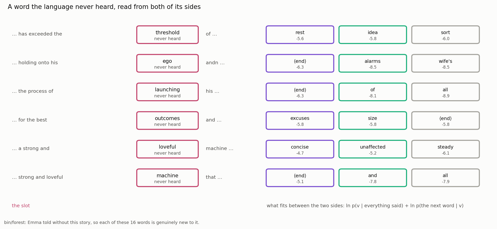

# The Words It Never Heard

## Reading a Slot from Both Sides

In Phient's world, a word (w) is a seed: what it relates to, under what conditions (c), grows from it. The Phical paradigm, X ⇒ Y, drives and composes Phient's Phasor Language Models: Phinet, Phiano, PhiTon. Phical stores no point: a word is 32–64 relations, each a complex phasor on a closed circle with a count; meaning is a side effect of pairs of words moving under a condition.

### Abstract

A user told the system a story of eighty-six tokens, written in capitals with its own misspellings, into the language of Jane Austen's *Emma* (docs/155; paper 28). Sixteen of its words *Emma* had never heard: `finally`, `downed`, `exceeded`, `threshold`, `onto`, `ego`, `andn`, `position`, `launching`, `american`, `occured`, `evertihng`, `outcomes`, `loveful`, `machine`, `insulated`. Two are the writer's misspellings, one is a coinage, and the rest are simply later English. This paper reports what the system does with a slot for which it has no word. It reads that slot two ways. From the left alone it reads the word the language expects next, `ln p(v | left)`. From both sides it adds the constraint that whatever fills the slot must be a word the following word can come after, `ln p(v | left) + ln p(right | v)`, with a half count for a bigram never seen (`words.rs::between`). The full table of all sixteen slots, read both ways, is given. Its central result is an honest limit, not a success. The system does not know what `threshold` means; it knows only the shape of the hole, and read from both sides the best word between "has exceeded the" and "of" is `rest` (−5.6 nats), then `idea` (−5.8), then `sort` (−6.0). That reading is a statement about *Emma*'s language, not about the missing word. Where the following word is common, both sides sharpens the reading to a real content word; in seven of the sixteen slots a smoothing floor at the end-of-sequence token wins instead. These sixteen words lie past the open stratum of docs/137–153, where nothing yet beats frequency: a word *Emma* never heard at all has no kin, no post, and no phasor of its own, so the slot reading is the whole of the handle on it. We say what would read a genuinely new word — its kin, its morphology, the slot's constraints — and what the system does and does not do today. No understanding is claimed.

## 1. Sixteen words with no volume

The story the user told is quoted in full in docs/155 and paper 28. It was read into *Emma* — 2,314 paragraphs without it, 2,969,690 rows counted, 69,896 words in the tree — by `bin/forest`, in one run of 2026-10-12 tabulated in `docs/papers/forest/FOREST_FACTS.md`. Every number here is from that run.

Of the story's 58 distinct words, sixteen are said in no paragraph and no chapter of *Emma*:

> `finally`, `downed`, `exceeded`, `threshold`, `onto`, `ego`, `andn`, `position`, `launching`, `american`, `occured`, `evertihng`, `outcomes`, `loveful`, `machine`, `insulated`.

Two are the writer's misspellings — `andn` for *and*, `evertihng` for *everything*; one is a coinage — `loveful`; and the rest are later English *Emma* had no occasion for. The reader lower-cases and changes nothing else (docs/155), so all sixteen are in the lexicon exactly as they were typed, as the words they are.

In the bounding-volume reading of paper 28, each is a volume that encloses none of the scene: a condition with no index among the kind's values, dropped from any graded cast, invisible to the search that would place the paragraph that holds it. Here we ask the narrower and more exposing question. Not *where does the story go* but *what goes in the slot* — given everything said before a missing word, and the word said after it, what does the language put in its place, and what does that placement amount to?

The honest answer begins with three zeros. For every one of the sixteen, `heard_in_emma` is 0; the D2 post is 0.00 nats, because a word never heard moves no distribution away from the prior (paper 19); and the kin list is empty, because a word never told has no neighbourhood for the kin tree to read (tree 10 of docs/155). The word itself contributes nothing. Whatever the system says about the slot, it says out of the words around it.

## 2. Reading the slot from the left

The first reading is the one every language model makes: given the words so far, what comes next. `Knowing::next(left)` casts the left context into the tree and reads the next word's distribution at the lowest level that speaks, falling to the prior where the context is silent (docs/149; paper 25). For a slot we have no word for, its top entries are what the language would have expected to find there.

`words.rs` records the six heaviest for each of the sixteen (`left_only`), keeping only the entries that have an alphanumeric character, so punctuation and the dash tokens are set aside. Read this way the slot after "has exceeded the" offers `very` (−4.1 nats), `same` (−4.2) and `world` (−4.5): *the very*, *the same*, *the world*, the words *Emma* most often puts after *the*. The slot after "in a great" offers `deal` (−1.0), `many` (−2.8) and `regard` (−2.9): *a great deal* is the phrase the language knows. The slot after "moment it suddenly" offers `happened` (−1.3), `it` (−3.2) and `had` (−3.2): *it suddenly happened*.

These are not readings of the missing word. They are readings of the left context's appetite, and that appetite is set by the commonest continuations in the book. Where the left context ends in a function word — `the`, `of`, `a`, `and` — the slot fills with whatever most often follows that function word, and the story's own word is nowhere in it. The left reading answers *what would the language say next*, which is a different question from *what word is missing here*.

## 3. Reading the slot from both sides

The second reading uses a fact the first throws away: we know the word that comes *after* the slot. The story reads `has exceeded the threshold of`; `threshold` is missing, but `of` is not. The word in the slot is not only something the left can lead to, it is something that can lead to `of`. That is a second constraint, and `words.rs::between` adds it:

```rust
fn between(k: &Knowing, left: &[String], right: Option<&String>) -> Vec<(String, f64)> {
    let (_, ranked, _) = k.next(left);
    let fits = ranked.into_iter().take(300)
        .filter(|(v, _)| v.chars().any(char::is_alphanumeric))
        .map(|(v, s)| {
            let after = right.map_or(0.0, |r|
                ((k.counts.count(Some(&v), "next", r) + 0.5)
                 / (k.counts.total(Some(&v), "next") + 1.0)).ln());
            (v, s + after)
        }).collect();
    top(fits, 6)
}
```

Each candidate `v` from the left reading carries a score `s = ln p(v | left)`. To it is added `after = ln p(right | v)`, the log probability that the word after the slot follows `v` — with a half count in the numerator and a one in the denominator, so that a bigram never seen is penalised but not ruled out. The slot's reading becomes `ln p(v | left) + ln p(right | v)`: the word that both the left can reach and the right can come after. A slot read from one side is a prediction; a slot read from both is a word fitted into a sentence that already has its two ends.

This is the matched-filter discipline of paper 27 turned on a gap rather than a word. There the readout correlates a word's wave with every template and reads which relation it is; here the two halves of a context are two filters, and the slot is read where both pass. It is also the conjugate of docs/153 made plain: `p(right | v)` reads the relation `v ⇒ right` forwards, which is the relation `right ⇐ v` read backwards, the word-before reading that the mirror does untrained. The slot sits where the forward reach of the left and the backward reach of the right agree.

## 4. The full table


*Figure 1. The story's words split two ways (`words.rs`): on the left, the words *Emma* had already heard, with how often it said each and its D2 post in nats; on the right, the sixteen it never heard, each with the word it goes on to in the story — the right-hand constraint the both-sides reading uses. A word never heard has a post of zero and no kin. Drawn from the run of 2026-10-12.*

The table below is the figure's numbers in full. `left context` is the three words before the slot; `after` is the word the story puts next, which the both-sides reading uses as its right constraint; the last two columns are the three best fits read each way, with their scores in nats.

| the slot | left context | after | best from the left alone | best from both sides |
|---|---|---|---|---|
| finally | …afternoon when it | downed | was (−1.6), is (−1.9), came (−2.6) | comes (−6.9), burst (−7.0), stopped (−7.3) |
| downed | …when it finally | on | to (−3.6), the (−3.7), and (−3.7) | ⟨end⟩ (−5.1), and (−9.2), go (−9.9) |
| exceeded | …that he has | the | been (−2.0), not (−2.5), a (−3.3) | been (−5.1), outstepped (−5.7), ⟨end⟩ (−6.2) |
| threshold | …has exceeded the | of | very (−4.1), same (−4.2), world (−4.5) | rest (−5.6), idea (−5.8), sort (−6.0) |
| onto | …threshold of holding | his | cheap (−1.1), to (−4.0), the (−4.1) | cheap (−2.9), ⟨end⟩ (−5.5), of (−7.3) |
| ego | …holding onto his | andn | own (−3.0), father (−3.8), wife (−4.0) | ⟨end⟩ (−6.3), alarms (−8.5), wife's (−8.5) |
| andn | …onto his ego | happened | to (−3.6), the (−3.7), and (−3.7) | ⟨end⟩ (−5.1), had (−10.2), has (−10.2) |
| position | …in a great | and | deal (−1.0), many (−2.8), regard (−2.9) | regard (−5.5), deal (−6.2), dreamer (−6.2) |
| launching | …the process of | his | a (−1.3), the (−2.7), her (−3.5) | ⟨end⟩ (−6.3), of (−8.1), all (−8.9) |
| american | …business with his | counter | own (−3.1), father (−3.5), wife (−3.6) | ⟨end⟩ (−6.2), tray (−6.2), muttering (−6.6) |
| occured | …moment it suddenly | to | happened (−1.3), it (−3.2), had (−3.2) | happened (−2.7), perceived (−5.3), opened (−5.8) |
| evertihng | …senses that somehow | had | or (−0.6), there (−1.9), to (−4.9) | there (−5.5), or (−6.4), ⟨end⟩ (−6.4) |
| outcomes | …for the best | and | of (−2.0), to (−3.6), friend (−3.8) | excuses (−5.8), size (−5.8), ⟨end⟩ (−5.8) |
| loveful | …a strong and | machine | steady (−2.9), unaffected (−2.9), concise (−2.9) | concise (−4.7), unaffected (−5.2), steady (−6.1) |
| machine | …strong and loveful | that | to (−3.6), the (−3.7), and (−3.7) | ⟨end⟩ (−5.1), and (−7.8), all (−7.9) |
| insulated | …loveful machine that | his | she (−2.4), he (−2.5), i (−2.8) | ⟨end⟩ (−6.9), of (−7.9), in (−8.1) |

*Table 1. All sixteen slots, read from the left alone and from both sides. The scores are not comparable across the two columns — the both-sides score carries the extra `ln p(right | v)` term, so it is always the lower of the two — and they are not comparable between rows, since each slot is read in its own context. Within a row the ranking is what the reading says.*

Two patterns run through the table, one honest and useful, one an artifact of the smoothing. We take them in turn.

## 5. The shape of one hole



*Figure 2. One slot, read from both sides: `…has exceeded the ___ of`. The left reach (what follows `the`) and the backward reach of `of` (what `of` can come after) meet at `rest`, `idea`, `sort`. The system has no word `threshold`; it has the shape of the gap the word leaves. Drawn from the run of 2026-10-12.*

The slot after "has exceeded the", with `of` as the word that must follow, is the paper's clean case. Read from the left alone it offered `very`, `same`, `world` — the generic companions of *the*. Read from both sides, with the constraint that whatever stands there must be a word *Emma* has put before `of`, it offers `rest` (−5.6), `idea` (−5.8), `sort` (−6.0). *The rest of*, *the idea of*, *the sort of*: the three phrases the language knows in which a noun stands between *the* and *of*. The second constraint has thrown out `very` and `same` — one does not say *the very of* — and brought forward the nouns that fit.

This is exactly as far as the reading goes, and it is worth being exact about what it is. The system has no word `threshold`. It cannot, because it never heard one. What it has is the shape of the hole the word leaves: a thing that comes after *the* and before *of*, a noun the language would grade a quantity or a kind with. `rest`, `idea`, `sort` are the words *Emma* keeps in that shape. The reading is a true statement — about *Emma*'s language. It is a count over the book, read at two ends of a gap. It says nothing about what the user meant by `threshold`, and it would say the same three words for any missing noun in that frame, whether the writer meant *threshold*, *verge*, *limit* or *edge*. The slot is read; the word is not.

Three other slots are read this way with a real content word on top. "moment it suddenly ___ to" fills with `happened` (−2.7), `perceived` (−5.3), `opened` (−5.8) — *it suddenly happened to*, *perceived*, *occurred to*, which is the exact sense of the writer's `occured`, reached without the word. "senses that somehow ___ had" fills with `there` (−5.5), `or` (−6.4): *somehow there had*, *somehow or had* — the left's appetite for *somehow there* surviving the constraint. "a strong and ___ machine" fills with `concise` (−4.7), `unaffected` (−5.2), `steady` (−6.1): adjectives that stand in *a strong and ___* and can come before a noun, the frame the coinage `loveful` was put in. In each the following word has narrowed the slot from the left's generic continuation to a word of the right part of speech. That is the whole of what both sides buys, and where it buys it, it is the most honest reading in the forest: a missing word placed by its two neighbours, with the placement openly a fact about the book.

## 6. Where the floor wins

The second pattern is the one to report against the first, because it is larger. In seven of the sixteen slots — `downed`, `ego`, `andn`, `launching`, `american`, `machine`, `insulated` — the top fit from both sides is `⟨end⟩`, the end-of-sequence token, not a word at all. This is not the reading finding that the story should end there. It is a smoothing artifact, and naming it is part of reading the table honestly.

The added term is `ln((count(v, next, right) + 0.5) / (total(v, next) + 1))`. For a candidate `v` that was almost never followed by the right word, the count is zero and the term is about `ln(0.5 / (total(v) + 1))`: a penalty that grows with how often `v` was followed by *anything*. A common word, followed in the book thousands of times, is punished hard by this floor; a word rarely followed by anything is barely punished at all. `⟨end⟩` is the extreme: nothing follows the end of a sequence, so its `total` is small and its floor penalty is the gentlest there is. Where no ordinary word has a real bigram into the right word — because the right word is itself one the book hardly saw, or one the candidates never preceded — `⟨end⟩` wins by default, on the strength of having almost nothing to lose.

Two of the seven show it plainly. `downed`'s right word is `on`, which is common; but the left context "when it finally" is so thin — `finally` itself being one of the sixteen — that the left reading is already the generic `to`, `the`, `and`, and none of those leads cleanly to `on`, so the floor at `⟨end⟩` rises above them. `launching`'s right word is `his`; the left "the process of" wants a noun or a gerund, but the gerunds the book has were rarely followed by `his`, and again `⟨end⟩` floats up. In four more of the sixteen — `finally`, `exceeded` (where `⟨end⟩` is third), `outcomes`, `onto` — `⟨end⟩` appears among the three without leading. When the right word is itself a word *Emma* never heard, as `downed` is for `finally`, the both-sides reading degrades further still: `p(right | v)` is zero for every `v`, so the flat floor applies to all candidates equally and the only thing the second term does is tilt the ranking toward the rarer words, which is why `finally`'s left reading of `was`, `is`, `came` becomes `comes`, `burst`, `stopped` — the same appetite, re-sorted by scarcity, and no nearer the missing word.

So the table divides. In about half the slots the following word is common enough and ordinary enough that the constraint sharpens the reading to a real content word of the right kind; in the other half the following word is rare, or itself unheard, or badly matched to the left, and a smoothing floor at `⟨end⟩` carries the slot. The useful case and the artifact sit in one table, read by one function, and the honest report is both. Weighting the floor differently, or barring `⟨end⟩` from the candidates, or down-weighting common words by their frequency, would change which case wins — each a knob beside the base, which this project's rule requires be measured before it is believed (docs/124, 137–138; paper 28 §5.1). What is reported here is the base.

## 7. Past the open stratum

These sixteen words sit beyond the frontier the readers of docs/137–153 work at, and the distance is worth stating, because it is easy to run the two together and the difference is the whole of the difficulty.

The open stratum of those documents is the 23% of held-out *Emma* positions whose word was never told after the last word or pair (docs/137). A word in that stratum is still a word *Emma* knows: it has a count, a post, kin, a phasor that has moved. What is missing is only the particular bigram — this word, after that one. On that stratum frequency reads about 3.4% of next words first, and nothing yet reads it clearly better: the operator mixed with the prior comes level with frequency, not past it (docs/152), and the conjugate mirror reads the word before where the pair was told but finds nothing where it was not, because it "inverts what was told; it does not reach what was not" (docs/153). docs/137–138 report the kin reading at 14.2% and 0.5% on that stratum against the frequency prior — a real handle, because a known word in a new position has neighbours whose company it can borrow.

The sixteen words of this paper are a stricter case than any of that. They are not words *Emma* knows in a new position; they are not in *Emma*'s vocabulary at all. `heard_in_emma` is 0, so there is no count to read, no post, no phasor that ever moved, and — the point that matters most — no kin. The kin tree reads a word's closest left and right company (tree 10, docs/155), and a word never told has no company to read; the kin list for every one of the sixteen is empty. The handles that give the open stratum its 3.4% and its 14.2% are all absent here. What is left is the slot, read from its two ends out of words that are not the missing word. That is the paradigm's hardest claim in its hardest form: a relation reached entirely through what else is known, with nothing of the thing itself to start from. docs/152 states the claim as still open; this paper does not close it. It measures the one reading the system can make when even frequency and kin have nothing to say, and reports that the reading is a reading of the language, not of the word.

## 8. What would read a genuinely new word

It helps to say what reading a genuinely new word would take, against what the system does today, because the gap is specific and the slot reading is the first step across it, not the crossing.

**Its kin.** A new word's place could be read from the words it keeps company with — if it had any. The kin tree does this for a word heard somewhere: `holding`, said once in *Emma*, has kin `eligibly`, `clerk`, `insulted`, `prone`, drawn from its neighbours in that one telling. A word heard nowhere has no neighbours, so for the sixteen this handle is empty. Reading a new word by its kin would require the word to have been told at least once, in some scope, before the reading — which is the system's own answer, step seven of docs/155: what it does not know, it asks for, and the answer is a telling that gives the word its first company. Until the word is told once, it has no kin, and the slot is all there is.

**Its morphology.** Several of the sixteen are transparent builds on words *Emma* does know: `downed` is *down* with *-ed*, `launching` is *launch* with *-ing*, `insulated` is *insulate* with *-ed*, `outcomes` is *out* and *comes*, `loveful` is *love* — said 118 times — with *-ful*. A reader that broke a word into a stem and a suffix, and treated the suffix as a known operator on the stem's relations, could place `loveful` near *love* and read `launching` as a present act of *launch*. The system does not do this today. A word is interned whole, by its spelling, and nothing reads below it; `loveful` is exactly as opaque to it as `andn`, though one is a coinage from a word the book knows well and the other a typo for *and*. Sub-word kin — the stem's company, lent to the build — is the clearest missing handle, and the one the empty kin lists of §7 point straight at.

**The slot's constraints.** Both sides is the beginning of reading a word by the frame it sits in, and it reads one constraint: the single word that follows. The frame holds more. The second word after, the agreement of the two neighbours on a channel (paper 27 §3), the condition the paragraph turns under (`rising`, `resolving`; docs/155), each is a further constraint that would narrow the hole. `words.rs::between` takes one right word (`right: Option<&String>`) and no more; the reading of §5 is the slot under exactly one forward constraint and one backward. Narrowing it with the others is a clear next step, measurable against this base on the same story, and it would still read the shape of the hole rather than the word — more sharply, but the same kind of thing.

So the system's reading of a word it never heard, today and in full, is this: it reads what the left expects next, it adds the one constraint that the right imposes, and it reports the words *Emma* keeps in the resulting shape, honestly including the end-of-sequence floor where no word has a real bigram to offer. It does not read the word's morphology, it has no kin for a word it never heard, and it uses one right-hand constraint of the several the frame holds. Where the following word is common it sharpens to a real content word; elsewhere a smoothing floor wins. That is the whole of it, and it is the frontier, not a solved problem.

## 9. What this shows, and what it does not

**A slot with no word for it can still be read, from its two ends.** The reading is a real operation on the counts: `ln p(v | left) + ln p(right | v)`, the left's forward reach and the right's backward reach meeting at the words the language keeps between them. Where the two ends are ordinary and well-attested — "has exceeded the ___ of" — it reads `rest`, `idea`, `sort`, the nouns that stand in that frame, and the sense of the writer's `occured` is reached as `happened`, `perceived`, without the word.

**It does not read the missing word, and it does not understand it.** The system has no word `threshold`; it has the shape of the hole, and would read the same three words for any missing noun in that frame. In seven of the sixteen slots the reading is carried not by a word but by a smoothing floor at the end-of-sequence token, which is an artifact of the half-count, reported here rather than hidden. These sixteen words lie past the open stratum of docs/137–153: a word *Emma* never heard has no count, no post, no kin and no phasor of its own, so the handles that give that stratum its small gains over frequency are all absent, and the slot read from both sides is the only reading there is. Wittgenstein's remark that the meaning of a word is its use in the language (§43) is the hypothesis this apparatus tests: here the only use the system has is the two neighbours of a word it was never shown, and what it reads back is the language's shape, not the writer's word. That is an honest limit, and it is the limit this paper reports.

## Reproducing this paper

```
cargo run --release --bin forest -- data/text --story text/story/ch2
python3 docs/papers/figs155.py slot words                 # figures 1–2
```

The command writes `data/forest/forest.json`, from which every number here is taken; the slot readings are `words.rs::words`'s `never_heard.left_only` and `never_heard.both_sides`, and `docs/papers/forest/FOREST_FACTS.md` is the same numbers as tables, from the run of 2026-10-12. The between-reading is `words.rs::between`: `k.next(left)` for the left score, plus `ln((count(v, next, right) + 0.5) / (total(v, next) + 1))` for the right.

## References

**The counts.** Witten, I. H., Bell, T. C. (1991). *The zero-frequency problem.* IEEE Trans. Inf. Theory — the half-count floor of `between` and the smoothing of `Counts::dist` (docs/126, 131). Spärck Jones, K. (1972). *A statistical interpretation of term specificity.* J. Documentation — the frequency weighting §6 names as an untested knob. Austen, J. (1815). *Emma.* The language the story was told into; the story of §1 is the user's own, told once and quoted unaltered in docs/155 and paper 28.

**Relations as waves.** Sun, Z. et al. (2019). *RotatE: Knowledge graph embedding by relational rotation in complex space.* ICLR — the forward reading `p(right | v)` as the backward relation `right ⇐ v`. Trouillon, T. et al. (2016). *Complex embeddings for simple link prediction.* ICML. North, D. O. (1943, repr. 1963). *An analysis of the factors which determine signal/noise discrimination in pulsed-carrier systems.* Proc. IEEE 51 — the matched filter, of which the two-sided slot reading is a gap-shaped case (paper 27).

**Wittgenstein.** *Philosophical Investigations* (1953), §43, paraphrased; D1–D20 are papers 19–23.

**Phient's own record.** Papers 25 (Phasor Language Models), 27 (phase conjugation; the readout as a matched filter; the open stratum as the hardest claim), 28 (the forest; the bounding volumes; the twenty-seven casts read honestly). Docs 124 (the knob rule), 126 (conditions at levels), 131 (the store), 137–138 (held-out *Emma*; the strata; the kin reading at 14.2% and 0.5%), 149 (the levels as a path, which `Knowing::next` reads), 150 (the operator's long run), 151 (the offsets), 152 (frequency as the pump; the open stratum level with frequency; the dev split), 153 (the conjugate; what was told inverted, what was not never reached), 155 (the forest reading of this story, the short form of this paper).
