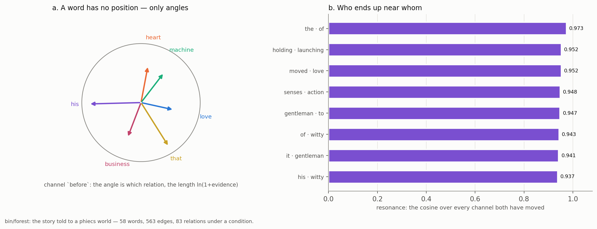

# A Word Has No Position

## The Story as a Field of Phasors

In Phient's world, a word (w) is a seed: what it relates to, under what conditions (c), grows from it. The Phical paradigm, X ⇒ Y, drives and composes Phient's Phasor Language Models: Phinet, Phiano, PhiTon. Phical stores no point: a word is 32–64 relations, each a complex phasor on a closed circle with a count; meaning is a side effect of pairs of words moving under a condition.

### Abstract

The same eighty-six-token story of the forest reading — told in capitals, with its own misspellings — was told once more, this time not into a tree of scopes but into a phiecs world, where a word is an entity and nothing it carries is a coordinate. This paper reports that world: 58 words, 563 edges, 83 relations told under a condition. Each word holds angles on up to sixty-four relation channels, and on each channel an evidence count and an amplitude `ln(1 + evidence)`; the story's words are related on three channels only — `before`, `after`, and `near` for the company of a stretch of six — and under two conditions, `rising` and `resolving`, which are the story's two halves made into words. To relate two words is to move both of them a step toward each other on one channel, the short way round, and to count the observation; this single rule, Kuramoto coupling (paper 11) reduced to its one necessary line, is the whole of learning in the world. From it a resonance falls out: the cosine between two words over every channel both have moved, weighted by the lighter evidence. The four most resonant pairs are `the · of` (0.973), `holding · launching` (0.952), `moved · love` (0.952) and `senses · action` (0.948), and we read all four honestly — the first is two function words that stand everywhere together, the other three the story's own company. The paper then argues the design: a word has no position but its relations, and this is a choice rather than a lack. A point needs a space to live in before it means anything; a set of relations needs only other words. We take that seriously — a physics that proves itself, an essence that is the play of layers, relations, modes and variations — while keeping every quantitative claim tied to the measured facts of docs/155.

## 1. What has no position

The claim is small and literal: in the world this story became, no word has a coordinate. Open the data for any of its 58 words and there is no `x`, no vector, no embedding — there is a list of channels, and on each channel an angle, a count, and an amplitude read off the count. The module that holds a word's state says so in its first line: *Phical stores no point — the number here is never a position, always an angle and how much evidence stands behind it* (`phiecs::phasor`). Where RealityKit hangs a `Transform` on an entity — a position, a rotation and a scale in ℝ³ — Phient hangs a `Phasor`, which is a word's phase on the relation circle and nothing else.

This paper is about what that buys and what it costs, measured on one story. The story is the user's own, eighty-six tokens long, and the forest reading (docs/155, paper 28) has already cast it into *Emma* as a tree of scopes. Here we take the other reading: the same tokens told to a phiecs world by `bin/forest`'s `world.rs`, where the question is not *where does this sentence belong* but *what does each of its words have company with, and how closely*. Every number below is from the run of 2026-10-12, tabulated in `docs/papers/forest/FOREST_FACTS.md`.

## 2. The story as a world

`world.rs` reads the story's tokens, keeps the ones with a letter or digit in them, and tells them to a fresh `World`. Three kinds are declared at the top — `before`, `after`, `near` — and the telling is three passes.

The first pass walks the adjacent pairs. For every two words in a row it relates the first to the second under `before` and the second to the first under `after`: the sentence read forwards and the same sentence read backwards, as two edges. The second pass takes the story in stretches of six words and relates every word of a stretch to every other, both ways, under `near` — a stretch of six standing for a small neighbourhood, the way a paragraph relates everything said in it. The third pass is the conditional one, and §4 is about it.

Told this way the story is:

- **58 words** — the distinct spellings, each an entity, told apart by spelling alone;
- **563 edges** — the rows that survive, counting a repeated pair once and adding to its weight;
- **83 relations under a condition** — the conditional rows of §4.

That is the whole world: a lexicon of 58 entries, a set of edges on three channels, and a small book of conditional calls. There is no grid the words sit on, no space they are embedded in, no distance between them that was measured before they were related. A word that was never related to another has no angle worth reading on any channel; a word gains an angle on a channel only by being seen with something there. The world is exactly as large as what was told, and no larger.



*Figure 1. The relation circle, and the story's most resonant pairs. Each word is a set of angles on the channels it has moved on — `before`, `after`, `near` here — with an amplitude that grows as the log of its evidence; two words resonate when their angles agree across the channels they share. Drawn from `world.rs` and `phiecs::phasor`, over the run tabulated in `FOREST_FACTS.md`.*

## 3. The phasor: an angle and a count, per channel

A word's state is a `Phasor`: three arrays as long as there are channels — the angle `θ` on each, the amplitude on each, and the integer evidence on each. Up to sixty-four channels are available (`phical`'s `CHANNELS`); this story moves only three of them. A channel with no evidence is silent — it claims no angle and stands behind nothing — so a word's real size is the handful of channels it has been seen on, not the sixty-four it could in principle carry.

A fresh word is not born at the origin. `Phasor::seeded` runs the spelling through a small deterministic hash and sets every channel's angle from it, so that two words that have never been related still start apart rather than stacked on one another. The seed is the only thing about a word that is not earned by observation, and it carries no evidence: until a word is related to something, its amplitude everywhere is zero, and §5 will show that a seeded angle counts for nothing in a resonance.

### 3.1 The learning rule is one line

To relate two words under a kind is three things at once (`World::relate_by` in `world/relate.rs`): record the edge and add to its weight; count the kind; and move both words' phasors a step toward each other on that channel. The move is the method `Phasor::couple`, and it is the whole of learning in the world:

```rust
let d = (target - self.theta[k] + PI).rem_euclid(TWO_PI) - PI;
self.theta[k] = (self.theta[k] + rate * d).rem_euclid(TWO_PI);
self.evidence[k] = self.evidence[k].saturating_add(1);
self.amplitude[k] = (self.evidence[k] as f64).ln_1p();
```

`d` is the shortest signed way round the circle from this word's angle to the other's; the word steps a fraction `rate` of that distance, where `rate` is `COUPLE_RATE`, 0.08 per observation; the evidence ticks up by one; and the amplitude is set to `ln(1 + evidence)`. Both words in a pair step toward the angle the other had before the step, so the two drift together and neither jumps to the other. This is phase-oscillator coupling — the Kuramoto rule of paper 11 — reduced to the one line a single observation needs. There is no batch, no epoch, no loss: a telling moves two angles and raises two counts, and that is all that ever happens to the stored state.

The amplitude deserves its own word, because it is where the count enters the geometry. Evidence is a raw integer — how many times this word was seen on this channel — and the amplitude is its logarithm plus one: `ln(1 + evidence)`. The first sighting lifts the amplitude from 0 to `ln 2 ≈ 0.69`; the thirtieth lifts it only from `ln 30` to `ln 31`. A word that has been related thirty times on a channel does not shout thirty times as loud as a word related once; it stands a little over three times as firm. The log is the standard courtesy a count table pays to repetition: much is learned from the first sighting, less and less from each after.

### 3.2 Four words, read off the table

The measured channels bear this out exactly. Four of the story's commonest words, on each of the three kinds they move:

| word | channel | θ (rad) | amplitude | evidence |
|---|---|---|---|---|
| it | near | 5.056 | 3.434 | 30 |
| it | before | 1.200 | 1.792 | 5 |
| it | after | 0.375 | 1.792 | 5 |
| was | near | 5.477 | 3.045 | 20 |
| was | before | 3.513 | 1.609 | 4 |
| was | after | 2.769 | 1.609 | 4 |
| on | near | 5.147 | 3.045 | 20 |
| on | before | 1.792 | 1.609 | 4 |
| on | after | 4.243 | 1.609 | 4 |
| a | near | 4.871 | 3.434 | 30 |
| a | before | 0.875 | 1.946 | 6 |
| a | after | 2.492 | 1.946 | 6 |

*Table 1. Some words' channels (`FOREST_FACTS.md`). The amplitude is `ln(1 + evidence)` and nothing else: `it` on `near` has evidence 30, and `ln 31 = 3.434`; on `before` it has evidence 5, and `ln 6 = 1.792`.*

Three things can be read straight off it. First, `near` carries far more evidence than `before` or `after` for every word, because a stretch of six relates a word to five others, both ways, where an adjacent pair relates it to one — so `it`'s thirty `near` observations against its five `before`. Second, the amplitude is only ever the log of the count: there is no second number, no weight learned apart from how often the thing was seen. Third, the angles are plain numbers between 0 and 2π with no meaning on their own; `it` sits at 5.056 radians on `near` and at 1.200 on `before`, and neither tells you anything until it is set beside another word's angle on the same channel. A single word's angle is not a fact about the word. It becomes a fact only in a pair.

## 4. The two conditions the story turns under

The third telling pass is the conditional one, and it is where the paradigm's own sentence — X ⇒ Y under c — is written into the story. `world.rs` cuts the story in half and makes each half a condition: the first half is `rising`, the second `resolving`. Within each half it walks the adjacent pairs again and records them under that condition's name — `relate_under(name, a, b, 1.0)` — which coins the condition as an ordinary word and files the call in the `Under` table (`phiecs::condition::under`). Eighty-three such conditional relations are told in all.

A conditional relation is read by `calls_for_under`: ask what a word relates to under a condition, and you get the condition's own edges for that word if it has any, and otherwise the word's plain edges on the channel — *the level above answers when the setting is silent*, which is D4's nesting in its simplest form (docs/155; `condition::under`). The story's first words, read under their conditions:

- `it` under `rising` calls for `was` (1.0) and `finally` (1.0); under `resolving` it calls for `suddenly` (1.0);
- `was` under `rising` calls for `on` (1.0) and `in` (1.0);
- `on` under `rising` calls for `a` (1.0) and `our` (1.0);
- `a` under `rising` calls for `sunday` (1.0) and `great` (1.0); under `resolving` it calls for `strong` (1.0);
- `sunday` under `rising` calls for `afternoon` (1.0);
- `afternoon` under `rising` calls for `when` (1.0).

The point is `it` and `a`. Each is a common word that turns up in both halves, and each calls for different things depending on which half it is read under. `it` under `rising` leads to `was` and `finally` — the story's opening — and under `resolving` to `suddenly`, deeper in. `a` under `rising` leads to `sunday` and `great`, and under `resolving` to `strong`. The word has not changed; the condition it is read under has, and so its answer has. This is the same mechanism the `Under` module demonstrates with its own test — `bank` under `money` calls for `deposit`, under `river` for `shore` — and it needs no coordinate for the word and no coordinate for the condition. The condition is a word; reading under it is a lookup; the answer is a word. A word's meaning is not a point that moves when the setting changes. It is which other words it leads to, and that is allowed to differ from setting to setting without anything about the word itself being overwritten.

## 5. Resonance: the cosine over every shared channel

So far a word is a set of angles and counts, which on its own says little. Resonance is what two of them say together. For a kind both words have evidence on, their agreement is `cos(θ_a − θ_b)`: 1 when their angles coincide, −1 when they are opposed, and — crucially — undefined when either word is silent on the channel, because *silence is not agreement* (`Phasor::agreement`). Resonance sums the agreement over every channel both have moved on, each weighted by the smaller of the two amplitudes, and divides by the total weight (`Phasor::resonance`):

```rust
if let Some(a) = self.agreement(other, kind) {
    let w = self.amplitude[k].min(other.amplitude[k]);
    sum += a * w;
    weight += w;
}
```

Two decisions in that fragment are the whole of its honesty. The weight is the *lesser* amplitude, so a channel counts only as far as the worse-attested of the two words supports it: a word seen thirty times and a word seen once agree only as firmly as the once. And a channel on which either word is silent is skipped, not scored zero, so a word is never credited with agreeing about something it was never seen doing. A seeded angle, carrying no evidence, therefore contributes nothing; resonance is built entirely from what was observed.

The most resonant pairs the story finds:

| a | b | resonance |
|---|---|---|
| the | of | 0.973 |
| holding | launching | 0.952 |
| moved | love | 0.952 |
| senses | action | 0.948 |
| gentleman | to | 0.947 |
| of | witty | 0.943 |
| it | gentleman | 0.941 |
| his | witty | 0.937 |
| and | suddenly | 0.931 |
| afternoon | loveful | 0.927 |
| the | witty | 0.920 |
| parts | moved | 0.919 |

*Table 2. The most resonant pairs, the cosine over every channel both have moved (`world.rs`; `FOREST_FACTS.md`).*

These must be read honestly, and they divide cleanly into two kinds.

`the · of` at 0.973 is the highest, and it is the least interesting. `the` and `of` are two function words that stand next to nearly everything and so appear in many of the same six-word stretches; their `near` channels have heavy evidence and have been pulled toward the same crowded part of the circle by the same neighbours. The resonance is real and it is high, and it means only that these two words keep the same company because in English they keep *everyone's* company. It is the phasor world's version of the forest reading's honest limit — that a cast on function words finds paragraphs full of function words (docs/155, paper 28). High resonance between two function words is a fact about English, not about this story.

The next three are the story's own. `holding · launching` (0.952), `moved · love` (0.952) and `senses · action` (0.948) are pairs of content words that this particular telling put into the same company — `holding onto` and `launching his business` in the rising half, `that moved his heart` and the closing `that love`, `his witty senses` and `insulated his action`. None of these is a pair English would offer on its own; each is a pair this story made by saying its words near one another. This is the sense in which the resonances are *the story's own company*: they are not drawn from a prior and they are not seeded — they are the measured consequence of which words this text chose to stand together, and they would be different for a different text in a way `the · of` would not. The forest reading noted the same four pairs and read them the same way; this paper is why the numbers come out as they do.

## 6. No position is a choice, not a lack

It is worth saying plainly why the world was built with no coordinate in it, because the natural reading is that something is missing — that a proper model would of course place its words in a space, and this one simply has not got round to it. The opposite is the case. The absence is the design.

A point is not self-sufficient. A coordinate means nothing until there is a space for it to be a coordinate *in*: an origin, axes, a metric that says how far apart two points are. The space has to be posited first, and then every word has to be placed in it, and then the places have to be defended — why *there* and not a centimetre over, why this many dimensions and not one more. The space is a large prior commitment made before any word is heard, and a word's position is only ever meaningful relative to that commitment. Take the space away and the coordinates are noise.

A relation asks for none of that. To say that `holding` stands near `launching` you need `holding`, and `launching`, and the fact that they were seen together — and nothing else: no origin, no axes, no ambient dimensions, no metric fixed in advance. The angle on a channel is not a position in a space; it is a bookkeeping device for *how* two words were seen together, and the only thing it is ever compared against is another word's angle on the same channel. A set of relations needs only other words. That is why the world can be exactly as large as what was told: it never had to erect a stage for the words to stand on, so it never has to decide where on an empty stage an unheard word would go. The sixteen words of this story that *Emma* never heard (docs/155) are not badly placed in the phasor world — they are simply silent on every channel, which is the honest state of a word nothing has been seen with. A coordinate space would have had to give them a position anyway, and that position would have been a fiction.

This is the user's own spine for the project, and it is worth taking at its full weight: *a word has no position but its relations, which makes it self-fulfilling.* Self-fulfilling, here, is not a boast but a description of the closure. There is no fact about a word that lives outside its relations to other words, and so there is nothing for the relations to be wrong *about* — a physics that proves itself, in that the only things it asserts are the couplings it has made, and each coupling is its own evidence. An essence, on this account, is not a hidden kernel the relations approximate; it is the play of the layers (a scope within a scope), the relations (the channels), the modes (the resolutions a word is read at, papers 13 and the sphere's degrees of docs/155) and the variations (what a word calls for differently under `rising` than under `resolving`). The meaning is in the interplay and nowhere else — the same thing paper 26 means by *meaning is a side effect* — and the interplay is a finite table of counts and angles, not a sample of some unknown density. That is the serious content of self-fulfilling: the model does not point at a meaning it is failing to reach; it *is* the relations, and it is complete in the only terms it admits.

None of which is a claim that the world understands the story. It does not, and the forest reading says so with numbers (docs/155, paper 28): the casts are drawn by function words, the trained readers get six of eighty-four next words first on a vocabulary they were not trained on, and `the · of` tops this paper's own resonance table for no deeper reason than that both words are everywhere. What the phasor world offers is narrower and it is honest: a place where a word is nothing but its company, that company is counted, and two words can be asked how closely they agree without either of them ever having been given a position it would have to earn.

## 7. What this shows, and what it does not

It shows that one story can be held as a field of phasors with no coordinate anywhere in it, and that the holding is enough to ask real questions of: which words keep company (resonance), what a word leads to and how that changes with the setting (the conditions), how firmly any of it is attested (the evidence behind each amplitude). The rule that builds the field is a single line, the same Kuramoto coupling as paper 11, applied once per observation with no epochs and no loss. And the field is self-correcting in the only way it needs to be: a later telling simply couples the angles again and raises the counts, so there is nothing to retract, only more evidence to add.

It does not show understanding, and three of its own numbers forbid the claim. The highest resonance in the story is between two function words. The conditions turn on `it` and `a`, which are the emptiest words in the language. And every angle began as a seed from a spelling, earning its place only through the handful of channels each word was actually seen on — fewer than a dozen for even the commonest word here, out of sixty-four available. The world is small because the story is short, and it is honest for the same reason: it holds what it was told, as angles and counts, and asserts nothing it was not told. A word has no position. It has its relations, and on the evidence of this story, that is both less and more than a point would have been.

## Reproducing this paper

From `phinet/crates/phiano`:

```
cargo run --release --bin forest -- data/text --story text/story/ch2 \
    --out data/forest/forest.json
cargo test -p phiecs coupling_moves_together_and_counts    # the phasor rule
cargo test -p phiecs a_word_calls_for_different_things_under_different_conditions
python3 docs/papers/figs155.py phasor                      # figure 1
cd docs/papers && python3 build_forest_papers.py 33_A_WORD_HAS_NO_POSITION
```

The `forest` run writes `data/forest/forest.json`, from which the world's words, edges, conditions and resonant pairs are taken; `docs/papers/forest/FOREST_FACTS.md` is the same numbers as tables, from the run of 2026-10-12. The two `cargo test` lines are the coupling rule and the conditional-reading rule with their own assertions.

## References

**The world and the rule.** `phiecs::phasor` (the `Phasor` aspect, `couple`, `agreement`, `resonance`), `phiecs::world::relate` (`relate_by` and `COUPLE_RATE = 0.08`, the whole of learning), `phiecs::condition::under` (`X ⇒ Y under c` and the nesting that lets the level above answer), and `phiano/src/bin/forest/world.rs` (the story told as a world). The coupling is Kuramoto, Y. (1975), *Self-entrainment of a population of coupled non-linear oscillators*, Lecture Notes in Physics 39 — Phient's own treatment is paper 11 (Phiano 1, phase oscillators on the relation circle), with Phinet 2 (paper 12) and Phical 3 (paper 13) completing the trilogy its header names.

**The counts and the levels.** Witten, I. H., Bell, T. C. (1991), *The zero-frequency problem*, IEEE Trans. Inf. Theory 37(4) — the courtesy a count pays to repetition, here the `ln(1 + evidence)` amplitude and the level-above-answers nesting of `condition::under`. Plate, T. A. (1995), *Holographic reduced representations*, IEEE Trans. Neural Networks 6(3) — the binding phinet carries, cited for lineage.

**Phient's own record.** Paper 25 (Phasor Language Models), paper 26 (the world model as a tree of conditions — *meaning is a side effect*), paper 28 (the forest; the honest limit of a cast on function words); docs/155 (the short form of the whole forest reading, from which every figure and table here is drawn, and whose condition work this paper takes up in place of a separate docs/154). Austen, J. (1815), *Emma* — the language the story joined. Wittgenstein, L. (1953), *Philosophical Investigations*: §43 (meaning as use) and §122 (surveyability), paraphrased and cited by § only; the D-numbers are papers 19–23.
