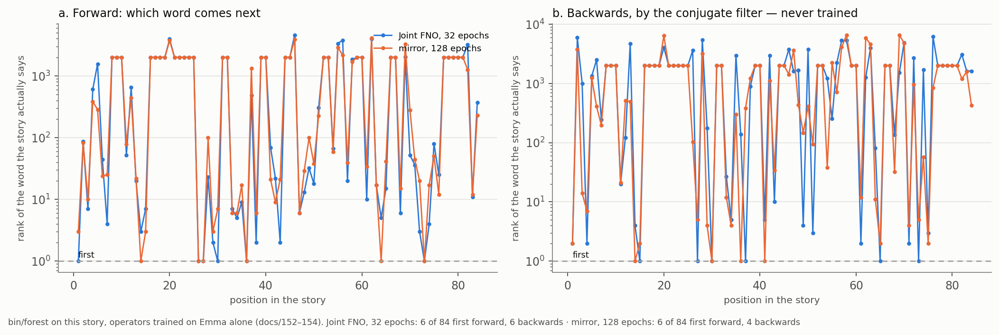

# Reading Forward and Back

## The Two Matched-Filter Readers on a Story Told in Vocabulary They Never Trained On

In Phient's world, a word (w) is a seed: what it relates to, under what conditions (c), grows from it. The Phical paradigm, X ⇒ Y, drives and composes Phient's Phasor Language Models: Phinet, Phiano, PhiTon. Phical stores no point: a word is 32–64 relations, each a complex phasor on a closed circle with a count; meaning is a side effect of pairs of words moving under a condition.

### Abstract

A user told the system an eighty-six-token story, written in capitals and with its own misspellings, and it was read by everything the system holds (docs/155; papers 28, 29). This paper reports one part of that reading: the two learned readers set to the story position by position. Both are matched filters over the relation circle — the Joint FNO of docs/150–152 and the phase-conjugate mirror of docs/153 — and both were trained on Jane Austen's *Emma* alone, 2,314 paragraphs without the story, 2,969,690 rows counted, 69,896 words in the tree. On held-out *Emma*, in the vocabulary they trained on, the FNO reads the next word first about 18% of the time and the mirror about 14% (docs/152–153). On this story, in a vocabulary they never trained on, the FNO reads the next word first at 6 of 84 positions and the mirror also 6; read *backwards* — which word came before, by the conjugate filter that was never trained for it — the FNO is first at 6 positions and the mirror at 4. We give the per-position tables, show why phase carries the whole reading (reading by amplitude alone falls to almost nothing, docs/153 §5.1), and state what the conjugate reading is and why it costs the mirror nothing (H̄ = H⁻¹) and the FNO a forward pass per word. The finding is a weak one, and it is the one to expect: a reader trained on one author, asked to read a new, misspelt story of later English, reads it poorly. No understanding is claimed.

## 1. The two readers, and what reading is

Both learned readers answer the same question in the same way. Given a word `w` and a kind, each produces an output function `q` and correlates it with every word's function, `Re ⟨q, a_v⟩ / (|q| |a_v|)` (`phinet::cosine`). That is a **matched filter**: the received wave times the conjugate of each template, the core of radar detection and of optical phase conjugation (paper 27 §3). The word whose function the output best matches is the reading; the others are ranked beneath it. Nothing else is read. There is no softmax over a trained vocabulary head, no logits: there is one function per word, fixed on the circle, and a correlation.

The two readers differ only in how they make `q`.

- **The Joint FNO** (docs/113, 137, 150–152) is a Fourier neural operator with width and a nonlinearity. For `w ⇒ ?` under `next` it forms `q = F(a_w + a_next)`: it adds the word's function and the kind's, passes them through the operator, and correlates the result. It is trained with a margin hinge against a sampled decoy, about two hours for the 32 epochs read here (`phiano::relate::FnoWave`).
- **The mirror** (docs/153; `phical::conjugate`) is the FNO's spectral path cut to one channel and to unit modulus. A word is a unit spectrum `a_w` of R = 64 Fourier coefficients; a kind is one phase per mode, `H_k = e^{iθ_k}`, an all-pass filter that shifts phases and keeps amplitudes. Its reading is `q = H a_w`, and because `|H a_w| = 1` the score is exactly the cosine. It trains on the FNO's rows with closed-form gradients, about a second an epoch, and the 128 epochs read here took about two minutes.

Both are matched filters, so both are read the same way, and the same figure holds for both: a word is a wave, a kind is a filter, a relation is read by correlating the filtered word against every candidate. The whole of paper 27 is about what that identity buys. This paper asks a narrower question — what the two readers do on one story they were not trained for — and answers it with the forest's own measurements (`bin/forest`, docs/155; `src/bin/forest/waves.rs`).



*Figure 1. The two readers across the story: forward (which word comes next) and backwards (which word came before). The small marks are the positions each reads first. The story's vocabulary is mostly outside what either reader was trained on, and the reading is weak throughout.*

## 2. The story, and why it is hard to read

The story is eighty-six tokens, told once, as the single paragraph `scope:text/story/ch2/p1`:

```
it was on a sunday afternoon when it finally downed on our gentleman that he
has exceeded the threshold of holding onto his ego andn happened to be in a
great position and he was in the process of launching his business with his
american counter parts in that moment it suddenly occured to his witty senses
that somehow evertihng had always worked for the best outcomes and that moved
his heart to be a strong and loveful machine that insulated his action that
love.
```

Fifty-eight distinct words. The reader lower-cases and changes nothing else (paper 28 §1), so the capitals are not themselves the difficulty; the vocabulary is. Sixteen of the fifty-eight words *Emma* never heard once: `finally`, `downed`, `exceeded`, `threshold`, `onto`, `ego`, `andn`, `position`, `launching`, `american`, `occured`, `evertihng`, `outcomes`, `loveful`, `machine`, `insulated`. Two are the writer's misspellings (`andn`, `evertihng`), one is a coinage (`loveful`), and the rest are simply later English than Austen's. A word *Emma* never heard has no function in the readers' table; the position after it, and the position whose true next word it is, cannot be read at all, and the reader returns no rank there (docs/155 §3).

What is left is a story carried, like *Emma* itself, mostly by function words. The six words the story says most beyond its parent are `his`, `that`, `a`, `and`, `in`, `it` (the D4 column, FOREST_FACTS). These are the words every paragraph says, and a reading keyed on them is keyed on the least discriminating thing in the language. The forest's casts found the same limit for the scope tree (paper 28): a cast on function words lands in paragraphs full of function words. The readers meet it here position by position.

## 3. Reading forward: which word comes next

At each of the 84 positions, the reader is given the word so far and asked for the next. The reading ranks every word the model knows; the **rank** is the number of words it scored strictly above the true one, so rank 0 means the true word was read first — a top-1 hit. Counting those:

| reader | forward, next word read first | of |
|---|---|---|
| Joint FNO, 32 epochs | 6 | 84 |
| mirror, 128 epochs | 6 | 84 |

Six of eighty-four is about one position in fourteen. The two readers reach the same count by different roads, the FNO with its width and the mirror with its single phase per mode; neither road helps much here, because most positions turn on a word outside the shared vocabulary.

The first ten positions show how the reading goes. The *top 3* column is the reader's own best three guesses forward; the true next word is in bold where it was read first.

**Joint FNO, 32 epochs**

| after | truth | forward rank | its top 3 | backward rank |
|---|---|---|---|---|
| it | **was** | 0 | was, would, is | 1 |
| was | on | 85 | quite, not, so | 5942 |
| on | a | 6 | his, the, her | 1000 |
| a | sunday | 602 | great, little, few | 1 |
| sunday | afternoon | 1555 | ., ,, her | 1331 |
| afternoon | when | 43 | ., of, , | 2502 |
| when | it | 3 | she, he, they | 245 |
| it | finally | None | was, would, is | None |
| finally | downed | None |  | None |
| downed | on | None |  | None |

**mirror, 128 epochs**

| after | truth | forward rank | its top 3 | backward rank |
|---|---|---|---|---|
| it | was | 2 | is, would, was | 1 |
| was | on | 81 | a, the, so | 3768 |
| on | a | 9 | the, mr, this | 13 |
| a | sunday | 383 | most, little, man | 6 |
| sunday | afternoon | 284 | ;, on, any | 1233 |
| afternoon | when | 23 | ;, ?, ! | 407 |
| when | it | 24 | he, miss, i | 195 |
| it | finally | None | is, would, was | None |
| finally | downed | None |  | None |
| downed | on | None |  | None |

The one clean hit in these rows is the FNO reading `was` first after `it` — the commonest bigram in the language, and the one the reader is surest of. Elsewhere the pattern is three kinds of miss. Where the next word is common but not the first guess, the reading is near: `on → a` at rank 6 for the FNO, `when → it` at rank 3. Where the next word is rare in *Emma*, the reading is far: `a → sunday` at rank 602 (`sunday` is said in two paragraphs of all of *Emma*), `sunday → afternoon` at rank 1555. And where the next word was never heard — `finally`, `downed`, and the fourteen others — there is no rank at all, because there is no function to match. The blank *top 3* rows (`finally → downed`, `downed → on`) are positions after a word *Emma* never heard: the reader has nothing to form `q` from.

The readers' own best guesses are revealing. After `it` the FNO offers `was, would, is` and the mirror `is, would, was` — the same small cloud of common continuations of `it`, which is correct in the language and happens to be correct here. After `sunday` the FNO offers punctuation (`., ,, her`): in *Emma* `sunday` is almost always followed by a comma or a full stop, and the reader has learnt exactly that, which is why it does not reach `afternoon`. The reading is not wrong about *Emma*; it is being asked about a story *Emma* does not contain.

## 4. Why phase carries the reading

A matched filter can be read two ways. Coherent detection keeps the real part of the correlation, which needs the phases of `q` and `a_v` to line up. Envelope detection keeps only the modulus `|⟨q, a_v⟩|`, the amplitude, and throws the phase away. On held-out *Emma*, with the same operators that read this story, the difference is total (docs/153 §5.1; paper 27 §5.1):

| last word, told stratum of held-out *Emma* | coherent (real part) | amplitude only |
|---|---|---|
| Joint FNO, 32 epochs | 18.3% · 0.296 | 0.1% · 0.005 |
| mirror, 128 epochs | 14.1% · 0.245 | 0.1% · 0.003 |

Amplitude alone reads one position in a thousand; the coherent reading, same operator, reads about one in five to one in seven. Everything either operator learned is carried by phase. That is why the small marks of Figure 1 are where they are and not elsewhere: the reader is not totting up how strongly words resonate, it is checking whether the phases agree. On this story the phases that would agree belong mostly to words the reader never met, so the agreement is rare — but where it is found, as at `it → was`, it is phase that finds it. The amplitude, in Phiano, is a separate quantity entirely: it is the counts, the pump, and it enters the reading only when the operator is mixed with frequency (docs/152; paper 27 §5.5). This paper reads the operators alone, as the forest does, so the amplitude is not in play and the whole reading stands or falls on phase.

## 5. Reading backwards: which word came before

The same matched filter can be run the other way. Instead of asking what follows `w`, ask which word `w` followed — the relation `w ⇒ v under next` read as `v ⇐ w`, the word before. No `prev` relation was ever trained in either reader. It comes out of the conjugate, and the two readers pay very different prices for it.

- **The mirror gets it for nothing.** Because `H` is unitary, `Re ⟨H a_w, a_v⟩ = Re ⟨a_w, H̄ a_v⟩`, so `H̄ a_v` is the time-reversed wave: it reads which word `v` came after, with nothing trained for it. Here `H̄ = H⁻¹` exactly, because the all-pass filter changes no amplitude (`phical::conjugate`; docs/153 §3). Reading backwards is one more correlation, `H̄ a_v` against every word, and costs the mirror the same as reading forwards.
- **The FNO has no conjugate.** For time reversal to come free the operator would have to commute with conjugation, `F(x̄) = conj F(x)`; the Joint FNO's defect on that identity is 1.87 of its output's own size, caused by the split GELU, the biases and the complex weights, and training makes it worse (docs/153 §2; paper 27 §5.2). So the FNO can be read backwards only by running its filter from the other end: `F(a_u + a_next)` for every word `u`, correlated with the word that came after — one forward pass per word, cached (`phiano::relate::FnoWave::back`). It reaches the same kind of answer, at a cost the mirror does not pay.

Counting the positions where each reader read the word before first:

| reader | backwards, word before read first | of |
|---|---|---|
| Joint FNO, 32 epochs | 6 | 84 |
| mirror, 128 epochs | 4 | 84 |

The backward columns of the tables in §3 show the texture. The FNO reads `a` first-but-one after `sunday` (`a → sunday`, backward rank 1) and `it`'s predecessor at rank 1 as well: the conjugate finds the common word before a rare one about as often as the forward filter finds the common word after it. Where the pair runs through a word *Emma* never heard the backward reading is blank, for the same reason the forward one is. The mirror, with one phase per mode, is a shade weaker backwards than the FNO here (4 against 6), as it is forwards on held-out *Emma*; what it keeps is that its backward reading is exact and free, where the FNO's is approximate and cached.

This is the forest-scale echo of paper 27's central backward result. On held-out *Emma*, where a pair had been told, the word before is found 14.1% of the time by the mirror and 17.4% by the FNO, against frequency's 7.4% — twice as often as chance, with no `prev` row ever learned. Where a pair had *never* been told, neither finds it (0.0%): the conjugate retraces the path a forward wave took, and where there was no forward wave there is nothing to retrace (docs/153 §4; paper 27 §5.3). On this story almost every pair is a pair *Emma* was never told — the story's own sequence of words, in the story's own vocabulary — so the backward reading, like the forward, is reduced to the few positions whose words and whose ordering *Emma* happened to share.

## 6. This story against held-out *Emma*

The point of the small numbers is clearest set beside the numbers from the vocabulary the readers were trained on. On held-out *Emma*, measured on the same operators (docs/152 §1, docs/153 §4; paper 27 §5):

| reading | Joint FNO, 32 epochs | mirror, 128 epochs | frequency |
|---|---|---|---|
| forward, told stratum (the word had been told after the last) | 18.3% · 0.296 | 14.1% · 0.245 | 6.9% · 0.156 |
| forward, open stratum (the word never had), mixed with the prior | 3.2% · 0.074 | 3.2% · 0.074 | 3.4% · 0.076 |
| backwards, the pair was told | 17.4% · 0.248 | 14.1% · 0.227 | 7.4% · 0.163 |
| backwards, the pair was never told | 0.0% · 0.008 | 0.0% · 0.004 | 1.1% · 0.042 |

On *Emma*, forward, the FNO reads the next word first about 18% of the time. On this story it reads the next word first at 6 of 84 positions — about one position in fourteen, well under half the rate. Backwards the same fall holds: about 17% on *Emma*, 6 of 84 here. The mirror falls the same way, from about 14% to 6 of 84 forward and 4 of 84 backwards.

The fall is not a fault in the readers. It is the honest, expected result of asking a reader trained on one author to read a new story. The story's words are mostly later English, two are misspelt, one is coined, and sixteen were never heard at all; the pairs the story makes are the story's own, not *Emma*'s. On *Emma*'s open stratum — positions whose next word *Emma* itself never told after the last word — the readers already fall to about 3%, level with frequency and no better (docs/152 §2; paper 27 §5.5), and that is the paradigm's standing open problem: nothing yet reads the never-told relation clearly better than chance. This story is, in effect, open-stratum almost everywhere. That it reads at 6 of 84 rather than at 0 is the matched filter catching the handful of common bigrams the two languages share — `it was`, a common word after `on`, a common word before `sunday` — and nothing more. A system that claimed to understand this story would be overreading six coincidences of frequency. The forest's verdict is the same (docs/155 §4): the readers get 6 of 84 next words first on unfamiliar vocabulary, and no understanding follows from that.

## 7. The matched filter, once more

Paper 27 reads these two operators as radar reads an echo, and three of that paper's pieces are exactly what §§3–6 measured.

- **Matched filtering** is the readout itself: the received wave correlated with the conjugate of each template (§1). It is why there is a reading at all.
- **Coherent against envelope detection** is §4: the coherent receiver keeps phase and reads; the envelope detector keeps only amplitude and reads almost nothing. On this story, as on *Emma*, the signal is in the phase.
- **The conjugate pulse** is §5: reading the relation backwards is correlating against the time-reversed template. The mirror's template inverts exactly; the FNO's must be rebuilt from the other end because its operator breaks the symmetry.

What this story adds to paper 27 is the behaviour of the filter when the templates are wrong — when the words being matched were learnt from a different language than the one being read. The filter does not break; it simply finds few matches, and reports the few it finds by rank rather than by a confident label. That is the right behaviour for a reader that stores what it was told and does not invent: on unfamiliar vocabulary it is quiet, and its quietness is measured, not hidden. Wittgenstein's remark that the meaning of a word is its use in the language (§43) is the claim the whole forest tests; here the test is narrow and the answer plain — these readers learnt the use of words in *Emma*, and a word used in a story *Emma* never told is a word whose use they do not have.

## 8. What this shows, and what it does not

It shows that the two learned readers are one mechanism — a matched filter over the relation circle — read forward and backward, and that both can be set to a new text position by position and will report, honestly, how little they can read of it. It shows that phase carries the whole reading, that the backward reading is free in the mirror and cached in the FNO, and that the gap between the two readers forward (18.3% against 14.1% on *Emma*) narrows to nothing on vocabulary neither was trained for, because the thing that separates them — the FNO's width — has nothing to work on when the words themselves are unknown.

It does not show understanding, and the numbers are the reason it does not. Six of eighty-four next words first, six and four backwards, against about 18% and 14% in the trained vocabulary: a reader of one author reading a new, misspelt story of later English reads it poorly, and that is the result to report. The paper's value is in reporting it straight. The companion papers take the rest of the forest's reading of this story at length — the scope tree as a bounding-volume hierarchy and the twenty-seven casts (paper 28), the sixteen trees the system holds (paper 29) — and the overview is docs/155. The phase-conjugate machinery read here in the small is set out in full, on held-out *Emma*, in paper 27 and docs/153; the frequency pump that this paper deliberately left out is docs/152; the long operator runs behind the 18% and 14% are docs/150–151; and the paradigm these readers sit inside is paper 25.

## Reproducing this paper

From `phinet/crates/phiano`:

- `forest data/text --story text/story/ch2` writes `data/forest/forest.json`, including the two readers' forward and backward reading at every position (`src/bin/forest/waves.rs`); the numbers quoted here are tabulated in `docs/papers/forest/FOREST_FACTS.md`, made on 2026-10-12.
- The readers themselves: `operator_run data/text --in text/emma --r 64 --epochs 32 --every 8 --dev 0.10 --out data/runs/operator_r64_s7_dev10` (the Joint FNO), and `mirror_run data/text --in text/emma --epochs 256 --every 32 --dev 0.10 --out data/runs/mirror_r64_s7_dev10` (the mirror). The story is read by `operator_r64_s7_dev10/epoch_32.relate` and `mirror_r64_s7_dev10/epoch_128.mirror`.
- The held-out *Emma* figures of §§4 and 6: `story data/text --in text/emma --held-out 0.05 --seed 7 --operator 64,32 --dev 0.10 --model data/runs/operator_r64_s7_dev10/epoch_32.relate`, and the waves' own measurements in `data/runs/waves/`.
- `python3 docs/papers/figs155.py` draws Figure 1 (`fig/f155_waves.png`).

The matched-filter code is `phiplm::relate::wave` (`Wave`, `FnoWave`, `MirrorWave`), the mirror is `phical::conjugate`, and the per-position reading is `phiano::bin::forest::waves`.

## References

**Phient's own record.**

- Papers 25 (Phasor Language Models — the paradigm these readers sit inside), 27 (Waves That Read Back — phase conjugation on held-out *Emma*, read here in the small), 28 (The Forest — the scope tree as a bounding-volume hierarchy, and the twenty-seven casts), 29 (Sixteen Trees).
- Docs 150 (the operator's long run), 151 (the offsets), 152 (frequency as the pump; the dev split; the fault of reading a word after itself), 153 (phase conjugation; the mirror; the relation read backwards), 155 (a story as a forest of trees — the overview this paper is a companion to).

**The readers in the literature** (fuller citations in paper 27).

- Li, Z. et al. (2021). *Fourier neural operator for parametric partial differential equations.* ICLR. The Joint FNO.
- Sun, Z. et al. (2019). *RotatE: Knowledge graph embedding by relational rotation in complex space.* ICLR; Trouillon, T. et al. (2016). *Complex embeddings for simple link prediction.* ICML. The mirror, read as a Fourier operator.
- North, D. O. (1943, repr. 1963). *An analysis of the factors which determine signal/noise discrimination in pulsed-carrier systems.* Proc. IEEE 51. The matched filter.
- Pepper, D. M. (1986). *Applications of optical phase conjugation.* Scientific American 254(1). The conjugate mirror, read backwards.

**Wittgenstein.** *Philosophical Investigations* (1953), §43, paraphrased.
