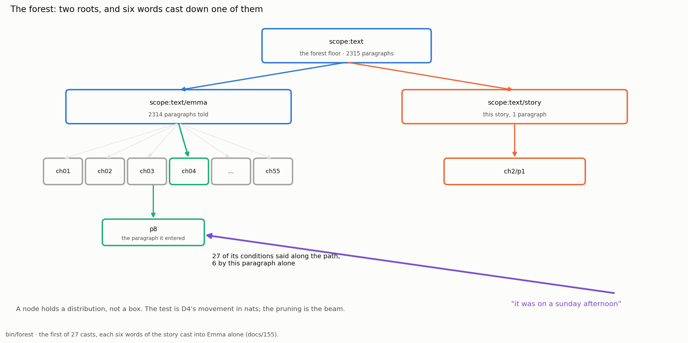

# Have We Understood Language? What the Forest Shows and What It Does Not

## The Capstone of the Forest: A Verdict Held to the Measurements

In Phient's world, a word (w) is a seed: what it relates to, under what conditions (c), grows from it. The Phical paradigm, X ⇒ Y, drives and composes Phient's Phasor Language Models: Phinet, Phiano, PhiTon. Phical stores no point: a word is 32–64 relations, each a complex phasor on a closed circle with a count; meaning is a side effect of pairs of words moving under a condition.

### Abstract

The person who told the system an eighty-six-token story asked, in plain words, to be shown that we have understood language. This paper is the honest answer, and it is the last of the eight that read that one story. Seven papers took the readings one at a time; this one gathers them and renders a verdict. The story enters the structures already there — the scope tree that is a bounding-volume hierarchy, the strand of sixty-four levels, the condition tree, the phasor world, the trained readers — and each returns something checkable: where the story belongs, what its words keep company with, which of them are new, what would fill their place, how the telling divides, and how it reads forward and backwards. Every one of those readings is a number in `data/forest/forest.json`, measured by `bin/forest` on 2026-10-12. Then the paper states, without softening them, the three limits those same numbers carry. The casts are drawn by function words and not by sense: of the heaviest words at the winning leaves, almost all are `the`, `of`, `and`, `to`, `a`, `his`. The trained readers, on a vocabulary they were never trained on, read six of eighty-four next words first. And the open stratum of docs/152 does not move: where a word was never told after the last, nothing yet beats frequency. The conclusion follows from the measurements and not around them. This is not a proof of understanding. It is an apparatus in which a sentence has a place, a word has company, and both are counted — Wittgenstein's remark that the meaning of a word is its use (§43) made into a measured structure. That remark is the claim the apparatus tests, not the verdict it returns.

## 1. The question that was asked

The request was short and it was not a request for a demonstration. The person wrote a story of eighty-six tokens, in capitals, with its own misspellings and one coined word, told it to the system once, and asked to be shown that we have understood language. Papers 28 and 29 answered the two structural halves of the same telling — the scope tree as a bounding-volume hierarchy, and the sixteen trees the system holds — and the five papers between them and this one took the remaining readings. This paper owes the question its plainest answer, and the house rule of the series holds here more than anywhere: every number comes from a run in the record, named by its doc, and the limit is stated beside the gain (paper 25). A capstone that overclaimed would betray the thing it is the capstone of.

So the paper does two things and keeps them apart. First, in §2, it gathers the eight readings and shows that each is real: the story is not merely stored but read, and each reading can be checked against the code and the numbers. Second, in §3, it states the three measurements that say what the readings do not amount to. Only then, in §§4–8, does it argue what understanding would be, what the system genuinely does, what it does not, and what verdict the two together force.

The story was told into Jane Austen's *Emma* — 2,315 paragraphs with the story in it, 2,314 without, 2,969,690 rows counted, 69,896 words in the tree — and *Emma* was read again around it. Nothing about the story's place was declared. `read_tree` walks the directory and tells the nesting it finds; the folder is the condition, and the condition is a word (docs/126). Everything below is what the system did with that one telling.

## 2. Eight readings of one story

The forest reads the story eight ways, and the point of listing them together is that they are not eight descriptions of one act but eight different acts, each performed by a structure built for its own reason and each returning a number. This is the part of the answer that is genuinely affirmative, and it should be read as such before §3 takes its measure.

**Where it belongs.** The scope tree is a bounding-volume hierarchy with the geometry removed: a node holds a distribution over what its subtree says, *contains* means a scope says everything beneath it, the ray is a few words and their pairs, the hit test is the movement in nats a child adds beyond its parent, and the pruning is the beam (paper 28). Cast back into the language it joined, the story found places: twenty-seven stretches of six words, cast three apart, each landing at a leaf. "it was on a sunday afternoon" entered chapter four, paragraph eight; "onto his ego andn happened to" entered chapter forty-nine, paragraph nineteen. The reading is checkable because the path is named and the leaf's own words are listed. The story has a place, and the place is computed, not declared.

**What its words keep company with.** Told to a phiecs world the story is 58 entities, 563 edges and 83 relations under a condition, each word carrying only the angles it has moved on (paper 26). From those angles the world reports which words resonate — the cosine over every channel both have moved. The most resonant pairs are `the · of` at 0.973, `holding · launching` at 0.952, `moved · love` at 0.952, and `senses · action` at 0.948. The first pair is two function words that travel together everywhere; the other three are pairs the story itself placed in the same company, in the same breath. Company is a reading, and it is one the story earned by being told.

**Which words are new.** Sixteen of the story's words *Emma* never heard: `finally`, `downed`, `exceeded`, `threshold`, `onto`, `ego`, `andn`, `position`, `launching`, `american`, `occured`, `evertihng`, `outcomes`, `loveful`, `machine`, `insulated`. Two are the writer's misspellings, one is a coinage, and the rest are simply later English. The system knows exactly which words are strangers, because a stranger is a word with no count, and a count is either there or it is not. Knowing which words are new is a reading the system makes with certainty.

**What fills their place.** For each stranger the system reads the slot from both sides — the words before it, and the word that must follow. After "has exceeded the", with `of` as the word that must come next, the slot offers `rest`, `idea`, `sort`. The system does not know what `threshold` means. It knows the shape of the hole the word sits in, read from the company on either side. That is a reading too, and an honest one: it is the shape of the slot, not the sense of the word.

**How it divides.** The strand cuts the eighty-six tokens into a tree once and then reads it at sixty-four resolutions, from `AAA` — one word — to `TTT`, the whole story as a single unit. Each cut is the division that gains the most information against the parent's distribution, so the words that carry each beat are the story's own and the division is made without being told where the parts are. Paper 25 measured, on this family of texts, that such units can read a text's own held-out words better than its true labels do. The telling divides itself.

**How it reads forward and back.** Two trained readers — the Joint FNO of docs/152 and the mirror of docs/153 — read every position of the story, forward to the next word and backwards to the word before, the backward reading taken by a conjugate filter that was never trained for it (paper 27). That a single operator reads both directions, one of them untrained, is the affirmative finding of the waves line of work. How well it reads is §3's business.

*The story cast into the language it joined: a ray drawn through the bounding-volume hierarchy to the leaves that hold its words. The full reading is paper 28's; this figure is its shape.*

Eight readings, eight structures, eight numbers. None of them is nothing. The story that was told once is now a thing the system can locate, resonate, divide, continue, and read in either direction, and each of those is a fact on disk rather than a claim in prose. The question is only, and exactly, what the readings add up to.

## 3. The three limits, stated without flinching

Three measurements, from the same run and the same records, say what the readings are and are not. They are stated here in full because a capstone that buried them would be worth less than no capstone at all.

**The casts are drawn by function words, not by sense.** Of the twenty-seven casts, twenty-two have a negative attraction — the stretch is *less* at home at its winning leaf than a flat expectation would be — and the worst is −40.963 nats (paper 28). Worse for the question of understanding is what draws the casts that do land. Of the heaviest words listed for the winning leaves, almost all are function words, pronouns and auxiliaries; the leaves that most attracted the story's stretches are full of `and`, `the`, `to`, `a`, `i`, `her`. The reason is in the information gain itself: a repeated word is strong evidence about a paragraph, and in English the repeated words are `it`, `was`, `a`, `his`, `that`. The word the story's own paragraph adds most beyond its parent is `his`, at 3.85 nats, because `his` occurs six times in eighty-six tokens; its content words sit tied far below on a flat shelf at 0.64 nats, the gain of a word said once. A search steered by information gain over a count table is steered by the words that recur, and those words carry grammar, not meaning. The story is cast where its words *were said*, not where its meaning is. This is honest, and it is the limit: a cast on function words finds paragraphs full of function words.

**The trained readers get six of eighty-four next words first.** On this story, in a vocabulary it was not trained on, the Joint FNO at thirty-two epochs reads the next word first at six of eighty-four positions, and the mirror at a hundred and twenty-eight epochs also at six. Read backwards, the FNO is first at six and the mirror at four. These are not small gains against a strong baseline; they are small numbers against eighty-four, and they are reported as such. A reader trained on *Emma* alone, asked to read a story written in later English with its own misspellings, reads it about as well as that comes to — which is to say, mostly it does not. The forward and backward readings of §2 are real as mechanisms and thin as performance, and both facts are true at once.

**The open stratum is unmoved.** Across the operator line of work, the held-out text splits into two strata: the positions where the condition was heard, and the open stratum — the roughly a quarter of positions where the word that came was never told after the last word or pair. docs/152 fitted frequency into the operator's reading directly, where the operator never trained, precisely to test whether the further-back readings were reaching into that open stratum or merely flattening toward frequency. The told stratum gained, reaching 18.3%. The open stratum did not move: 1.9%, against frequency's own 3.4%, which remains the best reader of it. Where a word was never told after the last, nothing the system has yet built beats counting how often the word occurs at all. This is the sharpest limit of the three, because it is where a system that had reached a sense beyond what it was told would show it, and it is flat.

## 4. What would count as understanding

To render a verdict honestly, the paper must say what it would take to earn the other one, and not set a bar so low that the apparatus clears it by construction nor so high that no system could.

Understanding, for a language model, cannot only mean saying the next word well; a trigram does that on familiar text, and the project's own held-out reading sits near the trigram ceiling at 20.6% top-1 (paper 25). It would have to mean reaching, from what was told, something that was *not* told — a sense that lets the system do with a word what it was never shown being done. The open stratum is the exact place to look, because it is defined as the positions where the continuation was never in the record. A system that understood `threshold` would fill the slot after "has exceeded the" with something a reader of English would accept as its sense, and would do so better than frequency, which knows nothing. A system that understood would read the strangers — `launching`, `exceeded`, `insulated` — not by the shape of their slots but by what the words mean, and would carry that reading to positions no count reaches. Measured understanding, on this project's own terms, is movement in the open stratum. Nothing else the paper reports would settle the question, and that one would.

There is a second, weaker sense worth naming to set it aside. One might call it understanding that the system keeps every relation it was told and can read any of them back by name — `calls_for`, `agreement`, `resonance`, `plan` — so that nothing it knows is hidden (paper 26, on surveyability, §122). That is a real and unusual property, but it is understanding of the *record*, not of the language. The system surveys what it was told perfectly and reaches past it not at all. Keeping the distinction is the whole of the honesty this paper is for.

## 5. What the system genuinely does

Against that bar, the affirmative account is still substantial, and it should not be lost in the refusal.

It learns from one telling. The story was told once, with no epochs and no training on its words, and from that single telling the eight readings of §2 are all available. A row told once is a relation with count one, heard from then on (paper 25). This is not a small thing: it is the property the whole paradigm is built around, and the forest demonstrates it on a text the system had never seen.

It keeps every relation, and keeps them by name. The 563 edges, the 83 relations under a condition, the counts under every scope on the path — all of them are there to be read, and the reading is exact rather than approximate. The information the system has is a finite table, not a sample of an unknown density, and so its content is a number that can be reported rather than a loss that can only be minimised (paper 26). What the system knows about the story, it knows surveyably.

It reads a structure. The story is located in a bounding-volume hierarchy, divided into sixty-four levels by its own information, resonated against itself, and read in both directions by one operator. These are structural facts about a telling, computed from the telling, and they are the same structure from a sentence to a repository (paper 29's sixteen trees are one system over different texts). The forest shows that one told text enters the structures already there and that each structure says something checkable about it. That is genuinely true, and it is genuinely a lot.

## 6. What it does not do

It does not reach a sense beyond what it was told. Every reading in §2 is a reading of the record: where the words were said, what company they were told in, which have no count, what the slots around the strangers look like. None of them crosses into meaning that was not in the telling. The three limits of §3 are three views of this one fact. The casts follow the words that recur, which are grammatical. The readers, off their training vocabulary, read a handful of positions. The open stratum, which is exactly the region where a sense beyond the record would show, is flat. The system does with the story everything that counting and relating a told text can do, and nothing that would require knowing what its words mean.

It is worth being precise about why this is not a defect to be patched but a boundary of the present apparatus. The abstract space the system works in is taken from the source, not found by an encoder (paper 26): a word is the level at which the text speaks. That is the paradigm's strength — it never reconstructs, never collapses, learns at the speed of telling — and it is also why there is, as yet, no mechanism by which a sense not present in any telling could arise. The system holds nothing below a word, and a meaning that was never told is below no word it holds.

## 7. The claim being tested, not the verdict

The person who asked the question framed it in two larger ideas worth meeting generously. One is that a physics, done rightly, is self-proving — that the structure, laid out fully enough, carries its own demonstration. The other is that the essence of a thing is the play of its layers and its relations, not a kernel hidden beneath them. The forest is built in the spirit of both. Each level of the tree is a model of its own, read beyond the one below it (paper 26); meaning is named, in the paradigm's own sentence, as a side effect of pairs of words moving under a condition. The system puts nothing beneath the word and asks the relations, laid out and counted, to be the whole of what there is to know.

Taken as engineering, that spirit is exactly Wittgenstein's remark that the meaning of a word is its use (§43): not a thing a word points to, but the place it has in what is done with it. The forest makes that remark into something measurable. A sentence has a place in the tree; a word has company on its channels; a slot has a shape read from both sides; and all of it is counted. Every sign by itself seems dead, and what gives it life is its use (§432) — the system takes that literally and stores only use.

But here is the honesty the whole series turns on. To build the apparatus is not to have proved the claim the apparatus states. Meaning-as-use is the hypothesis the forest *tests*; it is not a result the forest has returned. The project has made the strongest possible form of the hypothesis — a structure in which use is all there is, laid out so fully that if use were enough, it would show — and then measured whether it is enough. The answer the measurements give, so far, is that use as the system counts it carries the told and stops at the untold. A self-proving physics would be one whose layers, fully drawn, forced the conclusion; what the forest shows is a physics fully enough drawn to force an *honest* conclusion, which is not the same as the conclusion hoped for. The generosity the framing deserves is to take it as a programme that can be held to its own measurements. The respect the framing earns is that it can be, and here is.

## 8. The verdict

We have not understood language, and the forest does not show that we have. It shows something narrower and, on its own terms, worth having: that one story, told once, enters the structures already there, and that each structure returns a checkable reading — a place, a company, a division, a slot, a direction — every one of them a number on disk rather than a claim in prose. Set honestly beside those readings are three measurements that say what they do not amount to: the casts are drawn by the words that recur, which are function words and not sense; the trained readers, off their vocabulary, read six of eighty-four next words first; and the open stratum, where a sense beyond the telling would have to show, does not move off frequency.

So the verdict, stated once and without hedging: **this is not a proof of understanding but an apparatus in which a sentence has a place, a word has company, and both are counted — meaning-as-use (§43) made into a measured structure, which is the claim the apparatus tests, not the verdict it returns.** The forest earns the project's respect precisely by returning that verdict instead of the one it was asked for. A system that learns from one telling, keeps every relation, and reads a structure has done a great deal; a system that reached a sense beyond what it was told would have done the other thing, and the measurements say plainly that it has not. The day the open stratum moves — the day a word never told after the last is read better than frequency reads it — the verdict changes, and the apparatus is already built to show it the moment it does.

## Reproducing this paper

Every number in this paper is from one run of `bin/forest`, made on 2026-10-12 and tabulated in `docs/papers/forest/FOREST_FACTS.md`; nothing here was computed for the paper. The run is `forest data/text --story text/story/ch2`, which writes `data/forest/forest.json`; the sixty-four levels are `strand data/text/story/ch2.txt --prior data/text/emma --out data/forest/strand`; the figures are `python3 docs/papers/figs155.py`. The eight readings of §2 are `casts.rs` (the scope tree and the twenty-seven casts), `world.rs` (the phasor world, the resonances, the relations under a condition), `words.rs` (the strangers and the slots read from both sides), the strand binary (the sixty-four levels), and `waves.rs` (the two trained readers forward and backwards). The three limits of §3 are, in order, the casts' attractions and leaf words in `FOREST_FACTS.md`; the readers' forward and backward ranks in the same file; and the two strata of docs/152, whose open-stratum figure of 1.9% against frequency's 3.4% is quoted directly. The short form of the whole measurement is docs/155; papers 28 and 29 take the two structural halves at length.

## References

- docs/126 — the scope tree, its smoothing, and the bounding-volume analogy in the module's own documentation.
- docs/152 — the operator mixed with frequency, fitted where it never trained; the two strata and the unmoved open stratum.
- docs/155 — *A story as a forest of trees*; the short form of this measurement, whose §4 is the thesis this paper argues at length.
- Paper 24 — context language models beside Phient; the shared premise and where the two part.
- Paper 25 — *Phasor Language Models*; the positive case for the paradigm, the eight measured findings, and the house rule of stating limits beside gains.
- Paper 26 — *The World Model as a Tree of Conditions*; the entity–component paradigm, information measured rather than maximised, and surveyability.
- Paper 27 — *Waves That Read Back*; phase conjugation, the mirror, and the readers that read forward and backwards.
- Paper 28 — *The Forest*; the scope tree as a bounding-volume hierarchy and the twenty-seven casts read honestly.
- Paper 29 — *Sixteen Trees*; the trees the system holds, family by family, and the three places the BVH analogy breaks.
- Wittgenstein, *Philosophical Investigations*: the meaning of a word is its use (§43); a sign is dead by itself and alive in use (§432); what is held is surveyable (§122). Paraphrased throughout.
